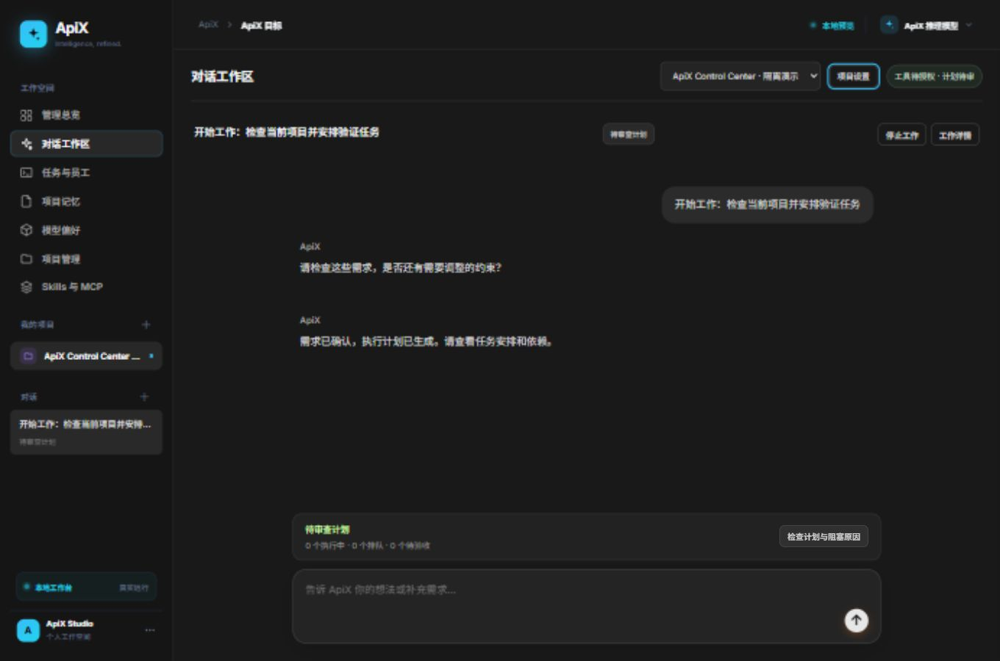
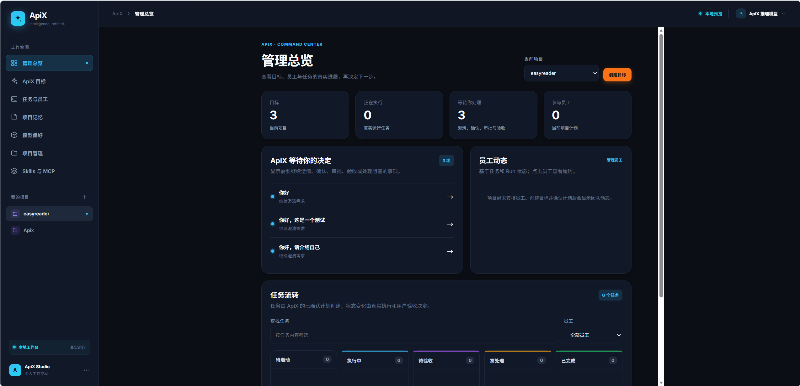
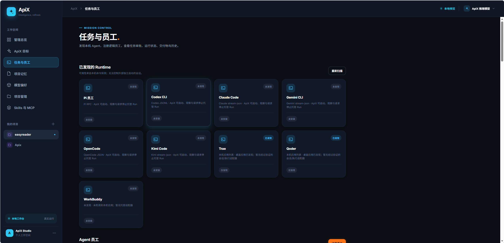
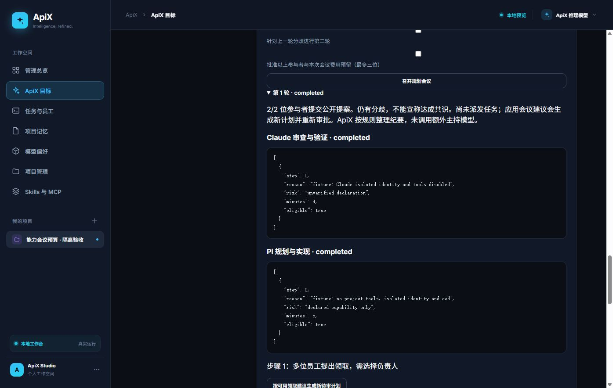
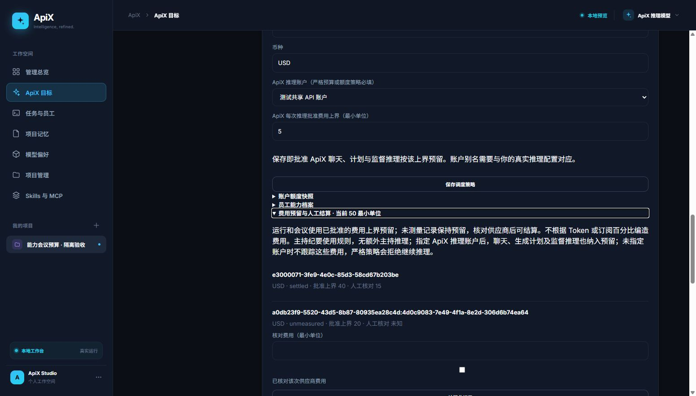

<h1 align="center">ApiX Control Center</h1>

<p align="center">
  <strong>直接说出目标，让 ApiX 协调你的 AI 开发团队。</strong><br>
  面向本机项目的多 Agent 协作工作台，将对话、规划、任务执行与代码验收放在一起。
</p>

<p align="center">
  <a href="https://github.com/Makimasdog/ApiX-Control-Center/actions/workflows/ci.yml"></a>
  
  <a href="LICENSE"></a>
  
</p>

<p align="center">
  <a href="#quick-start">快速开始</a> ·
  <a href="#screenshots">界面预览</a> ·
  <a href="#features">核心功能</a> ·
  <a href="#agents">Agent 接入</a> ·
  <a href="#configuration">配置指南</a> ·
  <a href="#security">权限与边界</a> ·
  <a href="#development">开发与文档</a>
</p>

<p align="center">
  
</p>

## ApiX 是什么？

ApiX 是你的管理者 Agent。你提出目标，ApiX 理解需求、检查项目、拆分任务，再协调不同 CLI 员工执行；你可以随时查看进度、提出指导、审查代码并验收成果。

Pi 提供管理者的推理与工具底座，执行员工使用独立身份和进程。项目、对话、计划和运行记录保存在本机 SQLite；使用远程模型时，推理上下文仍会发送到所配置的供应商。

- **从对话开始**：选择项目后直接输入工作请求，流式查看回复与真实工具活动。
- **按能力分工**：结合任务要求、员工能力、可比历史、费用估计和队列安排工作。
- **把过程看清楚**：计划、会议建议、审批、消息、工作区与交付物都有记录。
- **保留你的决定权**：自动协作须先授权，预算准入与代码验收继续生效。

> 当前为开发版本。本文对应 `codex/readiness-p0-p2` 截至 2026-10-14 的实现；工具与派发基线 `93595d9` 已通过 [PR #6](https://github.com/Makimasdog/ApiX-Control-Center/pull/6) 合入 `main`。本地新增架构契约、实际检查与有限返工、难度/成本路由及持续监督。开发分支通过草稿 PR 交付审阅，尚未合入 main，范围与限制见 [自主交付说明](docs/自主交付与模块契约.md)及[本轮自审](协作/自主交付开发与审查.md)。

---

<a id="screenshots"></a>

## 界面预览

桌面对话是默认入口，工作详情按需展开。以下截图来自仓库已有界面与验收记录；部分管理页截图保留早期页面标题，会议与账本截图使用隔离测试数据和模拟 CLI。

<table>
  <tr>
    <td width="50%">
      <strong>管理总览</strong><br>
      查看项目目标、待处理事项与任务流转。<br><br>
      
    </td>
    <td width="50%">
      <strong>Agent 管理</strong><br>
      扫描本机运行时，注册与管理执行员工。<br><br>
      
    </td>
  </tr>
  <tr>
    <td width="50%">
      <strong>规划会议</strong><br>
      查看员工领取意向、风险与分歧，审查后应用建议。<br><br>
      
    </td>
    <td width="50%">
      <strong>费用账本</strong><br>
      查看批准上界、预留、未知费用与人工结算。<br><br>
      
    </td>
  </tr>
</table>

[查看窄屏对话截图](协作/工具调度窄屏验收.png) · [查看界面验收记录](协作/ApiX工具与任务派发修复审查.md)

<a id="features"></a>

## 核心功能

| 功能 | 当前实现 |
| --- | --- |
| 流式对话 | 项目与会话管理，逐步显示回复、工具开始/结束及错误状态 |
| 项目工具 | 按管理者权限开放文件读取、搜索、编辑、写入与 Bash |
| 自动协作 | 按项目首次授权所选员工；明确工作请求可整理需求、生成计划并按准入规则调度 |
| 能力调度 | 必要标签、工具、上下文与指定员工先筛选，再兼顾质量依据、费用和速度 |
| 规划会议 | 最多三位参与者、两轮提案；保留分歧与失败，应用后生成新待审计划 |
| 额度与预算 | 人工额度快照、项目及共享账户预算、费用预留、额度错误暂停与人工结算 |
| 并行执行 | 依赖验收门槛、项目/员工并发限制、暂停新任务与排队原因 |
| 执行监督 | 收集真实运行记录、交付物和已报告 Token 用量；通过 mailbox 请求进度与指导 |
| Git 代码交接 | 独立 worktree、差异与指纹审查、冻结已验收交付、冲突阻止下游启动 |
| 失败恢复 | 保留部分成果，检查运行与工作区后重新批准或更换员工 |
| 模型配置 | Pi 已配置模型、兼容 API、阿里百炼，以及本机模型目录读取 |
| 历史追踪 | SQLite 状态、协调事件账本、快照、项目记忆与运行历史 |

---

<a id="quick-start"></a>

## 快速开始

### 1. 准备环境

| 工具 | 要求 |
| --- | --- |
| Node.js | ≥ 22.19.0，内置 SQLite 支持 FTS5 |
| Git | 已安装；执行项目须有至少一个 Git 提交 |
| Pi CLI | 管理者推理所需，已安装且可访问配置的模型 |
| 执行员工 CLI | 至少准备一种，并分别完成安装、登录与运行验证 |

### 2. 安装并启动

```powershell
git clone https://github.com/Makimasdog/ApiX-Control-Center.git
cd ApiX-Control-Center
npm ci
npm start
```

打开 **[http://127.0.0.1:4173/](http://127.0.0.1:4173/)**。已有本地仓库可直接在根目录执行 `npm ci` 与 `npm start`。

`npm start` 自动编译 TypeScript。升级代码或修改 `.env` 后须重启原服务。默认数据位于用户目录 `.apix-agent-os/`，数据库为 `apix.sqlite`；可通过 `APIX_DATA_DIR` 与 `PORT` 调整数据目录和端口。

<details>
<summary>启动报 FTS5 错误？检查 Node 的 SQLite 支持</summary>

```powershell
node --input-type=module -e "import {DatabaseSync} from 'node:sqlite'; const db = new DatabaseSync(':memory:'); db.exec('CREATE VIRTUAL TABLE probe USING fts5(content)'); db.close();"
```

若报 `no such module: fts5`，切换到满足要求且支持 FTS5 的 Node，再启动服务。

</details>

### 3. 配置项目与模型

1. 添加已有 Git 项目，在“任务与员工”注册可运行的员工。
2. 配置“ApiX 推理模型”：选择 Pi 已配置模型，或填写兼容 API 的 URL、模型 ID、协议与 Key 环境变量名。
3. 在对话工作区选择项目并提出一个小任务，例如“检查这个项目的 README，提出改进并安排文档任务”。
4. 默认请求批准：检查需求和计划，再批准启动。希望持续自动安排时，按项目选择员工并“授权并开启自动协作”。

工作详情可切换“对话模式”与“约束模式”，两者都检查目标、范围、约束、交付物和验收标准。普通问题不启动员工；明确工作请求可补齐通用默认值，用户已提出的要求保留。

### 4. 审查与验收

查看工作详情、员工进度及交付差异。普通自动协作等待用户验收；另行开启自主交付后，ApiX 按已授权检查实测、自审、有限返工并冻结交付，资源暂时不足时等待后续准入。前置成果验收后依赖任务才会启动，全部模块及最终集成验收后才完成目标。不自动合并源仓库。

---

<a id="agents"></a>

## Agent 接入

管理者始终通过 Pi 调用所配置的模型；员工使用各自 CLI 的模型、账户及权限配置，彼此独立。

| 执行运行时 | 入口环境变量 | 接入方式 |
| --- | --- | --- |
| Pi | `APIX_PI_ENTRY` | JSONL RPC |
| Codex CLI | `APIX_CODEX_ENTRY` | 原生 JSONL 事件 |
| Claude Code | `APIX_CLAUDE_ENTRY` | stream-json |
| Gemini CLI | `APIX_GEMINI_ENTRY` | stream-json |
| OpenCode | `APIX_OPENCODE_ENTRY` | `run --format json` |
| Kimi Code | `APIX_KIMI_ENTRY` | `--print --output-format=stream-json` |
| 自定义 CLI | 在“任务与员工”登记 | 显式可执行文件、参数数组及输出格式 |

未加入 PATH 时，可填写 JavaScript 入口或原生可执行文件的**绝对路径**；不接受 `.cmd`、`.bat`、`.ps1`。Windows 全局 npm 命令会按包清单定位实际入口。`APIX_MANAGER_PI_ENTRY` 可单独覆盖管理者的 Pi 入口；Pi 子进程会优先使用已安装 Git 的 Bash，不修改全局 PATH。

每种 CLI 都须在终端单独完成安装和认证，再用小任务检查版本、权限与工作目录行为。Trae、Qoder、WorkBuddy 的桌面应用发现不代表可托管执行；需要可用的非交互 CLI 或包装器。

<details>
<summary>第三方 CLI 的权限与消息支持</summary>

任务经标准输入传入，宿主收集事件、结果和已报告用量。Gemini 普通模式使用 `auto_edit`，完全访问使用 `--yolo`；OpenCode、Kimi 的工具权限仍取决于原生 CLI 配置。ApiX 不提供操作系统级隔离。

员工须主动读取 mailbox 才能在执行过程中收到指导。自定义适配器可声明支持，但声明不证明已领取或采纳；不轮询的第三方 CLI 仅保留指导记录。同计划交接须指定 `targetTaskId`，运行凭据绑定项目、员工、任务和运行，旧凭据与旧指导不在恢复时重放。

</details>

<a id="configuration"></a>

## 配置指南

### 管理者模型与阿里百炼

服务自动读取项目根目录 `.env`，已有进程环境变量优先。阿里配置参照 [.env.example](.env.example)，仅在本地填写密钥：

```dotenv
ali_url=https://dashscope.aliyuncs.com/compatible-mode/v1
ali_api_key=<你的本地密钥>
ali_model_name=<你的模型 ID>
```

`ali_api_key` 映射为进程内的 `APIX_ALI_API_KEY`。在“ApiX 推理模型”选择自定义 URL，手动填写 `.env` 中的 URL 和模型 ID，协议选 `openai-completions`，Key 环境变量名填 `APIX_ALI_API_KEY`；这些 URL/模型变量不会自动应用到页面设置。

管理者仍需要 Pi CLI。自定义配置写入数据目录下独立的 Pi 模型目录，不覆盖用户 Pi 配置，也不通过页面保存密钥。远程接口需要 Key 环境变量，本地回环服务可无 Key。

保存后可勾选一次费用批准，点击“测试已保存的模型连接”。测试使用当前项目的推理预算，不开放项目工具、不派发员工，显示实际推理是否成功及耗时；未保存或过期配置会被拒绝。测试期间不能重复测试或保存配置，90 秒后请求终止，离开页面不会取消调用。成功仅证明本次推理连接，不证明工具、员工或真实多 Agent 协作可用；未测得费用仍保留预留。

### 本地模型

选择 Ollama、LM Studio 或本机 OpenAI 兼容 URL 后，点击“读取本地模型”获取目录。它使用当前表单地址，不会自动保存、加载模型或生成回复；失败或空目录可继续手动输入。需要认证的服务仍须配置 Key 环境变量。

模型目录不保证模型已加载或能推理，保存后应进行实际对话验证。侧栏“模型偏好”和 Skills/MCP 目前是浏览器配置，不能替代管理者后端设置或员工原生配置。

### 能力、会议与预算

工作详情增加“自主交付”：授权检查脚本和循环边界后，新目标先生成模块契约，再派发实现，最后进行系统集成检查。实际检查和 ApiX 自审均通过后冻结交付；失败保存修复任务并重试，超时、未知进程或达到上限会停下。不自动应用源仓库、发布或合并。设置见 [自主交付与模块契约](docs/自主交付与模块契约.md)。

在“均衡调度 · 能力与预算”维护员工标签、工具、模型版本、熟悉项目和共享账户。新增推理能力与版本化费率，任务难度和工作量独立估计，满足质量门槛后比较费用。传统任务沿用 CLI 配置；难度路由对 Pi/Codex/Claude 显式指定声明模型，不切换认证账户，未观测模型的样本不冒充验证结果，预测不会授予费用上界。

任务可声明类型、相对写入范围、上下文量、指定员工与费用上界。`estimates` 可按 `employeeId` 设置 `estimateMinor`/`minutes`；金额为声明币种的最小单位整数，未知留 `null`。写入范围重叠的并行任务被拒绝，空范围标记未知；模型不能替用户批准费用。

待审计划可单独批准会议费用并邀请最多三位参与者。第一轮独立提出可领取工作、依据与风险，有分歧可再讨论一轮。当前会议接入 Pi 与支持 bare/restricted 模式的 Claude；独立目录不提供项目工具或执行邮箱凭据，纪要由规则整理。应用建议生成新待审计划，不直接执行。

额度采用人工快照，支持保留线、观测/重置时间与共享账户预算。订阅百分比不换算金额，未知/过期快照在严格模式下阻止准入。指定管理者账户后，聊天、计划与监督也进入费用预留；未指定时普通模式不跟踪管理者费用，严格模式拒绝推理。无实际费用的运行/会议保留预留，核对账单后人工结算，活动运行不可结算。

### 并发、暂停与恢复

默认项目并发 **4**、每位员工在本项目并发 **1**。降低并发或暂停新任务不停止已运行进程；暂停自动安排也不撤销已有权限或批准。停止当前工作会取消排队任务并请求停止受托管员工。

额度或速率错误会暂停对应运行时或绑定账户，核对后明确恢复。失败、待修改或排队任务可检查工作区后重新批准、换员工；依赖必须已验收。重启遗留的未知任务继续占用并发，须人工确认原进程停止，系统不自动重连或杀死未知 PID。指纹变化拒绝旧审批，冲突解决并暂存后需重新检查。

---

<a id="security"></a>

## 权限与边界

管理者和员工按项目分别授权，默认 `ask_approval`。自动协作首次授权明确设置 ApiX 与所选员工完全访问权限，并记录版本。

| ApiX 权限 | 对话工具 | 计划推理工具 |
| --- | --- | --- |
| `ask_approval` | 无工具 | 无工具 |
| `read_only` | `read`、`grep`、`find`、`ls` | 同左 |
| `full_access` | 只读工具及 `bash`、`edit`、`write` | 仅只读工具 |

管理者工具直接操作源项目目录，员工使用独立 Git worktree。请求批准控制计划/任务启动，不是逐条工具审批；目录、worktree 与写入范围声明不构成操作系统沙箱。完全访问允许所支持的 CLI 关闭原生审批/沙箱。权限变化请求中止在途管理者工具调用，使旧授权失效，但不撤销已有操作或保证所有外部子进程停止。

在无严格预算/额度策略、执行员工未绑定账户等条件满足时，有效模型计划可按双方完全访问权限派发；自动对话还要求开启自动协作。无工具也能生成待审计划，并在批准后由协调器派发。已确认需求不能通过聊天扩大范围，须调整需求或新建会话。

服务仅监听本机，管理 API 信任本机用户，**不能直接暴露到网络**。费用预算只限制本应用的新任务准入，未同步供应商账单、价表或外部用量，不能保证供应商硬封顶。旧直接派发 API 默认关闭，`APIX_LEGACY_API=1` 仅用于兼容历史流程。

对话使用 POST SSE，传送 `start`、`delta`、`tool`、`complete` 或 `error`；以校验保存后的正式会话为准，工具活动只记录名称、阶段及错误标记。会议及格式修复不开放项目工具，格式修复可能额外调用一次模型。回复上限为 10,000 字符，非法输出明确退回规则引导；断流不代表模型停止，应先读取正式记录，避免重发。

<a id="development"></a>

## 技术栈与开发

| 层次 | 技术 |
| --- | --- |
| 界面 | HTML、CSS、JavaScript 与严格 TypeScript 模块 |
| 服务 | Node.js 原生 HTTP、进程托管与 CLI 适配器 |
| 数据 | Node 内置 SQLite、FTS5、状态表与协调事件账本 |
| 实时通信 | 对话 POST SSE 与独立 mailbox 事件流 |
| 代码交付 | Git detached worktree、差异指纹与冻结交付 |
| 检查 | TypeScript、`node --check`、Node Test Runner、Windows GitHub Actions |

```powershell
npm run check
npm test
```

编译产物 `dist/` 不入库。自动测试使用隔离数据库和假 CLI，不调用真实付费模型。

对话工作区会检查项目 Git 提交、Pi 入口、模型密钥环境变量、员工入口和管理者预算，并提供修复入口。入口存在不证明认证、额度或推理可用；实际模型连接需要单独测试。“模型设置”进入真实管理者配置，浏览器模型收藏及 Skills/MCP 草稿不会改变运行时。

交付差异查询在独立线程执行，最多并行两次；检查期间任务状态变化需要重查。历史每页最多 200 条，可查看更早记录；记忆检索最多返回最近 50 个匹配项。验收与恢复仍会再次检查指纹。

真实协作验收使用隔离 Git 项目，会调用已配置的阿里模型及真实 Codex/Claude CLI，可能产生费用。确认 CLI 登录、网关和 Pi 入口后，显式运行：

```powershell
# 仅在需要指定管理者入口时设置；使用本机已安装的真实 Pi cli.js
$env:APIX_MANAGER_PI_ENTRY = '你的真实 Pi cli.js 绝对路径'
npm run build
node scripts/verify-real-collaboration.mjs --approve-cost
```

验收记录保存在 `.tmp-real-collaboration/run-*/result.json` 和隔离工作区，不纳入 Git。失败不会算作闭环通过；如果记录中 `workersStopped` 为 false，应检查保留的运行状态及进程。

### 已验证与待完成

| 范围 | 验证情况 |
| --- | --- |
| 代码基线 `93595d9` | [Windows CI](https://github.com/Makimasdog/ApiX-Control-Center/actions/runs/38340466487) 使用 Node.js 22.19.0，静态检查及 100/100 测试通过 |
| 既有连接测试 | 本地静态检查、104/104 完整回归及最终定向 4/4 通过；使用假 CLI，实际页面点击和真实模型未验，见 [审查记录](协作/模型连接测试开发与审查.md) |
| 本轮 P0–P2 代码 | 静态检查及 113/113 完整回归通过，包含慢 Git 检查、重连、就绪及历史分页；[自审与限制](协作/就绪改进P0到P2开发与审查.md) |
| 管理者真实模型 | Pi 0.74.2 + 阿里 `qwen3.7-flash` 验证 `read`、`bash`、`write` 与真实文件变化；工作请求进入实际任务派发，执行员工为假 CLI |
| 既有界面基线 | 1360×900 与 390×844 对话、详情开合和窄屏布局已验收；本轮新界面因浏览器工具不可用，视觉验收待补 |
| 真实多员工编码 | 真实 Pi 规划、Codex 写入与冻结、Claude 接收代码及指导确认、Node 验证和最终双员工验收通过；Claude 使用用户指定的 `claude-sonnet-5-5` 与临时兼容参数，见 [补验记录](协作/就绪改进P0到P2开发与审查.md) |
| 其他原生 CLI | Gemini/OpenCode/Kimi 真实 CLI 联调待补齐 |

证据见 [工具与任务派发修复审查](协作/ApiX工具与任务派发修复审查.md)。CI、模拟员工测试与真实模型工具测试分别表述，不能据此宣称所有 Agent 已完成端到端验收。

### 文档导航

| 文档 | 内容 |
| --- | --- |
| [架构设计文档](架构设计文档.md) | 当前模块、执行链、数据表、核心接口及边界 |
| [代码索引](docs/代码索引.md) | 实现入口 |
| [消息协议](docs/agent-message-protocol.md) | Mailbox、运行身份与消息交接 |
| [能力会议预算审查](协作/能力会议预算开发与审查.md) | 能力调度、会议、共享账户实现与验证 |
| [桌面对话与自动协作审查](协作/桌面对话与自动协作开发审查.md) | 交互和自动安排流程 |
| [分支管理](docs/分支管理.md)、[AGENTS.md](AGENTS.md) | 分支历史、审查与提交规则 |
| [协调系统阶段记录](docs/ApiX协调系统实现.md)、[管理总览设计](docs/管理总览设计.md) | 重构与管理页面设计历史 |
| [早期功能说明](docs/功能与限制.md) | 历史阶段能力；当前说明以本文与架构文档为准 |

代码交付须审查后提交，审查结果记录在 `协作/`；明确文件清单暂存，未经用户要求不推送或合并。

## 许可与致谢

本项目采用 [MIT License](LICENSE)。外部 CLI 的许可证和服务条款由各自提供方管理，来源见 [THIRD_PARTY.md](THIRD_PARTY.md)。

README 的标题、导航、截图与功能表组织参考 [Claw Empire](https://github.com/GreenSheep01201/claw-empire#readme)，文字和截图均使用 ApiX 自身内容。
