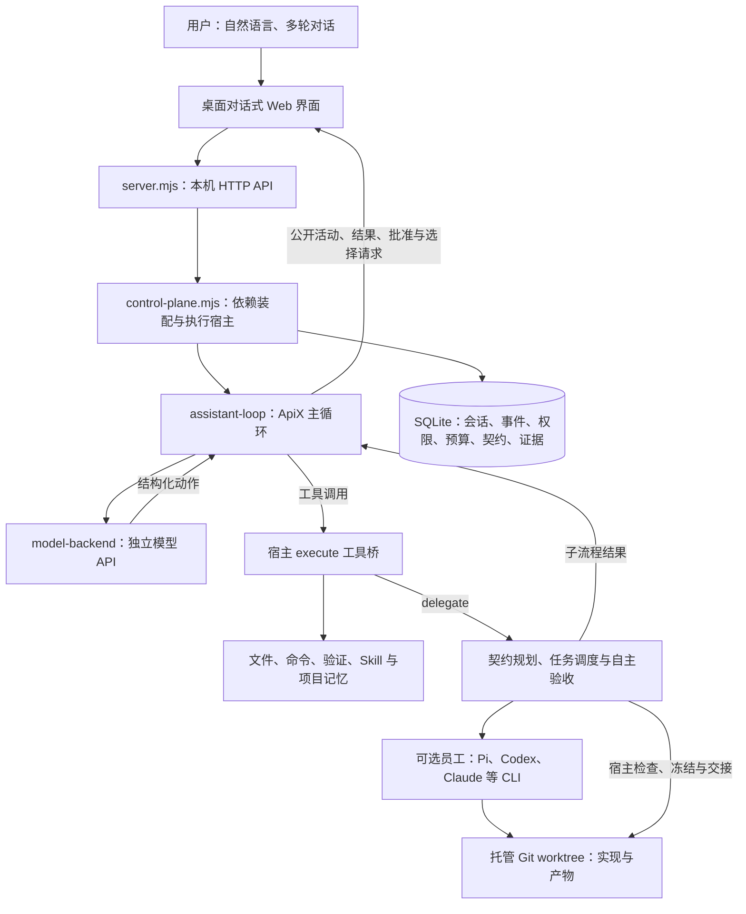
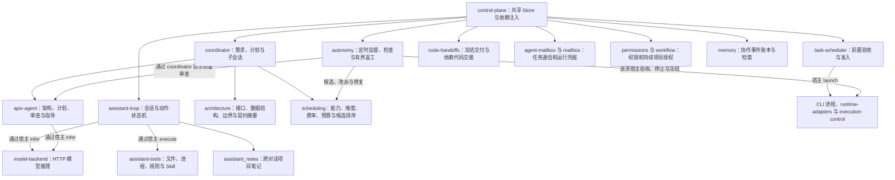
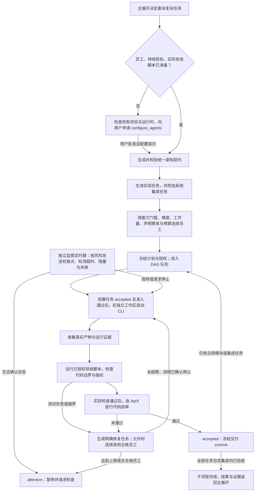
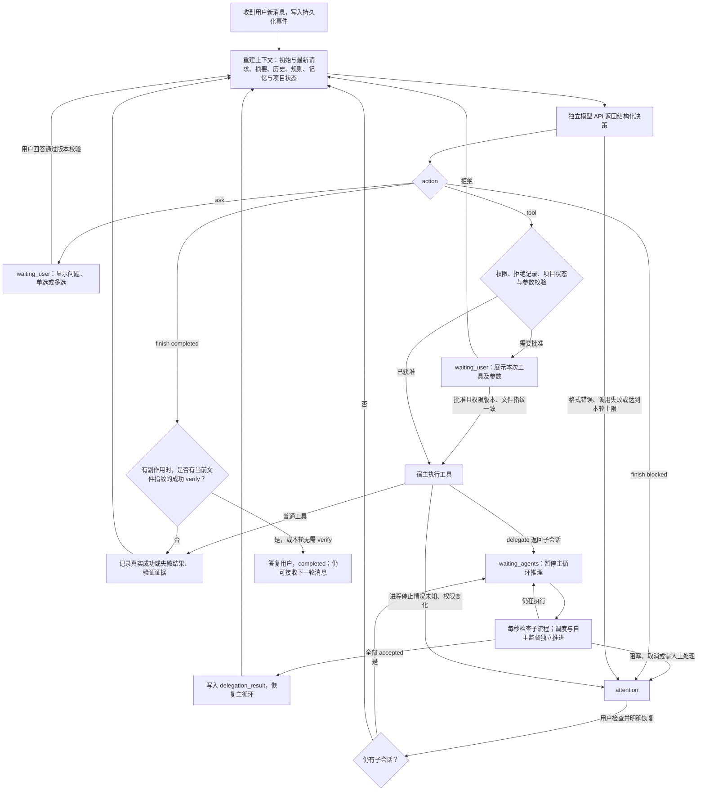

# ApiX 当前架构、模块关系与主 Agent loop

代码基线：`codex/readiness-p0-p2`，`3f5f22c62d3b072c88af2ef91ef7963e86d4fcb5`，2026-10-16。本页描述该提交的实际实现，不代表当前启动进程已加载这个版本，也不是生产可用性认证。

[打开四图浏览页](../.archify/architecture-apix-current-20261016-192305/index.html) · [交互框架图](../.archify/architecture-apix-current-20261016-192305/overview/overview.html) · [交互模块图](../.archify/architecture-apix-current-20261016-192305/modules/modules.html)

## 1. 系统框架

ApiX 自己实现主循环并调用模型 API。Pi 与 Codex、Claude 同属可选执行员工，主循环不依赖 Pi。OpenAI Chat Completions、Responses 和 Anthropic Messages 是模型接入协议，不意味着绑定某个模型品牌。

默认对话入口是 `/api/assistant/sessions`。旧 `/api/coordination/sessions` 目标工作台仍保留，并作为复杂委派的子流程。默认主循环的工具目录目前没有通用 `call_mcp`；界面的 MCP 资源登记不能直接等同于主循环已具备任意 MCP 工具调用能力。

## 2. 模块关系

箭头表示直接调用或标注了“通过宿主”的间接调用，不等于每两个模块都直接 import。`control-plane.mjs` 仍集中承担不少装配和执行责任，当前不是已经拆成独立部署服务的微服务系统。

| 责任 | 当前实现 | 关键边界 |
|---|---|---|
| 主循环 | `src/assistant-loop.ts` | `tool / ask / finish`，持久化等待与恢复状态 |
| 模型后端 | `src/model-backend.ts` | HTTP 流式推理，90 秒超时，可取消，失败不自动重试 |
| 工具和上下文 | `src/assistant-tools.ts` | 项目文件、直接进程调用、规则文件和 Skill 内容；不隐式使用 shell |
| 架构规划 | `src/apix-agent.ts`、`src/architecture.ts` | 冻结模块 paths、依赖、接口 schema、数据结构、验收条件和检查 ID |
| 成本与难度 | `src/scheduling.ts` | 质量门槛后比较费用；未知费用不当作零，预估不自动授予费用上界 |
| 排队与执行 | `src/task-scheduler.mjs`、`src/execution-control.mjs`、`src/runtime-adapters.ts` | 前置 accepted、权限、并发、额度和运行时准入 |
| 自动质量闭环 | `src/autonomy.ts` | 实际脚本、代码指纹、ApiX 自审、修复任务、再次执行 |
| 代码交接 | `src/code-handoffs.mjs` | 冻结版本后向依赖任务交接，不代表已合并原分支或推送 GitHub |
| 通信 | `src/agent-mailbox.ts`、`src/mailbox.mjs` | 按项目、任务和运行凭据控制访问；员工必须主动读取消息 |
| 记忆与授权 | `src/memory.ts`、`src/permissions.ts`、`src/workflow.ts` | 事件、笔记与授权分开；记忆和 Skill 本身不授予权限 |

## 3. 复杂任务协作流程

`architecture.bindArchitecture()` 自动附加依赖所有实现模块的 `integration` 任务。实现模块与集成任务都要通过实际检查和 ApiX 自审，才算整个协作子流程完成。自审返回 `reviewMode: apix_self_review`，不能将其称为独立审查。

默认自主交付策略为：最多修复 2 次、目标 120 分钟、员工运行 30 分钟、检查点基准 5 分钟。高风险检查间隔减半，低风险加倍。宿主的监督 tick 默认 15 秒；主循环检查子流程完成状态的 tick 为 1 秒。这些是不同的计时器。

当前动态调整包括排队改派、修复任务换人、确认停止后的恢复，以及显式修改需求后重新规划。冻结模块契约发生变化时不会任意继续执行；当前没有可在任何情况下自动重写全部架构契约的通用重规划引擎。

## 4. 主 Agent loop

真实循环位于 `src/assistant-loop.ts:90`，核心是 `while (get(id).status === 'running')`。每次工具结果会参与下一次决策；主循环不是“生成一次计划后线性执行到结束”。

但它也不是不受约束的无限循环：每轮最多 24 步或 30 分钟。等待用户或员工时退出当前 `run()`，由用户回复或定时器重新 `kick()`。用户停止会取消模型请求和当前工具，并请求停止子流程；服务重启会把中断主会话置为 `attention`，需要检查后恢复，不自动重放未确认副作用。

`send_agent_message` 已在工具目录，但主循环处于 `waiting_agents` 时不会自主继续推理发送指导；这一阶段主要靠 `autonomy` 的检查点和协作消息处理推进。不能把这个设计描述为“主模型一直思考并实时管理每个员工”。

## 上下文、成本与交付的准确含义

- **上下文与记忆**：项目笔记在不同主会话之间共享；历史超过约 28000 字符且多于 8 条时压缩旧事件，保留最近 8 条、最多 6000 字符摘要、初始请求与最新请求。另有协作事件记忆，不是所有 Agent 共享无限上下文。
- **难度成本路由**：模型提供任务难度和工作量，候选员工依据用户声明的能力与模型档案筛选；已声明且模型匹配的费率用于费用预测。没有费率、额度或可信观测时保持未知，不能声称已经自动测得每个 Agent 的真实能力与实际账单。
- **验证强度**：执行成功不等于验收；但验收仍受已授权测试脚本和可审查代码范围限制，不能证明所有业务场景完美。
- **Git 与 GitHub**：已实现托管工作区、冻结交付与依赖交接。协作完成信息明确说成果保存在托管工作区；主循环完成不会自动等于合并原分支、推送 GitHub、创建 PR 或部署。主循环可在获得权限后执行相关命令，但这些不属于当前交付闭环的固定步骤。

## 主要源码证据

| 行为 | 位置 |
|---|---|
| HTTP 主会话入口 | [server.mjs](../server.mjs#L136) |
| 依赖注入、工具桥、delegate、子流程结果 | [control-plane.mjs](../control-plane.mjs#L1264) |
| 主循环、完成门槛、批准、恢复与 tick | [assistant-loop.ts](../src/assistant-loop.ts#L90) |
| 上下文压缩与项目笔记 | [assistant-loop.ts](../src/assistant-loop.ts#L79) |
| 架构与计划生成、授权后派发 | [coordinator.ts](../src/coordinator.ts#L204) |
| 契约验证、模块绑定与集成任务 | [architecture.ts](../src/architecture.ts#L49) |
| 能力门槛、费用预测、候选排序 | [scheduling.ts](../src/scheduling.ts#L141) |
| 前置验收与排队执行 | [task-scheduler.mjs](../src/task-scheduler.mjs#L3) |
| 返工、测试与自审、周期监督 | [autonomy.ts](../src/autonomy.ts#L91) |
| 自审标识 | [apix-agent.ts](../src/apix-agent.ts#L101) |
| 冻结交付与代码交接 | [code-handoffs.mjs](../src/code-handoffs.mjs#L50) |
| 子流程交付边界 | [coordinator.ts](../src/coordinator.ts#L474) |

图形核验、源码引用检查、浏览器检查与人工视觉复核是不同的结果，详见本次 `协作/` 自审记录。本页未改变 ApiX 的程序逻辑或运行配置。
