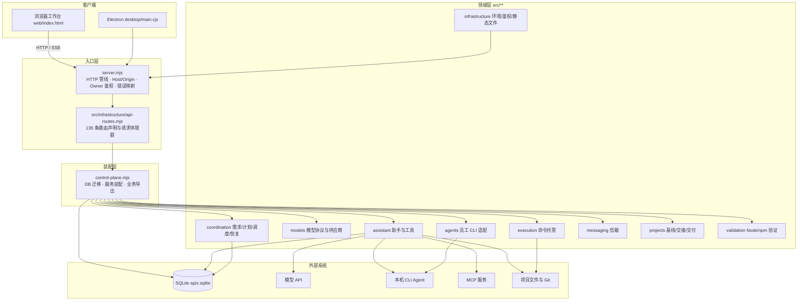
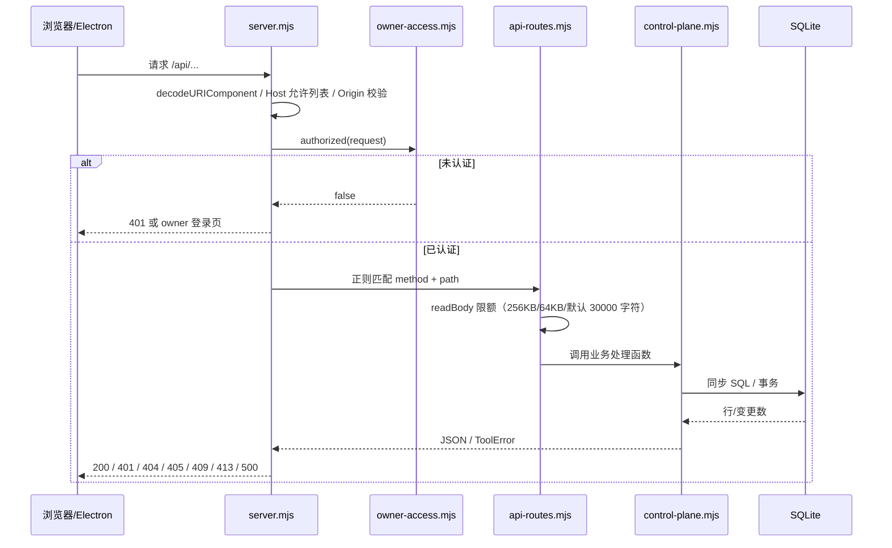
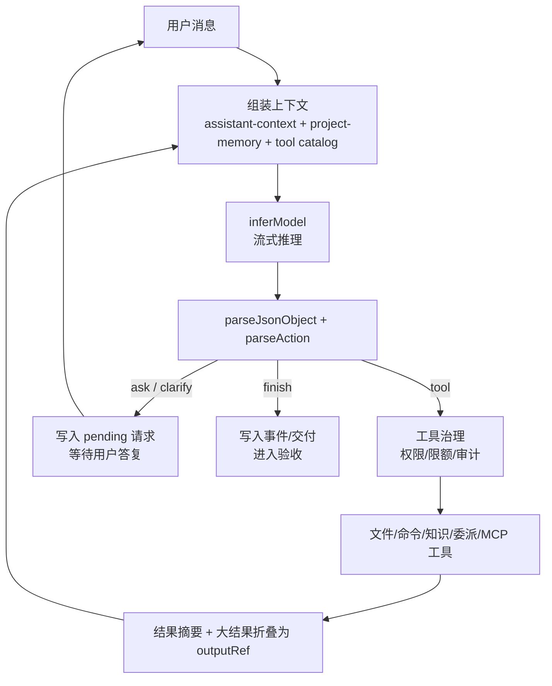
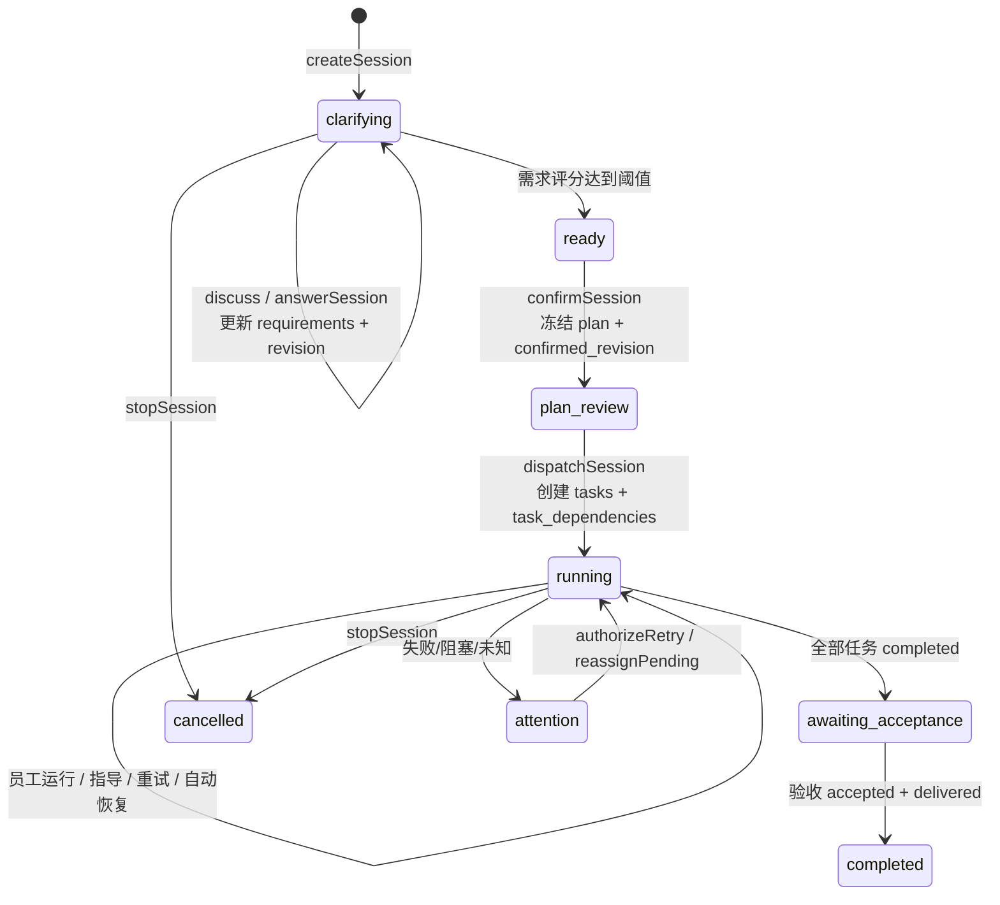

# 01 · 架构总览

## 1. 系统定位

ApiX 是一个运行在**本机单用户环境**的 Agent 控制中心。它不提供公网多租户认证，也不依赖容器或操作系统沙箱；信任边界是“本机所有者 + 显式审批”。

三条能力主线并存：

| 主线 | 入口 | 持久化核心 | 典型产出 |
| --- | --- | --- | --- |
| 通用助手 | 与 ApiX 对话 | `assistant_sessions` / `assistant_events` | 文件修改、命令日志、交付版本、验收证据 |
| 协作编排 | 协作进度、任务与员工 | `coordination_sessions` / `tasks` / `runs` | 员工任务、DAG 依赖、运行报告、集成结果 |
| Agent 托管 | 能力中心、员工注册 | `employees` / `runs` / `agent_mailboxes` | CLI 进程、事件流、额度与暂停状态 |

## 2. 技术栈与形态约束

- **运行时**：Node.js `>=22.19.0 <23` 或 `>=24.22.0 <25`，使用内置 `node:sqlite`。知识库优先使用 FTS5；引擎没有 FTS5 时降级为普通索引表与 `instr(lower(...))` 检索，服务仍可启动。
- **后端语言**：TypeScript 源文件在 `src/**/*.ts`，由 `tsc` 编译到 `dist/`；根目录还有少量 `.mjs` 入口与运行中模块。
- **HTTP**：原生 `node:http`，无 Express/Koa。
- **数据库**：原生 `node:sqlite` 的 `DatabaseSync`，同步调用，WAL + 外键。
- **前端**：无框架、无打包器；`web/**/*.ts` 编译为 `dist/web/*.js`，每个页面模块导入时自渲染。
- **桌面**：Electron 壳（`desktop/main.cjs`、`desktop/backend.cjs`）复用同一后端与页面。

源码引用规则（摘自 `AGENTS.md`）：

- 根级 `.mjs` 只允许入口文件（当前仅 `server.mjs`），新增业务代码放 `src/**` 或 `web/**`。
- 根 `.mjs` 引用编译产物走 `./dist/src/...`；`src/**` 内的 `.mjs` 直接相对引用。
- `npm run check` 含 `scripts/check-stale-dist.mjs`，源码删除/改名后需删除整个 `dist` 重新构建。

## 3. 分层架构

**依赖方向**：入口层 → 装配层 → 领域层；领域层之间以 `src/coordination/contracts.ts` 的类型与显式依赖注入交互；基础设施层不反向依赖业务。

## 4. 一次 HTTP 请求的流动

`server.mjs` 是唯一入口，`api-routes.mjs` 只存路由声明与限额，二者分离。

关键点：

- 仅监听本机；API 请求要求 `Host` 为 `127.0.0.1:<port>` 或 `localhost:<port>`，跨站 `Origin` 直接 403。
- 所有者令牌来自 `APIX_OWNER_TOKEN` 或 `dataDir/owner-access.json`；Bearer 与 HttpOnly Cookie 二选一，Bearer 存在时不会降级到 Cookie。
- `legacy:true` 路由在未设置 `APIX_LEGACY_API=1` 时返回 409。
- `raw:true` 路由自行写响应（SSE、ETag 等流式场景）。
- 静态文件走 `src/infrastructure/static-files.mjs` 白名单，不遍历 `web/`、`docs/`、`test/`、`src/`。

## 5. 通用助手主循环

`createAssistantLoop(deps)`（[assistant-loop.ts](../../src/assistant/assistant-loop.ts)）是闭包工厂，不是类。核心循环在 `run()`：组装上下文 → 调模型 → 解析 JSON 动作 → 执行工具 → 检查结果，直到 `finish` / `ask` / `clarify`。

模型只输出动作 JSON，不直接拥有本机工具。可用动作：

- `{"action":"tool","tool":"...","args":{},"message":"..."}`
- `{"action":"ask","question":"...","options":[...],"multiple":false}`
- `{"action":"clarify","question":"...","candidates":[解释一,解释二,解释三]}`
- `{"action":"finish","outcome":"completed|blocked","message":"..."}`

内置工具共 24 个（`builtinTools`，[tool-registry.ts](../../src/assistant/tool-registry.ts)），按职责分为知识、诊断、文件读写、命令、验收、技能与记忆、员工与委派、工具发现与上下文九类。工具描述与记忆不授予权限；权限由宿主按项目策略和用户批准决定。

主循环的并发与恢复：

- 会话状态、事件、输出全部落 SQLite；内存 `busy` Set 做单会话互斥。
- 中断后不自动重放；`assistant_sessions.status='idle'` 且用户显式“检查后继续”。
- 子流程（委派）通过 `tick(childId)` 唤醒监督，不阻塞主会话。

## 6. 协作编排主流程

`createCoordinator(deps)`（[coordinator.ts](../../src/coordination/coordinator.ts)）把“需求 → 计划 → 任务”做成显式状态机。

任务状态（`Task.status`）：`awaiting_approval` → `queued` → `running` → `stopping` → `completed` → `accepted`，异常分支为 `failed`、`blocked`、`cancelled`、`needs_revision`、`unknown`、`rejected`。

DAG 推进由 [task-scheduler.mjs](../../src/coordination/task-scheduler.mjs) 负责：前置未完成则保持 `queued`；前置不可恢复失败则 `blocked` 并级联；全部完成且审批/准入通过则调用 `launch` 进入 `running`。存活性由 [agent-health.mjs](../../src/coordination/agent-health.mjs) 独立判定，`unknown` 绝不自动重放。

## 7. 启动与恢复

`control-plane.mjs` 的模块顶层按固定顺序执行：

1. `loadEnvironment()` 加载根目录 `.env`（进程已有变量优先）。
2. 数据目录 `APIX_DATA_DIR` 或 `~/.apix-agent-os`，创建目录与凭据存储。
3. 打开 `apix.sqlite`，设置 `journal_mode=WAL`、`foreign_keys=ON`。
4. 按 `schema_migrations` 版本号执行迁移（当前到版本 12）。
5. 启动恢复：把上次残留的 `running/stopping` 运行标记为 `unknown`，任务同样置 `unknown`，`processing` 的主 Agent 消息置 `failed`。
6. 刷新 PATH 可执行文件缓存（pi/codex/claude/gemini/opencode/kimi/git，每 10 秒）。
7. 创建调度、员工、信箱、权限、推理、自主交付、助手循环等实例，并导出业务函数供路由层调用。

> 进程无法在服务重启后被安全接管，因此恢复策略是“标记未知 + 人工确认”，而不是自动重连或重放。

## 8. 贯穿全局的设计原则

| 原则 | 代码体现 |
| --- | --- |
| 本地信任模型 | 仅监听本机、Host/Origin 校验、owner token、无公网认证 |
| 显式审批 | 命令执行、持续授权、npm 网络、验收契约都要求用户批准 |
| 事实与推断分离 | 退出码不等于验收通过；`verified` 不等于 `accepted`；未知状态不重放 |
| 事件溯源 + 快照 | `events` / `assistant_events` / `coordination_events` + 投影表 |
| 乐观并发 | `revision` / `version` 字段，写入前比对，冲突要求刷新 |
| 最小上下文 | 大工具结果折叠为 `outputRef`，按需 `read_context` 回读 |
| 可审计 | 工具调用、模型用量、交付证据、验收决定均持久化 |
