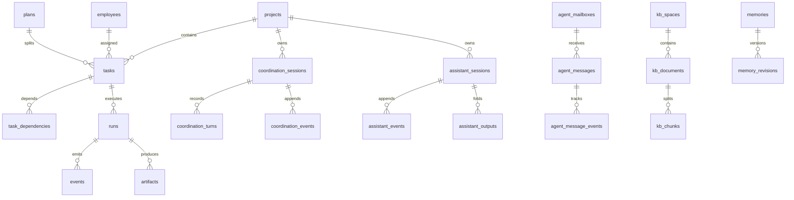

# 04 · 数据模型与存储

## 1. 存储位置与初始化

| 项 | 值 |
| --- | --- |
| 数据目录 | `APIX_DATA_DIR`，默认 `~/.apix-agent-os` |
| 数据库文件 | `<dataDir>/apix.sqlite` |
| 所有者令牌 | `<dataDir>/owner-access.json`（或 `APIX_OWNER_TOKEN`） |
| 日志模式 | `PRAGMA journal_mode=WAL` |
| 外键 | `PRAGMA foreign_keys=ON` |
| 迁移表 | `schema_migrations(version INTEGER PRIMARY KEY)` |
| 访问方式 | 原生 `node:sqlite` 的 `DatabaseSync`，同步 API |

核心表迁移在 [control-plane.mjs](../../control-plane.mjs) 顶层完成，采用“检查版本 → `BEGIN` → DDL → 写版本 → `COMMIT`”，失败 `ROLLBACK`，当前到版本 12。助手、知识库、调度、自主交付、工具治理、运行健康等域表则由各自模块在创建服务时执行 `CREATE TABLE IF NOT EXISTS` 初始化（见 [assistant-loop.ts](../../src/assistant/assistant-loop.ts)、[knowledge-base.ts](../../src/assistant/knowledge-base.ts)、[scheduling.ts](../../src/coordination/scheduling.ts) 等）。

| 版本 | 主要内容 |
| --- | --- |
| 1 | 基础表：`projects`、`tasks`、`approvals`、`runs`、`events`、`artifacts` |
| 2 | 审批补充 `target_path`、`prompt_hash` |
| 3 | `employees`；`tasks.employee_id` |
| 4 | `plans`、`task_dependencies`、`workspaces`；任务增加 plan/workspace/verification 字段 |
| 5 | `departments`、`project_repositories`、`workflow_packs`、`meetings`、`meeting_items`、`shared_artifacts`、`integration_reviews` |
| 6 | `conversations`、`project_profiles`、`memories`、`memory_revisions`、`memory_fts` |
| 7 | `director_threads` / `director_messages` / `director_proposals` |
| 8 | `agent_mailboxes`、`agent_messages` 及尝试/事件/附件/锁表 |
| 9 | `coordination_sessions`、`coordination_turns`、`coordination_events`、`coordination_plan_briefs` |
| 10 | `agent_messages` 增加 `target_task_id`、`target_run_id`、`source_run_id`；`runs` 增加 `mailbox_seen_at` |
| 11 | `tasks` 增加 `input_commit`、`delivery_commit`、`delivery_fingerprint`；`workspaces.common_dir`；新增 `code_handoffs` |
| 12 | `tasks` 增加 `queue_reason`、`recovery_fingerprint`；新增 `execution_settings`、`runtime_pauses` |

## 2. 表分组

以下表名来自源码中的 `CREATE TABLE` 语句（去重后共 94 张，含 `schema_migrations`），按领域分组便于定位。

### 2.1 核心执行域

| 表 | 说明 |
| --- | --- |
| `projects` | 项目（本地目录、名称、描述） |
| `tasks` | 任务（状态、员工、prompt、commit/指纹、队列原因） |
| `task_dependencies` | DAG 边（`task_id` → `depends_on_id`） |
| `approvals` | 任务/动作审批记录 |
| `runs` | 一次员工运行（进程、状态来源、PID、起止、退出码） |
| `events` / `artifacts` | 运行事件与产物 |
| `employees` / `departments` | 员工与部门 |
| `plans` | 执行计划 |
| `workspaces` | 隔离工作区与 Git common dir |
| `meetings` / `meeting_items` | 规划与评审会议 |
| `shared_artifacts` | 会议共享产物 |
| `project_repositories` / `integration_reviews` | 仓库绑定与集成审查 |
| `workflow_packs` | 项目工作流配置包 |

### 2.2 协作编排域

| 表 | 说明 |
| --- | --- |
| `coordination_sessions` | 协作会话（状态、需求 JSON、revision、confirmed_revision、plan_id） |
| `coordination_turns` | 会话轮次（用户/ApiX/员工消息投影） |
| `coordination_events` | 事件溯源账本 |
| `coordination_plan_briefs` | 计划与需求版本绑定 |
| `coordination_checks` | 协作检查记录 |
| `director_threads` / `director_messages` / `director_proposals` | 旧主 Agent 对话与方案 |
| `planning_meetings` | 规划会议 |
| `autonomy_policies` / `autonomy_plans` / `autonomy_tasks` / `autonomy_checks` / `autonomy_repairs` | 自主交付策略、计划、任务、检查与修复 |
| `apix_policies` / `apix_grants` / `apix_guidance` | ApiX 权限策略、授权、指导 |
| `apix_ledger` / `apix_workflows` / `apix_adapters` / `apix_agent_tokens` | 账本、工作流、适配器、Agent 令牌 |

### 2.3 通用助手域

| 表 | 说明 |
| --- | --- |
| `assistant_sessions` | 会话（状态、版本、子会话、验证状态、交付状态） |
| `assistant_events` | 事件时间线（消息、工具、审批、系统事件） |
| `assistant_outputs` | 折叠的大型工具结果（按 `outputRef` 回读） |
| `assistant_notes` / `assistant_note_versions` | 项目记忆与版本 |
| `assistant_memory_meta` / `assistant_memory_usage` | 记忆元数据与使用记录 |
| `assistant_optimization` | 上下文优化模式 |
| `assistant_supervision` | 监督状态 |
| `assistant_tool_discoveries` | 工具发现缓存 |
| `assistant_message_requests` | `ask` / `clarify` 挂起请求 |
| `assistant_effects` | 工具副作用日志 |
| `conversations` / `conversation_models` | 旧会话与对话模型配置 |
| `apix_manager_settings` | ApiX 主模型配置 |
| `apix_run_usage` / `model_token_usage` / `model_prompt_diagnostics` | 用量与提示词诊断 |

### 2.4 消息与锁

| 表 | 说明 |
| --- | --- |
| `agent_mailboxes` | 员工信箱注册 |
| `agent_messages` | 消息（类型、幂等键、关联、超时、状态） |
| `agent_message_events` / `agent_message_attempts` / `agent_message_artifacts` | 消息事件、投递尝试、附件 |
| `agent_locks` | 租约锁 |

### 2.5 调度与执行控制

| 表 | 说明 |
| --- | --- |
| `scheduling_accounts` / `scheduling_account_pauses` | 员工账户与暂停 |
| `scheduling_profiles` / `scheduling_policies` | 能力画像与调度策略 |
| `scheduling_tasks` / `scheduling_attempts` / `scheduling_reservations` | 调度任务、尝试、费用预留 |
| `execution_settings` | 项目/员工并发额度、总暂停、版本 |
| `runtime_pauses` | 运行时级暂停 |
| `agent_health` | 运行健康（healthy/suspected/stopping/unknown/ended） |
| `workflow_recoveries` | 恢复记录 |
| `code_handoffs` | 代码交接 |

### 2.6 知识库与记忆

| 表 | 说明 |
| --- | --- |
| `kb_spaces` / `kb_documents` / `kb_chunks` | 知识库空间、文档、分块 |
| `kb_fts` | 全文索引：FTS5 可用时为虚拟表；不可用时为普通表，由 `instr(lower(...))` 降级检索 |
| `kb_grants` / `kb_receipts` / `kb_queries` | 授权、引用回执、查询记录 |
| `memories` / `memory_fts` / `memory_revisions` | 项目记忆、全文索引、版本 |
| `project_profiles` | 结构化项目档案 |

### 2.7 治理与审计

| 表 | 说明 |
| --- | --- |
| `tool_access` / `tool_limits` / `tool_audit` / `tool_observations` | 工具访问策略、限额、审计、观察 |
| `agent_providers` / `agent_provider_bindings` | 员工供应商与绑定 |
| `artifacts` / `events` | 运行产物与事件 |

## 3. 实体关系（简化）

## 4. 状态机与版本锁

### 4.1 协作会话

`clarifying → ready → plan_review → running → awaiting_acceptance → completed`，异常为 `cancelled`、`attention`。定义见 [contracts.ts](../../src/coordination/contracts.ts#L54-L66)。

### 4.2 任务

`awaiting_approval → queued → running → stopping → completed → accepted`；异常 `failed`、`blocked`、`cancelled`、`needs_revision`、`unknown`、`rejected`。

推进规则（[task-scheduler.mjs](../../src/coordination/task-scheduler.mjs)）：

- 前置含不可恢复终态 → `blocked`，级联阻塞后续任务。
- 前置失败但可恢复 → 保持 `queued` 等待恢复。
- 前置全部完成 + 审批 + 准入 → 调用 `launch` 进入 `running`。

### 4.3 乐观并发

| 对象 | 字段 | 冲突处理 |
| --- | --- | --- |
| 协作会话 | `revision` / `confirmed_revision` | 写入前比对，版本变化要求刷新 |
| 助手会话 | `version` | `UPDATE ... WHERE id=? AND version=?`，`changes!==1` 即失败 |
| 执行设置 | `version` | 保存前比对 |
| 验收契约 | `version`（内容哈希） | 文件或脚本变化则契约失效，需重新批准 |
| 文件编辑 | `expectedSha256` | 哈希不符必须重读，不覆盖用户改动 |

### 4.4 事件溯源与快照

- `coordination_events` / `assistant_events` / `events` 保存事实；投影表保存当前状态。
- `memory.stateAt(projectId, sessionId, at)` 支持回放到指定时间点。
- `checkpoint()` 在关键节点生成快照，避免全量重放。
- 服务重启后残留运行标记为 `unknown`，不自动接管进程。

## 5. 证据与保留策略

| 数据 | 保留/限制 |
| --- | --- |
| 交付审阅资料 | 30 天、合计 128 MiB；淘汰后仅剩元数据，不能据此验收 |
| 单份交付资料 | 24 MiB |
| 扫描 | 3000 项、8 MiB；冻结扫描包含通常忽略的依赖/临时目录（Git 元数据除外） |
| 文本文件 | 256 KiB/文件；二进制只显示哈希元数据 |
| 命令日志 | 7 天 |
| 上下文输出 | 大结果存 `assistant_outputs`，上下文只留引用与预览 |
| 记忆 | 当前项目范围；删除停止召回，审计版本保留 |

> 以上限制来自 [assistant-delivery.ts](../../src/assistant/assistant-delivery.ts) 的 `reviewLimits` 与现有使用指南；调整时需同步更新文档与测试。
