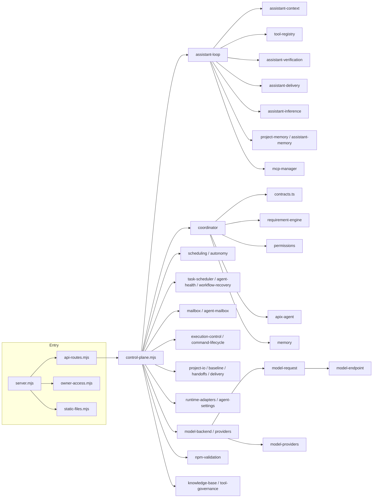

# 05 · 依赖关系

## 1. 分层依赖规则

```text
客户端（web / desktop）
        │ HTTP、SSE
入口层  server.mjs
        │
路由层  src/infrastructure/api-routes.mjs
        │
装配层  control-plane.mjs
        │
领域层  src/{assistant,models,execution,agents,coordination,messaging,projects,validation,recovery}
        │
基础层  SQLite / node:sqlite · 文件系统 · 子进程 · 模型 API · MCP · Git
```

约束：

- **入口层只做管线**：Host/Origin、owner 鉴权、请求体限额、路由分发、错误映射、静态文件。
- **路由层只声明**：方法、正则路径、限额、处理器、`legacy`/`raw` 标志，不写业务逻辑。
- **装配层是唯一组合根**：`control-plane.mjs` 负责打开数据库、迁移、创建全部服务实例，并向路由层导出业务函数。
- **领域层不反向依赖入口或装配**：跨领域协作通过 `contracts.ts` 类型与工厂函数的 `deps` 注入完成。
- **前端只通过 HTTP**：`web/**` 不导入后端模块；所有数据来自 `/api/*` 与 SSE。
- **基础设施层不依赖领域业务**：`environment`、`owner-access`、`static-files`、`api-routes`、`change-bus` 可被入口层直接使用。

## 2. 模块依赖图



## 3. 第三方与运行时依赖

`package.json` 的依赖非常克制：

| 类型 | 依赖 | 用途 |
| --- | --- | --- |
| 运行时 | `@modelcontextprotocol/sdk` 1.32.1 | MCP 客户端与服务发现 |
| 运行时 | `ajv` 8.20.0 / `ajv-formats` 3.0.1 | 工具参数 JSON Schema 校验 |
| 开发 | `typescript` 5.9.3 | 编译 `src/**` 与 `web/**` 到 `dist/` |
| 开发 | `eslint` 10 / `typescript-eslint` / `@eslint/js` | 静态检查 |
| 开发 | `electron` 45 / `electron-builder` 26.15.3 | 桌面壳与 Windows 打包 |
| 内置 | `node:sqlite`、`node:http`、`node:crypto`、`node:child_process`、`node:fs` | 数据库、HTTP、哈希、进程、文件 |

没有 Express、React、Vue、ORM、打包器或测试框架依赖；测试使用 Node 内置 `node:test`。

外部运行时依赖：

- Node.js `>=22.19.0 <23` 或 `>=24.22.0 <25`（内置 `node:sqlite`）。FTS5 可用时优先用于知识库全文检索；不可用时自动降级。
- Git（非 Git 项目的托管快照/worktree 也需要）。
- 可选 CLI Agent：Pi、Codex、Claude、Gemini、OpenCode、Kimi（委派任务时才需要）。
- 模型供应商 API（DeepSeek、OpenAI、Anthropic、本地回环等）。
- 可选 MCP 服务。

## 4. 三条关键调用链

### 4.1 页面请求

`web/assistant.ts` → `fetch('/api/...')` → `server.mjs`（Host/Origin/owner/限额）→ `api-routes.mjs` 匹配 → `control-plane.mjs` 导出函数 → `assistant-loop` / `coordinator` → SQLite。

### 4.2 助手工具执行

`assistant-loop.run()` → `assistant-inference`（模型）→ `parseAction` → `tool-registry.validate` → `tool-governance`（权限/限额/审计）→ `assistant-tools` / `assistant-coding` / `mcp-manager` → `assistant-result` → `assistant-context`（折叠/回读）→ 下一轮。

### 4.3 协作派发

`coordinator.confirmSession` → `requirement-engine` + `apix-agent`（计划）→ `writePlan` → `dispatchSession` → `task-scheduler.advance/pump` → `execution-control`（准入）→ `runtime-adapters` + `command-lifecycle`（启动 CLI）→ `agent-mailbox` + `coordinator.superviseWorkerMessage` → `task-delivery` / `delivery-inspection` → `coordinator.delivered`。

## 5. 耦合热点与维护提示

| 位置 | 现状 | 维护建议 |
| --- | --- | --- |
| [control-plane.mjs](../../control-plane.mjs) | 1937 行、56 个 `import` 语句、63 个出口函数声明（49 个 `export function` + 14 个 `export async function`），另有 67 个 `export const` | 新业务优先放领域模块，装配层只做实例化与转发 |
| [coordinator.ts](../../src/coordination/coordinator.ts) | 状态机集中，方法多、内联 SQL 多 | 修改状态流转时同步更新状态机文档与 `test/coordinator.test.mjs` |
| [assistant-loop.ts](../../src/assistant/assistant-loop.ts) | 单文件承载主循环、会话 API、事务与监督 | 新工具加在 `tool-registry` / 领域模块，不继续膨胀主循环 |
| [api-routes.mjs](../../src/infrastructure/api-routes.mjs) | 135 条声明集中（39 GET / 96 POST） | 新路由必须显式声明限额与鉴权语义，并补 HTTP 测试 |

## 6. 安全与信任边界

| 边界 | 实现 |
| --- | --- |
| 网络 | 仅监听本机；API 校验 `Host` 与 `Origin`，防 DNS 重绑定与跨站 |
| 身份 | 本机 owner token（Bearer 或 HttpOnly Cookie），`timingSafeEqual` |
| 文件 | 项目根目录约束、路径越界拒绝、写入范围契约冻结 |
| 进程 | 直接 `spawn` 无 shell；超时、中止、未知状态显式返回 |
| 权限 | 项目三档 + 员工级决定；持续授权与网络下载必须用户批准 |
| 数据 | 凭据只存本地；日志与工具参数脱敏；知识库结果不授予权限 |
| 桌面 | Electron 自动携带 owner token；仍复用同一 HTTP 鉴权 |

> 这是本机单用户应用的 Capability 认证，不是操作系统级沙箱。停止进程不能撤销已发生的文件副作用。
