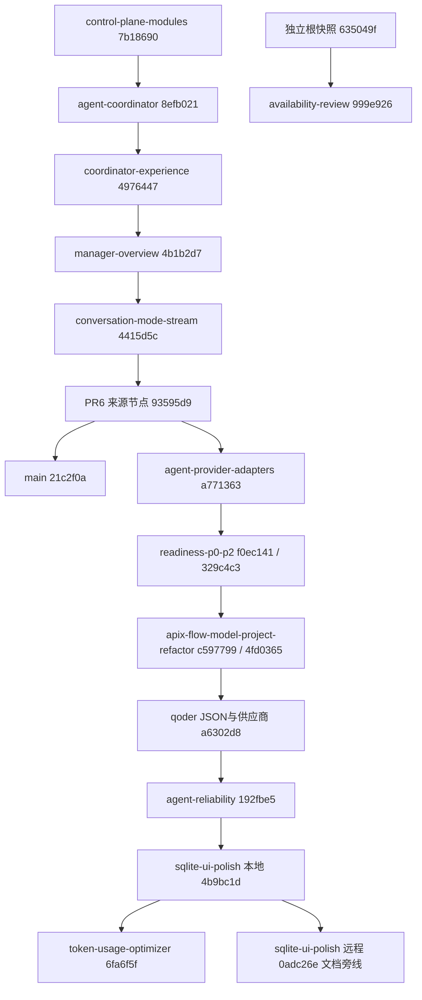

# Git 分支脉络与 GitHub 操作建议

核查日期：2026-10-29（Asia/Hong_Kong）。统计基线：`6fa6f5f18c119cf9671106074e0784573c3f830f`。本报告是仓库现状分析与建议，不是删除、合并、推送或修改 GitHub 设置的执行记录。

## 先看结论

仓库有 **14 条本地分支、8 条远程分支，合计 15 个不同分支名**。大多数名称只是同一开发链在不同时期留下的节点，不是 15 套需要逐条重新合并的功能。

- **实际承载最新成果的开发线**：`codex/token-usage-optimizer`，本地/远程均为 `6fa6f5f`。名字只写 Token，但已继承前面的执行、桌面、供应商、知识库和界面改造。
- **默认分支 main**：本地/远程均为 `21c2f0a`，最后提交在 10-13。当前开发线相对它有 94 个独有提交，反向有 1 个 main 独有提交（PR #6 合并记录）；文件树差异为 509 个文件、+73,428 / -5,085 行，包含文档、截图和目录迁移，不全是业务代码。
- **两条需要单独处理的旁线**：远程 `Kimi/sqlite-ui-polish` 多出的文档提交 `0adc26e`，以及无共同祖先的 `codex/apix-availability-review`。
- **GitHub 当前只有 PR #7 开放**，来源是远程旧节点 `f0ec141`，不是当前最新分支。其来源 tip 比当前基线少 43 个提交。

以下时间是分支 **tip 的提交时间**，不是创建时间。Git 远程引用不保存可靠的创建时间，不能仅凭名称、日期或 reflog 推断完整创建顺序。先后关系以祖先图为准；箭头可以省略中间提交。

## 一、开发先后关系



`codex/fix-json-contract-unify-provider-entry-20261022` 与本地 flow 分支同指 `4fd0365`，只是另一个名字，没有独有提交。availability 图独立于其余节点；根快照与开发链旧提交 `5151855` 文件树相同，不代表存在父子提交关系。

## 二、全部 15 个分支名

“已含于当前”表示该 tip 是 `6fa6f5f` 的祖先；不表示已合入 main，也不等于重新验收通过。改动摘要按阶段日志及相关 diff 归纳，避免把继承自前一阶段的功能再算一次。

| 顺序 | 分支名（完整） | 本地 / 远程 tip，tip 日期 | 这一阶段的主要改动 | 现状与建议 |
| --- | --- | --- | --- | --- |
| 1 | `codex/control-plane-modules` | `7b18690` / 已删除；10-10 | 拆出 mailbox、任务调度等模块，建立代码入口索引 | 已含于 main 和当前；PR #1 已合并，本地可列为清理候选 |
| 2 | `codex/agent-coordinator` | `8efb021` / 已删除；10-10 | TypeScript 协调系统、需求/计划/授权、员工适配、消息和进度监督 | 已含于 main 和当前；PR #2 已合并，本地可清理 |
| 3 | `codex/coordinator-experience` | `4976447` / 已删除；10-10 | 结构化/对话模式、SSE、员工详情与模型自定义地址 | 已含于 main 和当前；PR #3 已合并，本地可清理 |
| 4 | `codex/manager-overview` | `4b1b2d7` / 已删除；10-10 | 管理总览、任务看板、员工和待办跳转 | 已含于 main 和当前；PR #4 已合并，本地可清理 |
| 5 | `codex/conversation-mode-stream` | `4415d5c` / 已删除；10-10 | 修复轮询导致加载过期、对话输入可见性及流式反馈 | 已含于 main 和当前；PR #5 已合并，本地可清理 |
| 集成点 | `main` | `21c2f0a` / 同步；10-13 | PR #6 集成至 `93595d9` 的工具、对话、多 Agent 与 Windows 路径修复 | 默认分支；保留，尚未包含后续最新开发成果 |
| 6 | `codex/agent-provider-adapters` | `a771363` / 已删除；10-13 | 多 CLI 与模型接入、流式协作、冻结交接、并发/恢复、能力会议/预算、模型连接测试 | 24 个阶段提交中大部分随 PR #6 进入 main；最后 3 个提交未进 main，但均已含于当前；不能仅凭 PR #6 已合并判定本地 tip 已合并 |
| 独立旁线 | `codex/apix-availability-review` | 无 / `999e926`；10-16 | 独立快照上的 7 文件补丁：上下文、记忆、环境和交付短引用硬化 | 无共同祖先；已选择性移植并修正，保留溯源，不整条合并 |
| 7 | `codex/readiness-p0-p2` | `329c4c3`（10-22）/ `f0ec141`（10-21） | 就绪与自主交付、宿主可信验收、独立 ApiX API、MCP/记忆、编码工具、Node/npm 验证、Electron 与 HIG 界面；本地再增加直接保存 API Key | 本地领先远程 1；两种 tip 均已含于当前。PR #7 仍指远程旧 tip，先处理 PR 再清理 |
| 8 | `codex/apix-flow-model-project-refactor-20261022` | `4fd0365` / `c597799`；10-22 | 拆分交互入口与模型配置、执行流程重构；后续加入失败自动恢复、Electron 0.2.1 和独立供应商管理 | 本地领先远程 3；全部已含于当前，保留阶段记录即可，不必为了消除 ahead 而推送旧线 |
| 同节点别名 | `codex/fix-json-contract-unify-provider-entry-20261022` | `4fd0365` / 无；10-22 | 与上一条本地分支同一提交，没有新增差异 | 本地重复名称，可清理；真正的后续 JSON 契约修复在 Qoder 阶段，不能只看这个名称 |
| 9 | `qoder/unify-json-contract-provider-center-20261022` | `a6302d8` / 同步；10-24 | JSON 动作边界与供应商编辑、统一对话入口、依赖图、记忆上下文、Electron 热更新、故障恢复、工具治理/知识库与测试修复 | 阶段 12 个提交，已含于当前，未合 main；最新开发线集成后可清理 |
| 10 | `Kimi/agent-reliability` | `192fbe5` / 同步；10-24 | 持久化消息幂等，避免重试重复创建用户轮次 | 已含于当前，未合 main；最新开发线集成后可清理 |
| 11 | `Kimi/sqlite-ui-polish` | `4b9bc1d`（10-26）/ `0adc26e`（10-28） | SQLite 无 FTS5 降级、共享 UI、安全渲染、路由与 SSE、异步 Git/扫描、桌面验证；远程再补编码规范及自审 | 本地落后远程 1。当前已含本地 tip，未含远程独有文档提交；先人工核对该文档差异，不强制覆盖任何一端 |
| 12 | `codex/token-usage-optimizer` | `6fa6f5f` / 同步；10-29 | Token 账本、节省模式/补读优化、真实对照、最终请求诊断、Windows UTF-8、中文注释、文档与 Git 整理、开发规则 | 当前完整开发线，保留为集成候选；stable-prefix-v1 等仍是设计项，名称不能当实现承诺 |

### 最容易误判的三个差异

1. **PR #6 的来源已删除，但本地 provider 分支不完全等于已合版本。** main 合入的来源是 `93595d9`；本地随后还有 `bb83c9d`（分支说明）、`5112de5`（README）、`a771363`（模型连接测试），这些已在当前开发线保存，无需为了抢救而重复合并。
2. **Kimi UI 远程多出的不是新业务实现。** `4b9bc1d..0adc26e` 只改 AGENTS.md 和一份自审记录，2 个文件、+18 行。当前规则已含高度相近的目录整理要求，且有更新的历史路径、中文提交及通用规则。建议对比文字并补收所需记录；若整份覆盖，会回退现行规则。该提交尚未逐字节纳入当前，不能直接宣称“完全已合并”。
3. **availability 不是等待合并的普通功能分支。** 实测 `merge-base` 返回无共同祖先，且 `635049f` / `5151855` 文件树相同。`999e926` 的补丁经 [采纳评估](../../协作/归档/2026-10/availability-review分支采纳评估.md) 和 [修正移植自审](../../协作/归档/2026-10/availability-review改进移植自审.md) 后以 `3394775` 等进入开发线。这里确认的是历史选择性移植事实，不是本轮重新审查当前实现的全部等价性。

## 三、阶段增量：每条线到底增加了多少

以下是上一主链节点到下一节点的 Git 提交与文件树增量，包含文档和迁移。不是分支创建后的独占工作量，也不能跨行直接累加文件数量。main、独立旁线和重复别名单独在上表解释。

| 阶段分支 | 对比范围 | 提交数 | 文件树增量 |
| --- | --- | --- | --- |
| `codex/control-plane-modules` | `4a3c26d..7b18690` | 5 | 8 files changed, 375 insertions(+), 284 deletions(-) |
| `codex/agent-coordinator` | `7b18690..8efb021` | 3 | 33 files changed, 1415 insertions(+), 138 deletions(-) |
| `codex/coordinator-experience` | `8efb021..4976447` | 1 | 16 files changed, 238 insertions(+), 41 deletions(-) |
| `codex/manager-overview` | `4976447..4b1b2d7` | 1 | 9 files changed, 113 insertions(+), 8 deletions(-) |
| `codex/conversation-mode-stream` | `4b1b2d7..4415d5c` | 1 | 4 files changed, 50 insertions(+), 22 deletions(-) |
| `codex/agent-provider-adapters` | `4415d5c..a771363` | 24 | 113 files changed, 11213 insertions(+), 359 deletions(-) |
| `codex/readiness-p0-p2` | `a771363..329c4c3` | 49 | 325 files changed, 52369 insertions(+), 3573 deletions(-) |
| `codex/apix-flow-model-project-refactor-20261022` | `329c4c3..4fd0365` | 4 | 55 files changed, 1043 insertions(+), 188 deletions(-) |
| `qoder/unify-json-contract-provider-center-20261022` | `4fd0365..a6302d8` | 12 | 126 files changed, 3028 insertions(+), 766 deletions(-) |
| `Kimi/agent-reliability` | `a6302d8..192fbe5` | 1 | 6 files changed, 93 insertions(+), 6 deletions(-) |
| `Kimi/sqlite-ui-polish` | `192fbe5..4b9bc1d` | 11 | 111 files changed, 4341 insertions(+), 1172 deletions(-) |
| `codex/token-usage-optimizer` | `4b9bc1d..6fa6f5f` | 14 | 313 files changed, 13155 insertions(+), 562 deletions(-) |

在仓库根目录可按范围复核，例如：

```powershell
git log --reverse --oneline 4b9bc1d..6fa6f5f
git diff --stat 4b9bc1d 6fa6f5f
git log --left-right --oneline origin/main...6fa6f5f
```

## 四、GitHub 当前状态

核查使用 GitHub 连接器与只读 GitHub CLI；保护规则、发布和 Actions 信息由 CLI 补充。仓库为公开仓库，默认 main，自动删除已合 PR 来源分支已启用；merge commit / squash / rebase 三种方式均允许，auto-merge 关闭。没有 Release 或 tag。

### PR 与 CI

| PR | 当前状态 | 实际范围与后续建议 |
| --- | --- | --- |
| [#1](https://github.com/Makimasdog/ApiX-Control-Center/pull/1)–[#5](https://github.com/Makimasdog/ApiX-Control-Center/pull/5) | 已合并，10-13 | 早期模块、协调、交互、看板与流式修复；不重复开 PR |
| [#6](https://github.com/Makimasdog/ApiX-Control-Center/pull/6) | 已合并，10-13 | 将 `93595d9` 集成为 main 的 `21c2f0a`，不是本地 provider 后续 tip |
| [#7](https://github.com/Makimasdog/ApiX-Control-Center/pull/7) | open、非 draft、未合并 | `codex/readiness-p0-p2@f0ec141 → main`；51 个提交、325 文件。正文仍说保持草稿，且使用旧文档路径，描述与实际状态不一致，建议作为旧范围 PR 处理 |

- #7 的最近已记录 CI 成功在 `f0ec141`，时间为 10-21；[运行 39611038209](https://github.com/Makimasdog/ApiX-Control-Center/actions/runs/39611038209)，当时只有 `check` 作业。它不验证后面的 43 个提交。
- 当前 `6fa6f5f` 的 workflow run 数和 check-run 数都是 **0**。combined status 的 `pending` / `total_count=0` 不表示存在正在排队的测试。
- 当前 [CI 源码](../../.github/workflows/ci.yml) 只配置 `push: main` 与 `pull_request`；推送到 token 分支本身不会触发这一工作流。当前源码已扩为 Node 22/24 矩阵和 coverage，不能用旧 `check` 作业名臆造新的必需检查名称。
- main 保护接口返回 `Branch not protected`，仓库 rulesets 返回空列表；目前没有这两种机制强制 PR、CI 或限制强推。

## 五、建议操作顺序

### 1. 先确定一条完整开发线，不逐条合并历史节点

继续把当前 token 分支作为本次集成来源即可，不必现在重命名或多建一条长期 develop。提交图已经包含 readiness、flow、Qoder、Kimi reliability 和本地 Kimi UI 的代码。逐个合并会重复展示相同改动，并增加判断成本。

先核对 `0adc26e` 的文档差异：保存有价值的自审材料，合并需要的文字，保留当前 AGENTS 的完整新规则和已迁移路径。不要为了“所有分支显示同步”而把旧 readiness/flow 分支再次推送、重置或强推。

### 2. 为完整开发范围创建一条新的 Draft PR，目标 main

建议新建 `codex/token-usage-optimizer → main` 的 Draft PR，标题用中文概括“集成后续执行与桌面改造、上下文优化和文档整理”，正文按功能领域说明范围、实际验证、历史失败和未实现项，不只写 Token。

新 PR 创建后，给 #7 说明它被完整范围 PR 取代，再关闭旧 PR，保留原讨论和历史 CI。可以先把 #7 恢复为 draft，避免其“可合并”状态被误读为最新成果已完成验收。**这是建议，本轮未创建、编辑或关闭 PR。** PR 的 head 不是改 base 就能换成另一条分支；不建议为了复用 #7 而把旧 readiness 远程强行更新成最新开发线。

新 PR 上跑当前 Windows Node 22/24 静态检查、依赖审计、全量测试和 desktop 测试；浏览器关键路径另行验收。收费模型和真实员工仍按现有授权规则执行。94 个提交 / 509 个文件是较大的集成范围，建议按“工具执行与恢复、供应商、上下文/知识库、UI/桌面、文档”分组审阅；本轮只核查历史和结构，没有重新批准这些代码。

如需在后续启用“必须与 main 同步”，可在集成审查期间把 origin/main 合入当前开发线并复测，保留这 1 个合并记录的历史联系；不对共享开发线 rebase 或强推。本轮仍不合并任何方向。

### 3. 给 main 加最小必要保护

建议要求通过 PR 合并、通过当前实际 CI 作业、解决审查讨论，并禁止强推和删除 main。必需检查名称应等新 PR 实际运行后从 GitHub 选择，不复制旧版单作业名称。coverage 目前只产报告，无阈值，不必自动当硬门禁。

当前主要由本人和编码 Agent 工作，Agent 自审不等于独立批准；在没有其他真实审阅者时，不宜机械要求“另一个人必须 approve”而锁住仓库。有真实协作者后再设置相应审批门槛。自动删除已合分支已经开启，无需重复设置。保护能力及检查机制依据 [GitHub 分支保护文档](https://docs.github.com/en/repositories/configuring-branches-and-merges-in-your-repository/managing-protected-branches/about-protected-branches)。

本轮这条长开发线建议保留 merge commit，保存阶段历史和祖先关系；以后的小型、短期、彼此独立的功能 PR 可以统一 squash。若采用前者，本次不同时要求“只允许线性历史”。三种合并方式目前都可用，先明确团队约定即可，不必立刻大改设置。

### 4. 再分批清理旧分支

| 批次 | 分支/对象 | 建议条件 |
| --- | --- | --- |
| A：最明确的本地候选 | `control-plane-modules`、`agent-coordinator`、`coordinator-experience`、`manager-overview`、`conversation-mode-stream`（均有 `codex/` 前缀） | 5 个 tip 均已含 main，远端已删除，当前没有占用 worktree；用户授权清理后可用 `git branch -d`，不需要 `-D` |
| B：本地冗余节点 | `codex/fix-json-contract-unify-provider-entry-20261022`；`codex/agent-provider-adapters` | 前者与 flow 同 tip；后者独有于 main 的 3 个提交已保存在同步的当前开发线；可在确认保留当前线后删除本地名字，不必重复合并 |
| C：远程阶段分支 | readiness、flow、Qoder、Kimi reliability、Kimi UI | 完整开发线通过审查、合入 main，且 #7 已处理、`0adc26e` 材料已核对之后，再删除不再使用的远程分支和对应本地分支 |
| D：独立快照 | `codex/apix-availability-review` | 单独确认不再需要原始审查分支；需要长期溯源时先保留归档引用或离线备份，再决定删除远端名字；不能拿“已含于 main”的方式处理 |

删除前再次 fetch 并核对 tip、祖先关系和 worktree，避免基于本报告的旧快照操作。远程分支删除、PR 关闭、main 合并及仓库设置都应单独执行和记录；本轮没有执行。

### 5. 后续仓库使用习惯

- 默认 main 保持已审集成状态；短期分支从明确的已接受基线创建，名字写任务主题，不再沿用一个窄名字无限叠加所有功能。
- 每次只读盘点用 `git fetch origin --prune` 和 `git branch -vv`；只在确实要继续该旧分支时处理它的 ahead/behind。祖先节点不需要保持与其远程 tip 相同。
- PR 使用中文说明改动、验证、限制；增加一个简短 PR 模板即可，沿用现有协作证据，不另建重复记录系统。
- 以合并后、实际验证过的提交创建 tag 和 Release；若交付 Windows 安装包，则上传对应产物、校验值和已知限制。不要仅因为本机有 `.tmp-desktop` 包就标记为正式发布，也不要上传缓存、数据库或凭据。
- CI 触发策略可继续以 PR + main 为主，前提是每条准备集成的开发线都有 PR；若要支持当前这类长期开发分支的逐次推送检查，再增加针对该分支的 push 触发或手动 workflow_dispatch，而非默认所有分支重复跑重型测试。

## 六、本次完成与未执行事项

已更新远程引用、核查全部分支 tip/祖先/增量、核对 7 个 PR、仓库保护/合并设置、Release/tag 与 CI 状态，并形成此报告。本次没有删除或重命名分支、推送、创建/编辑 PR、合并、改写历史或修改 GitHub 设置。

本报告的文档提交将让本地当前分支在 `6fa6f5f` 上再多一个文档提交；不会改变上面的产品代码关系。统计应按本报告明确的基线解释。未运行产品构建、测试或真实模型，历史移植与验收报告仅作为当时证据引用。
