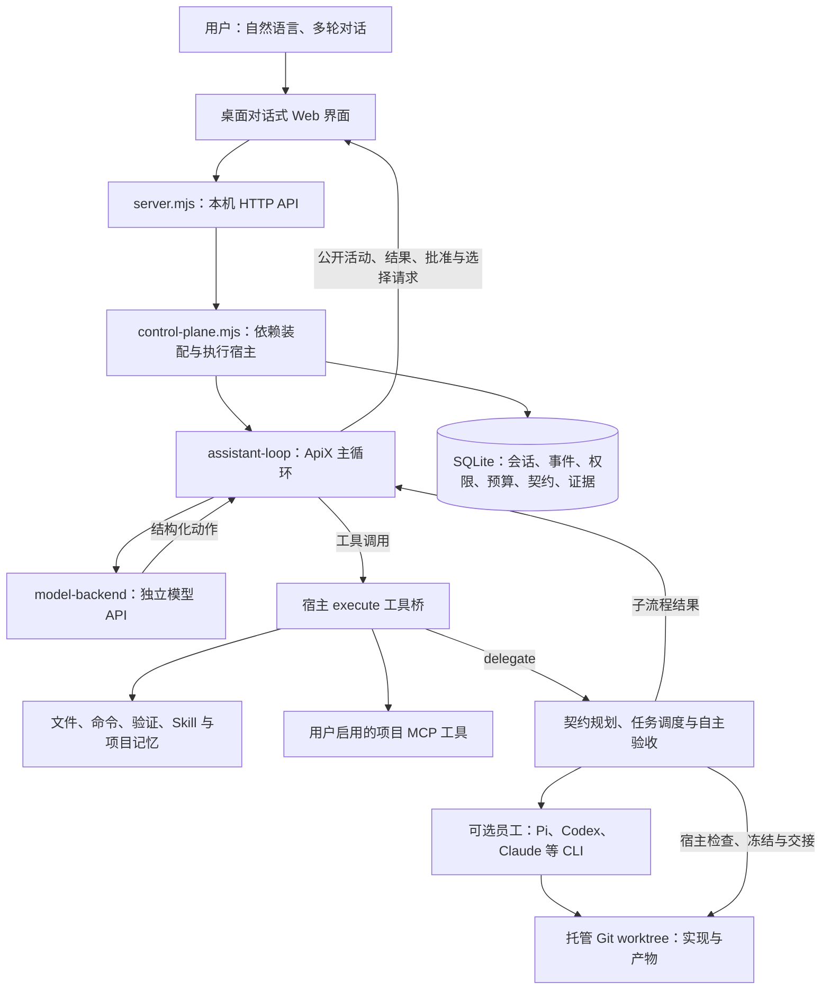
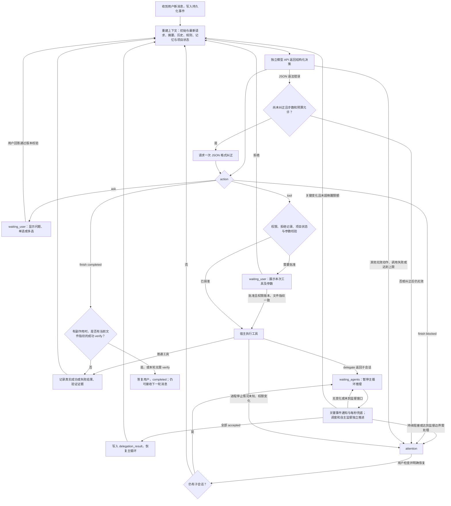

# 架构设计

2026-10-18；源码基线 `08bf165`。操作见[使用指南](使用指南.md)，源码入口见[代码索引](参考/代码索引.md)。

## 系统框架

ApiX 是本机单服务中的独立通用 Agent。模型 API 提供结构化决策，工具、权限、上下文、委派和完成门槛由宿主管理。Pi、Codex、Claude 等是可选执行员工。

默认主对话为 assistant；coordination 保留需求、计划和验收，也是 delegate 的子流程。两者共享侧栏，状态和版本独立。control-plane 仍集中承担装配和执行责任，不是微服务系统。

## 模块边界

| 责任 | 入口 |
| --- | --- |
| HTTP 与装配 | server.mjs、control-plane.mjs：API、SQLite、预算、进程与工具桥 |
| 循环和模型 | assistant-loop、model-backend、conversation-models：状态机、流式协议、每对话模型快照 |
| 工具与 MCP | tool-registry、assistant-tools、mcp-manager：Schema/版本、项目工具、启用的外部服务 |
| 上下文与记忆 | assistant-context、assistant-memory：完整输出引用、预算压缩、项目内确认后召回 |
| 契约与质量 | coordinator、apix-agent、architecture、autonomy：冻结模块、实测、自审和返工 |
| 路由和执行 | scheduling、task-scheduler、execution-control、runtime-adapters：能力/成本、DAG、并发和 CLI |
| 项目与代码 | project-folders、project-baseline、code-handoffs：目录身份、快照、指纹与冻结交接 |
| 通信与权限 | mailbox、agent-mailbox、permissions、workflow：运行身份、消息、主体和持续授权 |

## 主 Agent loop

每次真实工具结果参与下一次决策，核心是 assistant-loop 的 running 循环。每轮最多 24 步、30 分钟；重启后中断会话转为 attention，须检查后恢复，不自动重放副作用。

waiting_agents 期间关键事件经 30 ms 合并通知，另有每秒兜底；普通变化至少间隔 30 秒，每次委派最多六次监督唤醒。可检查员工和指导，不能同时改文件、运行命令或重复委派。

## 契约、路由与质量

需求明确 → 冻结模块边界、接口/schema、数据结构、依赖及验收 → 质量门槛后按难度/工作量/声明费率选员工 → worktree 执行 → 实测和 ApiX 自审 → 指纹复验与冻结 → 推进依赖和最终集成。

失败生成明确修复轮次，超限、未知进程或证据不足则暂停。自主交付默认最多修复两次、目标 120 分钟、运行 30 分钟、检查点基准 5 分钟，风险调整间隔。费用预测不代表实际账单或批准。配置和契约细节见[自主交付参考](参考/自主交付与模块契约.md)。

普通用户验收要求真实差异及有效指纹；多个候选须指定任务。accepted 冻结版本，不等于应用源仓库、推送或部署。

## 模型、上下文与权限

对话保存模型/强度及供应商连接快照，摘要、格式纠正和委派子流程继承，员工模型独立。配置只保存密钥变量名；全局和旧对话的管理者密钥与别名从员工、MCP、命令环境隔离。

主循环使用 JSON 动作和宿主工具注册表，不使用供应商原生 function calling。模型请求超时 90 秒，不自动重试连接失败。工具先校验 Schema、版本和权限；持续协作始终须明确批准。Skill、记忆和远程描述不授予权限，CLI 内部审批也不等于 ApiX 逐条拦截。

窗口默认声明 32768 Token、输入目标 72%，按字节估算。大结果完整保存并按会话归属分页读取，预算不足分批摘要。项目内最多召回五条、6000 字符已确认记忆，不跨项目授予权限。见[工具上下文与记忆](参考/工具上下文与记忆.md)。

管理接口信任本机用户，没有公网多用户认证或 OS 沙箱；路径/worktree 不能隔离任意程序。未知进程不自动接管，停止不能撤销已有副作用。

## 数据与 API 入口

| 数据/接口 | 用途 |
| --- | --- |
| assistant_sessions / assistant_events / assistant_notes / assistant_outputs | 主对话、动作、项目记忆和完整输出 |
| conversation_models | 按会话类型/ID 保存模型配置、快照和版本 |
| coordination_sessions / coordination_turns | 协作目标与讨论 |
| tasks / runs / approvals、autonomy / scheduling 表 | 执行、质量、修复、预算和证据 |
| /api/assistant/sessions、/api/coordination/sessions | 两种会话及消息、停止、恢复等子路由 |
| /api/conversation-models/:kind/:id、/api/chat-history | 对话配置和可恢复历史 |
| /api/project-folders、/api/employees/:id/runtime-info | 目录浏览及运行时支持时查询额度/模型 |
| /api/projects/:id/mcp | 项目 MCP 配置及 discover 子路由 |
| /api/tasks/:id/delivery、/api/tasks/:id/review、/api/tasks/:id/recovery | 差异、指纹验收和恢复 |
| /api/agent/* | 带 Run 凭据的员工消息 |

方法、参数、版本和批准要求以 server.mjs 为准，消息契约见[协议](参考/agent-message-protocol.md)。默认主对话轮询持久化事件，协作目标另有 POST SSE。归档/删除为可恢复标记；队列每五秒复核，仍遵守前置 accepted 和全部准入门槛。

验证证据统一见[变更回顾](变更回顾.md)。旧交互图作为[2026-10-16 快照](../.archify/architecture-apix-current-20261016-192305/index.html)保留，不作为当前功能全图。
