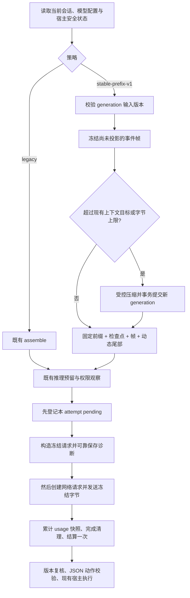

# ApiX Token 成本与前缀缓存优化设计方案

初版：2026-10-27；更新：2026-10-28，**R2**。状态：**部分前置优化已实现；最终请求诊断与 stable-prefix-v1 仍为 PLANNED**。

本轮重点的执行契约见 [R2 最终请求诊断与稳定前缀实施细则](2026-10-28-最终请求诊断与稳定前缀实施细则.md)。阅读顺序：本方案 → R2 细则 → [当前源码基线](2026-10-28-Token缓存设计源码基线.json)。R2 对回调时序、配置存储、帧预算和实施顺序的约定替代初版相应建议；2026-10-27 基线保留为历史。

本文供其他 Agent 实施，用户本轮只要求设计，不表示已经修改功能、批准发布或授权付费实验。推荐方案为 A，所有接口、表名和数值预算均为待实施契约；实施者应先核对当前代码，再按阶段提交。不得将本文写成现有功能说明。

## 1. 目标、范围与交付边界

目标是降低**正确完成一项任务的总成本**，同时保持用户约束、项目权限、执行安全和验收真实性。缓存命中率是诊断指标，不是最终目标。

本轮设计覆盖 ApiX 自己通过 API 发起的 assistant 主循环、格式纠正、压缩，以及共享模型适配器的兼容性。外部 Codex／Claude CLI 的内部上下文、缓存与费用不在 ApiX 可控制范围内；既有 CLI 观测数据继续维持各自口径。

交付要求：

1. DeepSeek 原生缓存字段能被正确计量，未知值不伪造为零。
2. 常规轮次保留的历史表示稳定，只在明确边界重建。
3. 能定位系统指令、目录、历史正文等哪些部分发生了变化。
4. 工具结果足够可用，不能靠增加补读轮次换取目录变小。
5. 对照实验涵盖任务成功率、费用或完整用量、补读、请求次数和耗时。

首版不做：语义答案缓存、向量数据库、自动换便宜模型、自动保温请求、Agent 并行执行、供应商账单结算、预算释放重构、原生 function calling。避免把本次上下文优化扩大成 Agent 重写。

未知项：生产任务分布、并发量、供应商费率及缓存保留时间、自定义网关路由、真实任务收益、可接受存储容量与清理周期、上线窗口。没有这些数据时，不承诺 90%／99% 命中或固定节省比例。

## 2. 已核对的当前状态

R2 基线 HEAD：`4daf698aa24526d860cf58386db426ec1de1bd4b`，取样时工作区干净。28 个选定源文件与验收材料的哈希见同目录 `2026-10-28-Token缓存设计源码基线.json`；这不是全库审计。实施者须核对接手时新增差异。初版基于含未提交改动的 `3e5cf73` 工作区，其基线仅供追溯。

| 位置／消费者 | 当前行为（源码观察） | 设计影响 |
| --- | --- | --- |
| `src/assistant/assistant-loop.ts` 的 assemble/context/run | 组装整段上下文对象，再生成 `APIX_AGENT_LOOP_JSON` 字符串；摘要、历史、动态状态混合；查询一次最多取 201 条事件 | 需要新的模型视图；不能直接改历史 API 或静默丢掉第 201 条以后的内容 |
| `src/assistant/assistant-context.ts` | saving 已增加单页 24 KiB／每次 32 KiB 的近期文件保留池及当前 history 相同正文去重；池外仍按年龄折叠，trimHistory 仍按位置过滤 | 已完成补读优化，尚不是冻结历史；新策略另建模型投影，保留 legacy 与 UI |
| `src/assistant/context-optimizer.ts` | standard 发送完整目录；saving 常驻 13 个核心工具，已发现工具重新加入完整目录 | 发现新工具可能改变历史前面的目录，需要明确契约 |
| `src/assistant/assistant-loop.ts` 的 search_tools | 发现结果含完整定义，并保存发现版本；MCP 调用有现有版本与权限门禁 | 可以借助已有发现结果，不必再造通用工具代理 |
| `src/models/model-usage.ts` | 解析 OpenAI 风格 cached_tokens 与 Anthropic 读写计数，未读取 DeepSeek 原生 hit/miss | 先修计量，避免“面板没记录”被误读为“没有实际缓存” |
| `src/models/model-backend.ts` | inferModel 接受字符串；支持三种协议；固定宿主 system；不发送 cache_control | 第一阶段保留字符串入口，供应商显式缓存单独实施 |
| `src/assistant/assistant-inference.ts` | 费用预留、未知账本阻断、额度暂停、清理错误优先级 | 不得绕过或弱化 |
| `control-plane.mjs` 的 inferManager | 冻结任务归属、逐 attempt 用量登记、权限变化中止；调用方包括 assistant、coordination、遗留 Director | 新业务逻辑放 src；根级既有文件只接线，不继续堆积业务 |
| `src/assistant/token-usage.ts` | pending → completed/failed，一次结算；coverage、项目/会话/任务汇总；费用未知 | 扩展字段保持可加性；不得回填旧请求的未知计数 |
| `src/assistant/assistant-tools.ts` | 默认 read_file 可读 20,000 字节；显式范围读取最多 16,000 字节；有哈希、游标 | 不得按“文件统一只有 16KB”设计折叠阈值 |
| `web/assistant.ts`、context/optimization 路由 | 显示现有 schema:1 用量与估算；配置有 version 和安全门禁 | 通过可选字段扩展，旧客户端继续工作 |

既有配对记录：标准模式 50,720 总 token、5 次请求；节省模式 69,284、7 次请求，后者多两次 read_context。两组答案 7/7，但费率未知、顺序未随机、仅一次配对。只能据此提出“补读抵消局部收益”的优化假设，不能声称费用上涨 36.60% 或普遍退化。见 `协作/2026-10-27-Token模式真实对照实测.md`。

R2 新证据与状态：

| 项目 | 2026-10-28 状态与证据 | 不能推出的结论 |
| --- | --- | --- |
| 文件页保留、相同正文去重、contextReadPolicy | 已实现于 `3a4a516`；两组单任务总 token 从 176,197 降至 80,773，read_context 从 5 降至 0；见 `协作/2026-10-28-节省模式补读优化与真实对照自审.md` | 不是稳定前缀收益；不能推广为跨任务费用节省 |
| 供应商缓存实测 | Qwen3.8-flash、两个新会话 8 请求，输入缓存占比 33,792/72,600=46.55%，请求有命中比例 7/8=87.5% | 两种口径不能混用，也不是与 DeepSeek Harness 的同条件比较 |
| 重复下降信号 | 两次任务第3次缓存 7,168，第4次均降到 4,096；未记录完整发包诊断 | 尚不能定位是哪一字段变化或供应商原因 |
| Windows 命令入口故障 | 已有 `e5483e8` 修复及自审 | 本轮未重跑测试，不再把历史失败当成未修复项，也不声称全套回归通过 |
| 最终请求诊断、稳定帧、DeepSeek 原生字段适配 | 当前源码未实现 | 不能将设计项登记为完成 |

后续对照以**当前已含补读优化的 legacy + saving**为基线，不能与旧版节省策略混算收益。上述是源码观察和既有记录，不是本轮重新运行得到的测试；R2 新能力及收益均待验证。

## 3. Reasonix 的借鉴范围与证据限制

采用其确定性表示、追加历史、动态尾部、低频检查点，以及按组件哈希诊断前缀变化的思想；不照搬仓库、语言、模型或默认阈值。

Reasonix 文档、README、不同分支会有差异。例如官网与工程规范中的默认压缩比例并不完全一致，因此 ApiX 首版沿用已有 threshold，不复制某个 80%／85% 数字。实施时应记录参考源码 commit，不只记录移动分支名。

核对于 2026-10-27 的第一手资料：

- [Reasonix 缓存诊断源码](https://github.com/esengine/DeepSeek-Reasonix/blob/studio/internal/runtime/agent/cache_shape.go)：比较 system、工具与保留历史消息链，记录变化原因。
- [对应测试](https://github.com/esengine/DeepSeek-Reasonix/blob/studio/internal/runtime/agent/cache_body_test.go)：追加与改写区分，动态派生尾部单独处理。
- [Reasonix 工程规范 §3.6](https://github.com/esengine/DeepSeek-Reasonix/blob/studio/docs/SPEC.md)：限制普通轮次历史重写，区分原始事件与模型视图。
- [记忆契约](https://github.com/esengine/DeepSeek-Reasonix/blob/studio/docs/SESSION_MEMORY_RETRIEVAL.md)：稳定指令与动态召回分离。
- [DeepSeek 缓存规则](https://api-docs.deepseek.com/guides/kv_cache/)：需匹配已持久化的完整前缀单元；供应商只提供 best effort。
- [Anthropic 缓存控制](https://platform.claude.com/docs/en/build-with-claude/prompt-caching)：显式启用方式、有效期与读写计费须按实际模型核对。

这些资料支持设计方向，不证明 ApiX 能复制它们的宣传命中率或费用收益。

## 4. 方案比较与建议决策

| 方案 | 结构 | 优点 | 代价与退出条件 |
| --- | --- | --- | --- |
| **A：稳定文本分帧，推荐先实施** | 保留 inferModel 的 prompt:string；固定前缀＋逐帧历史＋动态尾部 | 对三协议、JSON 动作契约、重试与老调用者影响较小；容易局部回滚 | 不能完整重放供应商原生 assistant/reasoning 消息；只复用共同输入前缀，不能假设复用上一轮生成输出缓存。实测收益不足时不扩大默认范围 |
| B：原生多消息重放 | 新建规范化消息请求，按协议映射 user/assistant/tool 等内容 | 更接近原生多轮上下文；可能复用更完整的请求/回复边界 | 涉及输出持久化、角色顺序、推理块、工具配对、三协议差异和调用者迁移。只有 A 证实收益受表示限制、且有三协议夹具后再考虑 |
| C：仅修计量与诊断 | 保留现有上下文组装 | 最小变更，能找到问题并正确显示数据 | 不解决位置相关折叠与早期动态字段；可作为 P0 独立交付或 A 的回退状态 |

本方案是 A 的详细实施建议，C 是第一阶段成果；B 是有条件的后续选择。它们不是已经获准的生产迁移。其他 Agent 可先实现可测试的代码与一次性测试数据库，任何真实数据库、部署和付费测试仍按用户授权范围执行。

## 5. 必须保持的系统不变量

1. 原始 assistant_events 与 assistant_outputs 不被投影重写，不删除原始失败和证据。
2. 同一 generation 中，已提交模型帧的 UTF-8 内容不因年龄、刷新、补读、事件数量变化而变化。
3. 当前权限、工具治理、项目指纹、审批状态和验收状态仍由宿主实时检查。稳定前缀不授予权限。
4. 权限撤销中止当前请求；配置变化使旧执行决策失效的原有规则保持有效。
5. unknown、失败、超时、停止、结果不完整、部分副作用、证据未保存等宿主事实不能被折叠为成功。
6. read_context/read_output 保持项目与会话隔离；文件原文哈希与保存结果 JSON 哈希继续区分。
7. usage 账本逐 attempt 记账；压缩、纠正、重试都进入任务总成本。completed 仅表示传输完成。
8. 投影/检查点失败不自动重放工具；用量结算失败继续触发 INFERENCE_ACCOUNTING_UNKNOWN。
9. 外部资料、工具结果、记忆、模型响应不能伪造宿主权限或生成配置指令。
10. 不为提高命中率保留已撤销访问的数据；权限与敏感数据处理优先于缓存稳定。

## 6. 目标组件与调用流程

推荐新增的职责边界，文件可以按项目风格微调，不新增根级业务 .mjs：

| 模块 | 负责 | 不负责 |
| --- | --- | --- |
| `src/assistant/prompt-projection.ts`（新增） | generation、事件选择、冻结模型帧、稳定序列化、请求分区 | 网络调用、工具授权、费用结算 |
| `src/models/prompt-diagnostics.ts`（新增） | 最终发包语义组成哈希、组件比较、attempt 诊断数据 | 模型正文持久化、判断供应商一定过期或故障 |
| `src/models/model-usage.ts`（修改） | DeepSeek 原生字段及冲突校验 | 费率和金额 |
| `src/assistant/token-usage.ts`（修改） | 同一请求集合的命中比、coverage、诊断关联 | 根据 token 释放预留 |
| `src/assistant/context-optimizer.ts`（修改） | legacy 目录与稳定策略目录的明确区分 | 改工具注册与校验规则 |
| `src/models/model-cache-policy.ts`（可选 P4 新增） | 能力匹配和显式缓存参数 | 按模型名称猜测网关能力 |
| 现有 assistant-loop / inference / control-plane | 接线、事务与安全门禁 | 承接全部新实现 |

请求流程：



投影操作不持有跨网络事务。压缩请求也走既有 inferManager，使用 purpose=compaction。prepare 失败时不发送正常推理请求。

## 7. 稳定文本协议：stable-prefix-v1

### 7.1 布局

下面是模型 prompt 的结构示意，不是新的网络协议：

```text
APIX_AGENT_LOOP_JSON
APIX_PROMPT_LAYOUT stable-prefix-v1
<现有主循环行为指令及 JSON 动作契约>
STABLE_CONTEXT <一行规范 JSON：固定目录、指令内容、相关稳定能力>
CHECKPOINT <一行规范 JSON：摘要与 throughEventId；本 generation 不变>
EVENT <一行规范 JSON：事件 1 的冻结投影>
EVENT <一行规范 JSON：事件 2 的冻结投影>
...
CURRENT_STATE <一行规范 JSON：当前动态状态>
<固定的回复契约结束指令>
```

各帧是独立完整记录；外面不包裹逐轮变化的大 JSON 数组。正文中的换行与控制字符通过 JSON 转义，避免正文伪造结构边界。不能把低权限正文拼接为可执行宿主指令。

底层 model-backend 的固定 system 继续存在，不将工具正文升级为 system。A 不添加原生 tools/tool_choice，也不接管原生推理块；现有 JSON action 解析和验证不变。

### 7.2 三个区域

**稳定区域**：主循环指令、序列化版本、当前模式下的固定工具目录、实际加载的项目指令及其内容版本、稳定工具使用约定。模型、协议、有效服务端地址、认证配置代次和推理设置属于 generation 身份，但密钥值与真实端点不得进入提示词或诊断输出。

**可追加区域**：按 event_id 排序的用户消息、已完成工具执行组、交付/验证失败事实等。每条事件首次投影时冻结；不再随位置调用 trimHistory。活动文本、用量事件、投影配置事件、缓存诊断等是否纳入，应采用固定 kind 规则，不能采用“最近 N 条才纳入”的规则。诊断和 context_budget 始终排除，防止观测行为反过来改变请求。

**动态尾部**：当前任务标识与反馈、最新权限和治理状态、当前验收投影、相关记忆召回、引用索引、上下文预算和必要能力变化。按需保留字段，不重复整个历史或完整记忆索引。尾部可以变化，变化应局限于这里。

不在每轮 prompt 中加入本地请求 ID、当前时间、随机 UUID、诊断哈希和统计面板数据。原始事件中已经存在且冻结的必要 ID 不需要清除。

**重要限制**：上轮尾部被下一轮新事件替换，故整个上轮 prompt 不一定成为新 prompt 的前缀。承诺稳定的是共同的历史区，不是 entireRequestStartsWithPrevious。该方案仍需供应商实际持久化共同前缀，不能用本地字节相同证明实际命中。

### 7.3 确定性序列化

- 仅对宿主拥有的 JSON 对象递归排序键，统一换行与编码；工具集合按稳定名称排序。
- 数组默认保留语义顺序；不得排序 JSON Schema 的 enum、oneOf、任务步骤或任何有序正文数组。
- JSON 字符串内部保持原文，不对用户代码、文档或命令输出做空白格式化。
- Schema 对象字段可规范化，未知类型、循环引用、非有限数值应在边界拒绝或显式转换，禁止静默丢字段。
- 将确定性函数用于实际发送内容；不能只规范化哈希，却发送另一种顺序。
- 串行化版本参与 generation 身份；升级序列化必须产生明确切换记录。

## 8. generation 与持久化设计

### 8.1 边界规则

每个会话独立 generation；下列变化触发安全边界上的重建：策略/standard-saving 模式、模型或推理配置、协议或端点身份、认证配置代次、固定指令内容、固定工具契约版本、压缩检查点、显式回退/历史截断。

权限变更先中止旧请求；恢复前重新验证，并按需要生成新 generation。文件正文变化以新的工具事件追加，不重写旧 read_file 帧。新任务状态置于尾部；不要求每个任务都冷启动，但任务计量归属必须冻结为新任务。

generation 是模型视图版本，不是执行权限快照。MCP 同名工具换了连接、Schema 或版本后，旧发现结果不能继续执行；不得为了稳定目录继续使用旧连接。

重新读取指令时比较真实内容版本，不能只依靠 mtime/文件大小；读取范围沿用既有指令加载限制，不每轮全库扫描。若权限变化还撤销了某些上下文的发送资格，新项只能从当前允许的原文重新构建；无法证明旧摘要不含已撤销内容时，停止并要求检查，不直接复制旧摘要。不能把“生成新 generation”当作自动完成数据撤权处理。

### 8.2 建议附加表（SQLite，具体 DDL 在实施时验证）

| 表 | 建议字段与约束 |
| --- | --- |
| `assistant_prompt_generations` | `session_id, generation` 联合主键；`project_id, strategy, layout_version, optimization_mode, identity_hash, prefix_text, prefix_sha256, checkpoint_summary, through_event_id, created_at`；session 外键、同会话单调 generation |
| `assistant_prompt_frames` | `session_id, generation, event_id` 联合主键；`source_sha256, projection_version, rendered_text, rendered_sha256, projection_kind`；外键关联 generation；索引支持按 event_id 读取 |
| `model_prompt_diagnostics` | `usage_id` 主键并关联 model_token_usage；`session_id, generation, layout_version, route_scope_id, system_hash, tools_hash, history_hash, tail_hash, wire_body_prefix_bytes, logical_input_prefix_bytes, change_reasons_json, observation_state`；不存正文、URL 或密钥 |

R2 使用独立附加表 `assistant_prompt_settings(session_id PRIMARY KEY, strategy, version)`，缺行等同 legacy；不向 assistant_optimization 加列，保留原 standard/saving 和旧版位置 INSERT 的兼容性。新表使用显式列清单写入。更新时校验会话 version、设置 version 与安全状态；详细请求契约见 R2 细则。

generation 号及当前项通过事务内检查会话版本后分配/查询，不能仅在内存里递增。是否需要显式 current 指针可根据实现选择；必须保证同一会话一个已提交当前项，不能靠不同连接各自 MAX+1 竞争。

新表中的 prefix_text 与 rendered_text **确实包含模型上下文片段**，应按 assistant_events 的私有本地数据处理；不放进用量账本、HTTP 诊断或遥测。无需新增完整 prompt 日志。不得复制凭据、读取环境变量或在报错中打印正文。删除会话/项目时接入真实删除路径，覆盖生成视图；归档仅阻止访问，沿用原有保留语义。

### 8.3 事务、恢复和容量

- 在正常推理前，固定事件水位，生成并事务提交缺失帧；同 event 重复 prepare 复用已有投影。
- source_sha256 与当前原始事件不一致意味着异常改写，停止并提示检查，不能悄悄改帧。
- 原始工具结果已保存、投影保存失败时，停止推理并保留原始事件；恢复只重新生成视图，不重跑工具。
- 不在 context GET、刷新面板或导出历史时创建 generation/帧；GET 应无新模型请求、无新投影写入。
- 每轮分页扫描到冻结水位。保留现有 200 事件的保护边界时，应触发受控压缩/分批处理，不能仅取 LIMIT 201 后悄悄忽略剩余事件。
- 请求大小仍受现有 512 KiB prompt 限额与窗口目标约束；分帧开销也进入预算。最终协议体与 prompt 字节分别统计，不能把正文估算说成实际 token。
- A 的新活动 generation 只存固定部分和逐事件帧，不每轮复制整个历史。压缩后，旧模型帧可在新项可靠提交后清理，原始事件/输出不清理；失败不影响当前项。首版不增加后台全库清理任务。
- 存储增长是 UNKNOWN；用 fixture 测每千事件新增字节、活动帧数量、prepare 耗时，记录后再决定容量上限。不得凭空承诺存储或延迟 SLO。

## 9. 工具结果展示与补读控制

### 9.1 首次进入模型时冻结

模型投影与 UI history 分离，旧 history/read/index 契约保持。投影器首次读取工具结果时决定 full 或 referenced，后续同 generation 保持不变。

建议首版策略（是候选参数，需夹具和 A/B 校准）：

| 内容类型 | 初始处理 |
| --- | --- |
| read_file、范围搜索结果 | 在工具既有读取上限内尽量完整保留；不因 1,200 字符阈值立即折叠当前工作文件 |
| read_context/read_output | 保留本次请求的分页片段与完整性字段，不再次折叠为同一引用；不预读下一页 |
| 命令/检查日志 | 保留宿主状态、失败相关上下文和有界尾部；其余通过既有 read_output |
| 普通大结果/MCP 返回 | 先做结构化字段选择和确定性限额；正文约 4 KiB 预览可作为初始候选，完整原文保留引用 |
| 用户约束/审批/失败事实 | 不做通用字符截断；无法容纳时通过保留策略/受控压缩处理，必要时停止并要求缩小输入 |

默认整文件读取目前可达 20,000 字节，不能把 16,000 字节范围预算误当默认文件上限。小窗口中如果本次完整文件加必要前缀已超预算，应先整理旧历史；仍超限时显式返回范围读取方案或超限状态，不能以“已读完整”的形式静默截断。

必须沿用 hostResultSummary，保留 operationId、exitCode、timedOut、aborted、unknown、processesEnded、executionComplete、sideEffectsNeedReview、evidencePersisted、conflict、游标、truncated/scanComplete 等必要事实；`ok:true` 不等于执行/验收成功。

### 9.2 去重与版本变化

同一文件版本的重复读取可以避免重复正文，但不能每轮删除早期帧。只有旧正文仍在当前可见 generation、范围覆盖本次读取、哈希完全相同时，才可把**新结果**表示为引用旧正文；原始新事件仍保存。旧正文已被压缩或权限变更后，不得声称仍可见。

文件改变时追加新版本和明确“此版本取代前次读取”的事实。编辑工具仍使用最新 expectedSha256，缓存不授予写入资格。首版可不做内容去重，先交付稳定结果，避免过度扩大范围。

### 9.3 补读指标

记录 read_context/read_output 请求次数、相同引用重复分页次数、可确定关联时的“投影为 referenced 后再次回读”次数。后者只说明关联，不宣称因果。不能把所有日志查看都算为优化失败。

初期不自动提高/降低阈值、不引入 LLM 摘要每条工具结果。先用固定策略避免把调参和缓存稳定性混在一起。

## 10. 工具目录与按需发现

legacy 策略完全保持现有行为。stable-prefix-v1 下：

- standard：初始化固定当前完整目录；集合变化、Schema 变化通过新 generation 处理。
- saving：固定现有 13 个核心定义和初始 deferred 名称/短用途索引；search_tools 返回的完整定义放在其工具结果帧，不再为每个新发现把定义插回早期目录。
- 固定指令明确：可使用主目录或当前可见 search_tools 结果中已发现的工具；没有完整参数定义时先发现，禁止猜接口。
- 工具的注册、参数验证、治理、审批、发现版本校验仍使用实时 registry，不能仅用冻结目录判断可执行性。
- 压缩时为仍有效且已发现的定义保留一个有界的发现定义包，或明确标为需重新发现。不得既丢掉 Schema 又告诉模型已加载完整定义。新 generation 可以重选目录，但应记录原因与费用。
- 外部工具重连/版本变化使发现结果失效，重新发现后使用；撤销工具立即阻止执行，不等目录换代。

不增加 execute_tool 通用代理，不开放未注册工具，不把 schema 固定误当固定执行权限。

## 11. DeepSeek 计量与命中率契约

### 11.1 字段归一化

Chat Completions 兼容层新增原生 `prompt_cache_hit_tokens`、`prompt_cache_miss_tokens` 的读取，**由响应字段而非模型名称判定**。本阶段不改变请求参数。

规则：

1. count 继续只接受非负安全整数，零是有效值；负数、字符串、Infinity、溢出仍为未知。
2. 已知 `prompt_tokens` 是总输入；标准 `prompt_tokens_details.cached_tokens` 与原生 hit 是同一概念的候选来源，绝不相加。
3. 两个 hit 候选都有效且一致时取该值；仅一个有效时使用它并保留来源。两个有效但冲突时，缓存计数置 null，诊断标记 conflict；不任意挑一个好看的数值。
4. 已知总输入时要求 hit≤input。若原生 hit 和 miss 均有效，要求安全求和且与已知总输入一致，否则相关缓存分项标记不一致，不输出命中率；仍可保留独立可信的总输入/输出。
5. 总输入缺失而 hit+miss 同时有效且安全时，允许重建总输入，标明 derived_from_provider_parts；只有 hit 或只有 miss 时不推断缺失值。
6. 不把 miss 当 cacheWriteTokens。DeepSeek 自动缓存的 miss 不等同 Anthropic 缓存写入计费类别。
7. 流式事件是累计快照：缺失字段沿用已观察值，出现的字段覆盖；保存来源候选后再对同次累计结果做一致性校验，避免分开的快照导致提前丢掉有效字段。冲突不能被后续空 usage 悄悄恢复为旧值；后续明确的一致快照可以修复。
8. Anthropic 既有 input+read+write 归一化保留；OpenAI/Responses 既有口径保留。推理属于输出、缓存属于输入，不重复加总。

来源和冲突状态建议作为 ModelAttempt 可选元数据传至诊断表，不改变 unknownUsage() 的既有固定字段语义；所有调用方、deepEqual 测试和 UI 类型需一起检查。旧行不从估算回填。

### 11.2 成对汇总

不能用“所有已知缓存之和／所有已知输入之和”直接算命中率，因为字段 coverage 可能不同。

设 E 为同一次 attempt 中 input 与 cached 都有效、input≥cached 且计量一致的行：

```text
cacheReadRatio = sum(E.cachedInputTokens) / sum(E.inputTokens)
```

同时返回 eligibleCalls、totalCalls、excludedCalls、pairedInputTokens、pairedCachedInputTokens、coverageComplete。分母为零返回 null。任何安全整数求和溢出返回 null/overflow。包含已观测到有效用量的失败与重试，pending 与未知不假装零。既有总用量小计继续独立展示。

UI 必须写明“已观测请求中的输入缓存占比”；coverage 不完整时显示“部分覆盖 x/y”。不得把估算前缀长度当真实缓存 token，不平均每轮百分比，不用跨模型总体比例掩盖差异。

## 12. 请求诊断：先测量，再优化

### 12.1 放在最终请求边界

在 model-backend 完成系统提示、协议映射、缓存参数与 reasoningParameters 组装之后，网络调用之前计算诊断。对重试冻结同一输入，不能在重试过程中重新读取动态状态。

R2 保留当前 onAttemptStart 先登记 pending 的语义，新增可选 `onRequestPrepared(attempt, metadata)`，在最终 bodyText 生成后、httpRequest/httpsRequest 创建前执行。inferManager 将诊断附加到该 attempt 已有 usage_id；两个短事务都可靠完成后才能发包，不要求改写为一次事务。

准备或附加失败时沿现有路径结算一次 failed、无网络请求。请求体只序列化一次，传输发送同一 bodyText；重试另记账并复用 invocation 的冻结输入。详细回调、比较基线、线级/文本级差异与清理优先级见 R2 细则第 3–6 节；它们替代初版“先准备再登记”和“必须同一事务”的建议。

### 12.2 字段与归因

- routeScopeId：可信配置引用/版本与模型、协议、认证代次对应的不透明比较范围；不输出 URL、Key 或其直接哈希，缺版本时保守重开范围。
- systemHash：实际固定 system 与宿主规则；toolsHash：实际发送的固定目录。
- historyHash／帧链：按实际发送顺序累计哈希。仅比较两次共有的冻结事件前缀，新增帧不算改写。
- tailHash：动态尾部单独记录；尾部变更不标记为历史改写。
- wireBodyPrefixBytes 与 logicalInputPrefixBytes 分别表示最终 JSON 请求字节和 prompt 文本共同前缀，不能混用或命名为 cachedTokens。重启后没有内存字节基线时返回 null，不凭哈希伪造精确偏移。
- changeReasons：first_request、model_config、instructions、tool_catalog、layout、optimization_mode、compaction、explicit_switch、history_rewrite、permission_change、credential_revision 等固定枚举。
- usageSource／usageConsistency：observed/derived/missing/conflict；providerHitObserved 是实际返回结果，不能由哈希推导。

对“本地前缀未变化但低命中”显示 `unexplained_provider_miss` 或未知原因。无法从本地证据断定 TTL 到期、网关换路由或供应商故障；这些只能作为排查项。

跨会话不比较历史链；不同模型/协议/账户范围不混用基线。持久化是为重启后继续诊断，绝非在宿主本地实现供应商 KV 缓存。

## 13. 压缩与 generation 切换

首版沿用当前 memory threshold，不新加多个自动阈值。输入目标还要预留输出、协议固定开销和估算误差；具体余量由当前配置与夹具实测确定，不能照抄 Reasonix 的大窗口数值。

达到阈值或现有事件数量保护边界时：

1. 固定 session.version、待压缩的完整工具组边界与原始事件水位。
2. 生成包含用户约束、当前目标、已验证/失败事实、未完成工作、引用、必要工具定义的有界摘要请求。
3. 通过现有推理链调用，purpose=compaction；记录所有 attempt、费用覆盖状态和耗时。
4. 检查摘要非空、大小受限、敏感数据规则、仍有足够近期原文，并验证上下文确实缩小且低于目标。
5. 再检查会话版本、停止/权限/配置状态；过期结果不提交。
6. 事务内同时更新既有 summary/compacted_through 与新 generation/checkpoint，使 legacy 回退仍可继续；失败全部回滚。
7. 提交后再清理旧模型视图；不清理原始事件、引用和命令日志。

保护近期工具组，不拆 tool_started/result；如果已有实现依赖串行执行，应明确该前提并测试，不能靠文本匹配推断执行组。对超大固定指令或单条用户消息，压缩历史可能无效，应清楚报错，禁止反复付费压缩。

同一 generation 和待压缩有效事件水位失败后，通过既有事件表保存有类型的压缩失败记录并停止自动循环；该记录与诊断事件不进入模型历史，也不算新的有效水位。普通 resume、状态版本递增和面板刷新不能清除此失败抑制；显式手动 compact 重试或确有新的用户/工具输入后才允许再次尝试。现有最多多批压缩上限仍受总请求预算约束。不能每次 resume 都重复为同一失败摘要付费。

缓存友好的摘要请求是后续优化：若可以在同模型、同协议下原样复用已有前缀且不超预算，可在尾部附加摘要指令；否则使用既有独立摘要请求。不能为了复用输入缓存扩大摘要到得不偿失，也不能把摘要系统指令混入正常决策调用。首版不自动切换摘要模型。

## 14. 供应商显式缓存与费用

P0–P3 的 DeepSeek 不需要新增任何缓存请求字段；其自动缓存是否命中由返回 usage 验证。

P4 独立接入 Anthropic 时，新增可选、默认 off 的会话模型配置 `promptCache: 'off' | 'anthropic-auto-5m'`（名称可按项目约定调整）。仅对已核对能力的原生端点或用户明确声明能力的自定义端点发送，不能仅凭 provider 标签或模型名称判断。接入现有配置版本、保存验证和 UI；旧配置默认 off。

当前文档允许顶层 cache_control 自动缓存；如选择显式块断点，需另测内容块序列化、最小长度及限额。首版只选一种方式，不同时实现多套 TTL/断点。只在首次明确配置的安全边界切换，记录新 generation。

不支持字段导致请求失败时，不自动删字段再发送第二次；用户可在确认后关闭配置。首版不做 1h TTL、自适应 TTL、保温 ping、自动能力付费探测。

费用继续区分：provider usage、基于版本费率的 estimate、真实 invoice。首次性能实验可用人工核对的独立费率快照计算估算，不必把完整计价引擎纳入 P0–P3。

若实现估算，必须按 provider/model/生效日期/币种匹配：

```text
估算 = 非缓存输入×对应价 + 缓存读取×对应价
     + 各 TTL 缓存写入×对应价 + 输出×对应价
```

总输入已经包含缓存，先扣除已知分项，不得重复收费。缓存写入 TTL 不明、某费率缺失、用量覆盖不全或输入分解不一致时，任务总费用为 null；可以另报“已知小计”，不能标成完整费用。推理 token 不再加到输出费用。保存费率版本，禁止套用当前费率解释旧账单。费用预留/结算逻辑本轮保持不变。

## 15. API 与界面扩展建议

保持既有 GET `/api/assistant/sessions/:id/context` 和 POST `.../optimization`，不新建独立缓存后台页面。

POST 建议输入：

```json
{
  "version": 12,
  "mode": "standard",
  "promptStrategy": "stable-prefix-v1",
  "promptSettingsVersion": 0
}
```

promptStrategy 可省略，省略时**保留当前值**，不能因旧客户端只保存 mode 而重置策略。新会话默认 legacy；运行、委派、待审批、副作用未核对等情况沿用 admitReview 拒绝切换。版本不匹配沿用既有错误模型。切换保存、version、配置事件与必要 generation 状态应原子更新；下一次实际运行才准备新的模型视图。

GET 在既有 schema:1 对象中添加可选 cache 字段，不改变既有 usage 与 optimization 字段：

```json
{
  "cache": {
    "schema": 1,
    "strategy": "stable-prefix-v1",
    "generation": 3,
    "readRatio": {
      "value": 0.72,
      "eligibleCalls": 8,
      "totalCalls": 10,
      "excludedCalls": 2,
      "coverageComplete": false,
      "pairedInputTokens": 10000,
      "pairedCachedInputTokens": 7200
    },
    "latestChangeReasons": ["compaction"],
    "diagnosticsState": "observed"
  }
}
```

示例数值仅解释结构，不是性能目标。generation 尚未建立时为 null。readRatio 的任务/会话/项目作用域应与已有 usage 一一对应，不能把项目值放进当前任务卡片。最近 attempt 明细仍最多 30 条，但汇总覆盖全部记录。

界面增加策略选择、实际缓存占比与覆盖范围、最近前缀变化原因。保留“目录估算减少”的估算标签，不再把它用作节省模式收益。旧服务未返回 cache 时前端隐藏扩展区域；新服务对旧客户端兼容。沿用异步请求 generation/会话/任务防过期覆盖，以及 HTML 转义。

错误信息保持中文、无正文与密钥。新投影损坏可使用宿主专有 `PROMPT_PROJECTION_INVALID`，不能接受模型返回文本伪造同名安全错误；HTTP 状态映射沿用项目现有分类，实施前检查路由错误处理。

## 16. 测试与验收矩阵（全部待执行）

| 组 | 必须覆盖的情形 | 通过条件 |
| --- | --- | --- |
| 计量 | 原生 hit/miss、标准字段、两者一致/冲突、缺失、零、非法值、溢出、拆分流快照、失败部分 usage | 无重复计数；不一致为未知；可重建时有来源；旧协议口径不退化 |
| 汇总 | 不同 coverage、pending、失败、重试、跨项目/会话/任务、不同模型 | 使用同一 E 集合；未知不为零；不泄漏其他范围 |
| 稳定前缀 | 加入事件、旧事件从近期变远期、刷新页面、重启、对象键顺序变化 | 同 generation 的旧帧字节完全一致；刷新不写投影 |
| 目录 | saving 发现工具、压缩后发现定义、Schema 变化、MCP 撤销/重连 | 发现不重写早期目录；真实校验有效；失效定义不执行 |
| 投影 | 文件 1,201/8,001 字符、多字节中文、默认 20KB、范围 16KB、超大命令/JSON、相同引用分页 | 无立即二次折叠；原文可回读；错误、哈希、游标和完整性正确 |
| 输入边界 | 正文伪造 EVENT/CURRENT_STATE、非 JSON 数据、超大固定规则、>201 事件 | 不混淆权限与资料；无静默丢历史；超限清楚停止 |
| generation | 模型、端点、认证代次、指令、mode、策略、权限、压缩变化 | 明确原因；旧请求失效；不复用跨范围基线 |
| 压缩 | 摘要无效/超限/敏感、保存失败、版本变化、中止、部分执行组、重复失败恢复 | 旧项完整可恢复；不重复执行工具；不无限压缩付费 |
| 传输 | 三协议、重试、格式纠正、usage 缺失、中断、清理未知 | 每 attempt 记账一次；输入冻结；旧错误优先级保留 |
| 诊断 | system/tools/history/tail 单独变化、first request、低命中但前缀不变 | 变化原因可解释；动态尾部不冒充历史改写；不推测供应商根因 |
| 数据库 | 旧库升级、重复启动、半完成升级恢复、切回 legacy、旧版本程序读新库、删除会话 | 数据与引用保留；回退可操作；真实旧二进制不兼容时明确限制 |
| UI | 旧/新字段、无观测、部分 coverage、切换时状态变化、异步响应乱序、恶意文本 | 不误报零/节省；保留门禁、转义与当前作用域 |

实现测试建议落在现有 token-usage、token-usage-http、assistant-loop、model-backend、model-lifecycle、assistant-inference、conversation-model、tool-knowledge 等测试，并新增有必要的 prompt-projection / prompt-diagnostics 用例。不编写只复述内部实现的快照测试，验证上表行为不变量。

项目要求的命令（以实施时 package.json 为准）：

```powershell
npm run build
node --test --test-concurrency=1 test/token-usage.test.mjs test/token-usage-http.test.mjs test/assistant-loop.test.mjs test/model-backend.test.mjs test/model-lifecycle.test.mjs test/assistant-inference.test.mjs test/conversation-model.test.mjs
npm run check
npm test
npm run test:ui:tokens
npm run test:ui:memory
npm run test:ui:html
```

工具发现或供应商配置有变更时追加对应浏览器回归。源码删除/重命名导致 stale dist 报错时，确认 dist 绝对路径仍在工作区内后删除整个 dist 再 build，不手删若干孤儿掩盖问题。

初版终端 Node 为 22.15.0，不在项目声明范围；2026-10-28 补读自审记录使用 Node 24.22.1。接手者须重新确认实际运行路径与版本。本轮设计更新没有执行这些功能测试。

## 17. 真实收益实验

### 17.1 设计

至少覆盖：短问答、代码定位、小改动含验收、长调试、大日志、工具发现、跨压缩任务。每类固定输入、仓库状态与验收条件；每个实验单元建议至少 3 次，预算不足则明确样本数，不据单次结果推广。

分开比较：

- A0：legacy + standard；A1：stable-prefix-v1 + standard，隔离布局收益。
- B0：legacy + saving；B1：stable-prefix-v1 + saving，隔离目录/结果策略收益。
- 显式缓存 on/off 在支持且获准的供应商中另做，不能与模型、推理强度一起改变。

同模型、协议、推理强度、读取预算、验收条件；交叉随机运行顺序。记录观察到的首轮与后续 usage。供应商不能清缓存时，不声称严格冷启动；将缓存状态标为 uncontrolled，并报告顺序影响。跨会话共同系统缓存也可能影响结果。

禁止自动发起付费实验。实施者先交付任务集、次数、调用/时间/费用上限和停止条件，真实请求仅在用户已给出的预算授权内运行。

### 17.2 指标与候选推广门槛

主指标为每个通过验收任务的总费用（含所有失败尝试、补读、压缩、纠正）。费用未知时报告总输入/输出、缓存读写及覆盖率，不宣称实际省钱。失败任务成本也必须纳入整组总成本，禁止只展示成功样本。

整组另计算 `全部任务尝试总成本 / 验收通过任务数`，通过数为零时报告无成功交付，不输出零成本。配对中位数必须注明是否仅含两侧均通过的任务，并同时展示全部失败与整组成本，避免成功样本筛选掩盖退化。

同时报告成功率、严重错误、总轮次、补读、压缩次数、总耗时、P50/P95、存储新增量，以及按模型与任务类型分层的缓存占比。样本不足以估 P95 时显示样本原值/范围，不伪造稳定分位数。

建议进入默认策略的候选门槛：所有安全不变量通过；配对验收无观察到的退化；代表任务组中位总费用下降至少 10%；P95 耗时与补读无无法解释的恶化。**10% 是待采用的产品门槛，不是预测结果或统计显著性结论。** 样本或费率不足时维持显式试验开关，不扩大默认范围。

短任务可能没有收益，长缓存输入仍占上下文且仍收费。不能通过填充无用前缀、保留无限历史或制造请求来提高命中比例。

## 18. 分阶段实施与任务交接

以下保留初版阶段映射；**本轮执行顺序以 R2 的 RD-01 → RD-06 为准：先诊断，再稳定投影，再真实收益。DeepSeek 专用字段适配不是当前 Qwen 诊断的前置阻塞。** 不表示已有 Agent 领取任务，也不自动启动其他 Agent。

| 阶段 / action ID | 工作范围 | 依赖与退出条件 |
| --- | --- | --- |
| P0 / TC-01 | DeepSeek 字段归一化、冲突状态、成对命中比、coverage、基础 UI | 待实施，可独立交付；Qwen 当前已有 cached_tokens，无需等待此阶段才做诊断 |
| P1 / TC-02 | 最终发包诊断、attempt 关联、归因、legacy 观测 | 本轮优先，对应 RD-01/RD-02；不改实际 prompt；无正文/URL/密钥日志 |
| P2 / TC-03 | generation/帧存储、稳定文本布局、默认 legacy 的试验开关 | 依赖 P1；三协议、重启、事务、回退与安全测试通过 |
| P3 / TC-04 | 首次结果投影、saving 发现定义、压缩检查点衔接、补读统计 | 依赖 P2；旧 UI history/read API 不变；无历史丢失和版本绕过 |
| P4 / TC-05 | 可选 Anthropic 5m 显式缓存能力配置 | 独立开关；仅有已核对能力时启用；失败不隐式双发 |
| P5 / TC-06 | 对照任务集、获准后真实实验、推广/维持试验的结论 | 依赖目标阶段完成；记录所有成本和失败，更新文档和限制 |

初版 P0 的最薄端到端切片为一条模拟 DeepSeek SSE 响应 → inferModel → inferManager → model_token_usage → context GET → UI，涵盖“原生字段有效”和“冲突为未知”两个路径；它不是本轮起点，本轮先执行 RD-01 的最终发包诊断切片。P2 的切片是一段只读任务的两次 prepare，证明旧帧不变、尾部变化、原有授权仍执行；不必先改全部供应商。

P2 尚未交付 P3 时，只允许 standard + stable-prefix-v1；对 saving + stable-prefix-v1 返回明确未支持状态，不能宣称完整支持。P3 完成目录与结果契约后再开放组合。legacy + saving 始终保持原有行为。

每阶段都提交代码、相关测试、docs/Token用量与优化.md 的实际契约变更、docs/INDEX.md 对应行，以及协作/ 中真实自审。新文件放 src/** 或 web/**；测试/验证脚本放 test/** 或 scripts/verification/**。不得把临时模型账单、凭据、会话快照放入仓库。

## 19. 迁移、灰度与回退

### 19.1 迁移顺序

1. 先在一次性旧结构 SQLite fixture 中演练 additive DDL 与重复初始化，不对用户数据库试运行。
2. 先扩展读取，再写入新数据；配置缺省 legacy、显式缓存 off，旧会话不自动转换。
3. 新代码允许空闲安全会话显式启用。建立 generation 时从现有 summary/compacted_through + 原始剩余事件开始，不重放执行动作。
4. P0/P1 可直接用于观察；P2/P3 通过合约和回退演练后只对试验会话启用。
5. P5 达到门槛后再决定新会话默认；既有会话保持显式设置。兼容窗口起止日期 UNKNOWN，在验证完成前不删除 legacy。

### 19.2 回退

触发条件：历史丢失/权限绕过/错误计量立即停止推广；投影损坏、恢复不可靠、补读或成本明显恶化则关闭试验策略并调查。

操作：等待/中止并确认在途调用与副作用状态 → 空闲安全边界把策略改回 legacy → 保留原始事件、引用、用量和诊断 → 使用同步更新的 summary/compacted_through 继续。切换不退还或重放请求。

功能回退到**新代码中的 legacy 路径**与二进制降级是两件事。R2 的独立策略表不改变 assistant_optimization 列结构，消除初版位置 INSERT 的明确障碍；仍须在一次性数据库用实际旧版本演练，不能据此宣称旧程序完全兼容。降级必须停机并处理在途状态，禁止丢弃升级后任务、账本或证据；优先采用新代码内关闭策略的回退。

### 19.3 事务与失效检查清单

- 切换前后任务归属一致，已有 pending 不被误计为新请求。
- 压缩提交失败后原摘要、原帧、引用均可恢复。
- 重启不能沿用旧权限或旧 MCP 身份，也不能再付一次相同失败摘要。
- 删除/归档/失效会话的 GET 与读取引用仍被原有访问边界拦截。
- 未配置缓存能力的自定义供应商请求体保持原样。

## 20. 接手 Agent 的执行要求

1. 先读取 AGENTS.md、当前 Git diff 与本文源码基线，确认其他人的改动；不得 reset/clean、自动换分支、覆盖或一起提交无关文件。
2. 先领取一个明确阶段，不把整个方案写成正在执行；本轮禁止自动启动子 Agent 的约定继续有效，除非用户另行明确更改。
3. 基于当前代码确认 source→dist 路径、真实 inferManager 位置、模型配置消费者和 API 错误模型；不凭本文过期行号实现。
4. 先完成本阶段最薄切片和边界测试，再扩大范围。纯观察 P0/P1 不改工具执行权限。
5. 记录功能和未验证项，不把本方案的设计自审当成实现审查、独立审查或人工批准。
6. 提交前审最终 diff，包括新增文件、所有调用方、错误路径、计数口径与访问边界；改代码后重新审；明确文件清单暂存，确认暂存与审查内容一致再提交。
7. 未经用户要求不推送/合并/部署；真实模型请求遵守明确预算，不能以验收为由自行花费。

完成定义：相应阶段实现与测试有证据、文档同步、旧行为可回退、没有吞掉未知值和失败事实。整个方案完成还需要 P5 的真实收益报告；没有实测时只能交付“功能验证通过，收益未知”。
