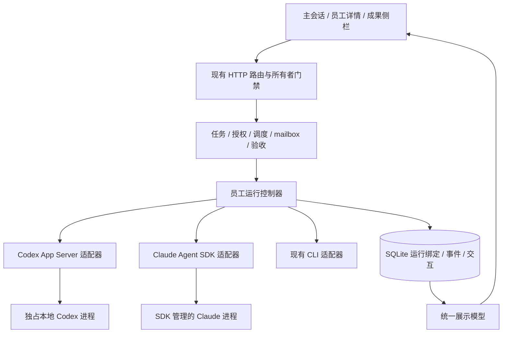

# 外部 Agent 运行与协作工作台改造方案

日期：2026-10-30。状态：**设计提案，未实施**。本轮授权仅为编写设计文档，不授权安装依赖、修改源码、迁移数据库或运行真实员工。所有任务均为待领取；本文的接口、类型、表和模块名均为拟议契约，不能作为当前产品能力说明。

## 1. 目标、范围与决策

将 Codex 接入 App Server、Claude 接入 Agent SDK，同时让主会话能够查看员工过程、发送指导、回答问题、检查成果与继续任务。保留 ApiX 的任务 DAG、版本化授权、预算、worktree、mailbox、可信验证和交付冻结规则。

推荐方案 A：在现有 Node/HTTP/SQLite 架构内增加薄运行适配层和统一展示模型，按员工显式启用新 backend，其他 CLI 保持原状。一个活跃 Run 独占自己的原生进程/SDK 查询；原生历史可以持久化，但不建立跨员工共享进程池。

可行替代方案 B：仅接入两个后端，仍按一次任务一次输入工作，不提供运行中输入、问题桥接与原生延续。B 改动较小，适合兼容性验证，但不能兑现完整协作体验。若阶段 D0 无法确认认证、配置或 Windows 停止行为，保留 CLI，暂停对应 backend；不能以自动重跑掩盖不兼容。

| 项目 | 方案 A | 方案 B |
| --- | --- | --- |
| 用户收益 | 执行可见、可交互、成果可审查与延续 | 主要改善接入和结构化事件 |
| 成本 | 后端、存储、前端与恢复联动，中等偏大 | 运行层为主，中等 |
| 迁移方式 | D0–D4 分阶段、逐员工启用 | D0–D2，保留以后扩展空间 |
| 不采用条件 | 接入兼容性未通过，或无持续协作需求 | 明确要求运行中指导与用户交互 |
| 退出与回退 | 停止并核对当前 Run，后续 Run 改回 CLI | 同左，已有原生历史保留 |

本设计不迁移 Vue，不把 HTTP 改成 Electron IPC，不替换 SQLite，不引入 Agent 编排框架，不改主助手模型循环，不新增自动升级、登录代管、浏览器、交互终端、厂商内部子 Agent 或新的 OS 文件沙箱。后续如复制上游实质代码，应保留 MIT 版权与许可；本轮仅做设计参考。

### 收益与可测量边界

| 目标场景 | 预期变化 | 验收信号 |
| --- | --- | --- |
| 用户中途补充要求 | 不再只等员工主动轮询 mailbox | 可区分已保存、已接收、已排队、处理有结果 |
| 员工需要回答或授权 | 在主会话/员工详情处理 | 能定位员工、任务、Run 和有效请求 |
| 原生一轮结束 | 不再依赖进程退出判断业务完成 | 结果、资源停止、结算、交付依次正确 |
| 刷新或重新打开历史 | 过程与状态可重建 | 实时与历史展示模型一致，不执行历史动作 |
| 任务需要修订 | 检查后使用原生历史继续 | 新 Run、新凭据、新预算，旧记录不复活 |

当前并发上限沿用 scheduling/execution 配置，不因 SDK 自动提高。实际并发负载、常驻内存、启动延迟、停止延迟、事件吞吐与费用变化均为 UNKNOWN；D0 记录单员工与现有并发配置下的基线，D2 同任务比较。不得宣称模型更聪明、必然省 Token 或执行加速。首版不为未知吞吐引入事件总线或微服务。

## 2. 证据基线与参考映射

ApiX 阅读基线：本地 HEAD `a90901470477810c0f320413e6505187ac446e12`，同时存在其他任务的未提交修改。以下为 2026-10-30 阅读到的工作区实现，后续实施前须重新核对，不能把 HEAD 当成完整工作区快照。

| 已观察的现状 | 事实源 | 目标差距 |
| --- | --- | --- |
| Codex exec JSONL、Claude stream-json；能力统一声明不可恢复 | [runtime-adapters](../../src/agents/runtime-adapters.ts) | 能力按 backend/版本报告 |
| launch、handleNative、stopRun 直接持有 ChildProcess；退出后收尾 | [control-plane](../../control-plane.mjs) | 业务流程与通信解耦 |
| 额度/模型只读查询已使用 App Server | [agent-settings](../../src/agents/agent-settings.ts) | 复用必要通信基础，执行仍独立管理 |
| 供应商配置主要产出 env/CLI args | [agent-providers](../../src/models/agent-providers.mjs) | 配置意图与各后端编码分离 |
| 已有员工 Token 表与原生用量解析 | [employee-insights](../../src/agents/employee-insights.ts) | 新事件、多轮和快照口径 |
| 沉默超时、进度请求、故障分类及恢复已有实现 | [健康检测](../../src/coordination/agent-health.mjs)、[恢复](../../src/coordination/workflow-recovery.mjs) | 识别等待交互，不能伪造心跳 |
| 交付活动判断仍有 child.exitCode 依赖 | [control-plane](../../control-plane.mjs) | 改为运行控制器报告活动/停止事实 |
| 前端已有助手、协调、员工、事件和交付视图 | [assistant-view](../../web/assistant-view.ts)、[员工](../../web/employee.ts)、[事件](../../web/task-events.ts)、[交付](../../web/delivery-view.ts) | 紧凑员工行、分轮过程、交互区与统一成果入口 |
| Windows 桌面后端已有 Job Object 监督 | [desktop/backend](../../desktop/backend.cjs)、[命令生命周期](../../src/execution/command-lifecycle.ts) | 实测新原生进程是否完整受管；Job 不等于文件访问沙箱 |

上游固定提交：`TheSyart/emperor-agent@d5625438df6051061050b5415ffe2c25c60a6acb`。其文档自己的核验日期和测试声明属于上游证据，本轮没有复跑。参考入口：

- [E1：架构总览](https://github.com/TheSyart/emperor-agent/blob/d5625438df6051061050b5415ffe2c25c60a6acb/docs/architecture/overview.md)：学习 Core/运行/展示职责；不迁移其 Vue、IPC 和日志存储。
- [E2：运行接口](https://github.com/TheSyart/emperor-agent/blob/d5625438df6051061050b5415ffe2c25c60a6acb/packages/core/src/harness/delegation/types.ts)：学习会话、回合、统一事件与 close 结果；不复制完整类型体系。
- [E3：Codex 适配](https://github.com/TheSyart/emperor-agent/blob/d5625438df6051061050b5415ffe2c25c60a6acb/packages/core/src/harness/delegation/adapters/codex.ts)、[E4：Claude 适配](https://github.com/TheSyart/emperor-agent/blob/d5625438df6051061050b5415ffe2c25c60a6acb/packages/core/src/harness/delegation/adapters/claude.ts)：参考双向交互、配置来源和宿主管理进程。E3 对超出委派策略的权限请求拒绝，不能据其界面推断外部工具都交给用户审批。
- [E5：会话与成果设计](https://github.com/TheSyart/emperor-agent/blob/d5625438df6051061050b5415ffe2c25c60a6acb/docs/architecture/external-agent-delegation.md)：学习稳定子身份、每轮新记录、原生历史延续和执行/验证分离；不复制其自动回退或认证文件处理。
- [E6：事件与展示](https://github.com/TheSyart/emperor-agent/blob/d5625438df6051061050b5415ffe2c25c60a6acb/docs/architecture/ipc-and-runtime-events.md)、[E7：布局](https://github.com/TheSyart/emperor-agent/blob/d5625438df6051061050b5415ffe2c25c60a6acb/docs/design/layout.md)、[E8：会话流](https://github.com/TheSyart/emperor-agent/blob/d5625438df6051061050b5415ffe2c25c60a6acb/docs/design/conversation.md)：学习按需展开、员工入口、成果侧栏与历史投影。

官方接口依据（阅读日期 2026-10-30，实施时重核）：[Codex App Server](https://learn.chatgpt.com/docs/app-server)、[Claude TypeScript SDK](https://code.claude.com/docs/en/agent-sdk/typescript)、[流式输入](https://code.claude.com/docs/en/agent-sdk/streaming-vs-single-mode)、[交互](https://code.claude.com/docs/en/agent-sdk/user-input)、[会话](https://code.claude.com/docs/en/agent-sdk/sessions)、[认证](https://code.claude.com/docs/en/agent-sdk/quickstart)。版本号、选项和认证渠道以 D0 实测锁定结果为准，不直接沿用上游的版本白名单。Claude 第三方产品认证要求不能由上游复用本机登录的做法替代。

## 3. 目标架构与模块清单



现有 API、coordinator、scheduling、permissions、autonomy、恢复、主助手 delegate 以及前端均为本次接口消费者。主助手只调整委派结果和指导的连接，不修改其推理、压缩或缓存策略。

| 模块 | 拟议改动 | 阶段 |
| --- | --- | --- |
| `src/agents/runtime-contract.ts`（新增） | 输入、能力、事件、RunHandle；仅运行域类型 | D1 |
| `src/agents/runtime-controller.ts`（新增） | 后端选择、事件落库、活动状态、一次收尾、交互和投递连接 | D1–D3 |
| `src/agents/cli-runtime.ts`（新增） | 迁出旧 CLI 通信，保留行为、错误和输出口径 | D1 |
| `src/agents/codex-app-server.ts`（新增） | stdio RPC、session/turn、输出、问题、审批、中断、关闭 | D2–D4 |
| `src/agents/claude-agent-sdk.ts`（新增） | query、流式输入、回调、会话、受管启动、取消与关闭 | D2–D4 |
| `src/agents/runtime-interactions.ts`（新增） | 请求存取、回答、失效；不另建审批框架 | D3 |
| `src/agents/runtime-adapters.ts`、`agent-settings.ts` | backend 能力探测；抽取真正共用的 App Server 请求匹配/握手 | D1–D2 |
| `control-plane.mjs` | 保留 launch 正常业务流程，替换 child 操作；setRun 只在最终收尾触发一次 | D1–D4 |
| `src/models/agent-providers.mjs` | 保留密钥隔离与供应商版本；配置意图分别编码成 CLI/RPC/SDK 输入 | D2 |
| `src/coordination/scheduling.ts`、`agent-health.mjs`、`coordinator.ts`、`autonomy.ts`、`workflow-recovery.mjs` | 预算/模型映射、等待交互、停止、监督和恢复接线 | D2–D4 |
| `src/agents/employee-insights.ts`、`src/messaging/mailbox.mjs` | 按轮计量；mailbox 仍是消息记录源，原生直投避免二次领取 | D2–D3 |
| `src/infrastructure/api-routes.mjs`、`server.mjs` | 增量 API；复用 owner、大小限制、错误响应；server 只在必要处接线 | D2–D4 |
| `web/agent-run-model.ts`（新增）、`web/agent-run-view.ts`（新增） | 纯展示折叠、紧凑员工行、分轮过程、交互卡；不维护业务权威状态 | D2–D3 |
| `web/assistant.ts`、`assistant-view.ts`、`coordinator.ts`、`employee.ts`、`employee-settings.ts`、`task-events.ts` | 工作台接线；保持现有 html 转义与会话导航 | D2–D4 |
| `web/execution-view.ts`、`delivery-view.ts`、`styles/` | 检查后继续、成果侧栏、响应式布局 | D3–D4 |
| `desktop/backend.cjs`、`scripts/prepare-desktop.mjs`、依赖清单与 THIRD_PARTY | 核验后代进程受管、SDK 运行资产与许可证；仅在确有缺口时修改 | D0、D2 |

新增业务代码只放 src/web；根既有 .mjs 不再增加文件。根入口引用 TS 编译产物仍走 `./dist/src/...`；生成文件从源头再生成。以上为边界清单，不要求每个文件都必须改动。

## 4. 身份、配置与运行接口

### 4.1 身份关系

`runtime=codex|claude|...` 继续表示员工种类，`backend=cli|codex-app-server|claude-agent-sdk` 表示接入方式。不能为新 backend 复制员工身份。任务仍是验收单位；Run 仍是一次尝试。

原生会话通过 Run 绑定记录关联；首版不引入独立的顶层会话实体。一个 Run 可含初始处理和运行中指导引出的多个回合，不能在首个回合结束时提前释放预算或冻结成果。后续“检查后继续”创建新 Run，通过 `resumeFromRunId` 继承允许延续的原生 session。

员工配置变更只影响之后的 Run。每次启动冻结 backend、运行时版本、供应商/模型/权限版本、工作区、需求版本和验收契约引用；变化后的执行必须重新通过现有准入，不能热切换认证或提升权限。

### 4.2 运行接口草案（不是已编译源码）

```ts
type Backend = 'cli' | 'codex-app-server' | 'claude-agent-sdk';
type DeliveryMode = 'steer' | 'queue';
type StopEvidence = 'quiescent' | 'unknown';
interface RuntimeCapabilities {
  steer: boolean; queue: boolean; questions: boolean;
  approvals: boolean; resume: boolean; usage: boolean;
  compatibility: 'verified' | 'unverified' | 'incompatible';
}
interface RunHandle {
  events: AsyncIterable<RuntimeEvent>;
  send(message: {messageId: string; content: string; mode: DeliveryMode}):
    Promise<{state: 'accepted' | 'queued'; nativeTurnId?: string}>;
  answer(interactionId: string, answer: InteractionAnswer): Promise<void>;
  interrupt(): Promise<void>;
  close(): Promise<{evidence: StopEvidence}>;
}
```

`open(input)` 接收已校验的 `projectId/taskId/runId/employeeId/runtime/backend/cwd/prompt/model/env/configSnapshot/resumeFromRunId/signal`，返回 RunHandle。输入的 cwd、env 和配置只由宿主构造，不能接受前端传入任意目录、环境变量、命令或原生 session ID。业务值在入口校验一次，适配器仅解析不可信原生协议。

能力探测失败必须暴露原因，不能因 CLI 文件存在就声明可交互/可恢复。CLI backend 的能力按既有实测行为返回；旧适配器不伪装支持 send/answer。D0 锁定兼容组合，D2 对原生握手再核对必需字段；不先建设完整上游自动升级和协议摘要平台。

### 4.3 原生接入

**Codex**：独占 stdio App Server → initialize/initialized → thread/start（或 D4 thread/resume）→ turn/start；指导用 turn/steer 并绑定当前 turn；完成看原生 turn 状态；停止用 turn/interrupt，再关闭确认。使用所选版本生成的协议类型，不手改生成文件。自定义供应商继续走 Responses，ChatGPT/API 通道与模型配置不能混用。未知请求明确返回不支持，不默认批准。

**Claude**：显式 options 调用 Agent SDK；env 按 Run 传入，不修改全局 process.env；流式输入区分排队与处理；session_id 持久关联。通过 SDK 支持的启动接缝将子进程纳入宿主管理（D0 先验证）。配置来源需列出项目规则、用户设置、hooks、skills、MCP 的加载/关闭策略，默认不因为 SDK 换了入口就引入新工具；保留已批准项目指令，避免既注入正文又重复自动加载。D0 比较旧 CLI 实际加载结果，任何不兼容差异必须明确呈现。

SDK 版本与本机 Claude 可执行版本分别记录。Windows 原生包、启动参数、停止行为、API Key/Bearer 中转兼容性、认证支持范围为实施门槛；未验证的通道继续保留 CLI。不得复制上游 macOS 的 auth.json 链接、钥匙串处理、Seatbelt 参数或其关闭厂商沙箱的策略。

## 5. 生命周期与持久化草案

### 5.1 生命周期

任务沿用现有 status；新增 Run 展示阶段 `preparing/executing/waiting_input/waiting_approval/closing`。停止仍走现有 stopping，结果仍为 completed/failed/cancelled/unknown/blocked。新阶段不当作新任务终态传播给 DAG。

正常结束：原生回合完成 → 确认没有已接受但未处理的输入 → 关闭输入与资源 → 确认不再活动 → 保存报告/交付引用 → setRun 终态一次 → 预算结算与依赖推进。执行 completed 只表示可进入验证；accepted 仍由既有验收决定。

停止：先登记停止意图并停止接收新输入，取消本地未送队列及待交互 → 原生中断 → 关闭资源。原生中断 ACK 不足以证明所有子进程停止；无法确认时 unknown，保持现有检查和预算未知语义。不能把进程非零退出一律当作已取消，也不能把清理失败当正常完成。开始、事件循环抛错和异步 spawn 失败都必须进入同一收尾入口。

用户回答等待期间暂停沉默失联判定；保留现有运行总期限，不偷偷延长预算。交互有效期拟定 15 分钟，且受剩余运行期限限制；超时拒绝该请求、请求停止本次运行，结果按停止证据确定。同步调整 coordinator/autonomy 的进度监督；连接活动、工具活动和模型进展分开，不能靠给模型发送无意义消息伪造健康。

### 5.2 SQLite 增量记录

以下为逻辑字段与约束，D1 编写实际迁移时对照最新 schema_migrations 分配版本；本文不预占版本号、不提供可执行 DDL。时间为 UTC ISO 字符串，前端按用户时区显示。

| 拟议表 | 关键字段 | 唯一性、归属与用途 |
| --- | --- | --- |
| `employee_runtime_settings` | employee_id、backend、version、updated_at | employee_id 主键；缺行视为 cli，不批量改旧员工 |
| `agent_run_bindings` | run_id、backend、executor_version、sdk_version、native_session_id、resume_from_run_id、cwd、config_fingerprint、phase、stop_evidence、created_at、updated_at | run_id 主键/FK runs；归属从 runs→tasks→project/employee 推导；原生 ID 不作授权依据；多 Run 可引用同一原生会话 |
| `agent_runtime_turns` | id、run_id、native_turn_id（可空）、input_message_id、status、usage_json、started_at、ended_at | 宿主 id 主键；有原生 ID 时在 Run 内唯一；Claude 无原生 turn ID 不伪造厂商 ID；用量原始快照与口径一起保存 |
| `agent_runtime_interactions` | id、run_id、turn_id、native_request_id、kind、payload_json、permission_version、state、answer_request_id、answer_hash、answer_json、answer_delivery、expires_at、answered_at | id 主键；同 Run+原生请求去重；kind=question/approval，state=pending/answered/denied/expired/invalidated；answer_delivery=not_sent/accepted/unknown 区分用户选择与原生接收；只保留可公开且脱敏内容 |
| `agent_runtime_deliveries` | message_id、run_id、turn_id、mode、state、native_ref、error_code、updated_at | message_id+run_id 唯一；FK mailbox 消息与 Run；记录直投，不另建一套业务消息 |

不在这些表保存 API Key、完整 env、原始认证文件或私有推理。配置指纹引用非敏感版本与必要字段，不能用完整密钥生成面向前端的摘要。新表随 Run 关联清理，运行中、停止未知和恢复所需原生历史不能被普通“关闭面板”删除。已有项目/任务保留策略不因本设计变化；增加删除/归档路径时纳入迁移回归。

迁移只增加结构，旧记录不回填猜测 session、用量或 backend 事实；历史页面显示“旧 CLI 记录，原生会话未知”。回退停止写新表并保留数据，不在回退时删表；旧版本兼容必须以可丢弃数据库副本验证。

### 5.3 事件契约

复用现有 Run 事件持久化入口，统一事件带 `schemaVersion:1`、`runId`、宿主 event ID、可选 `turnId/nativeEventId`、`kind`、`occurredAt`、`payload`。对客户端不暴露 env、凭据、任意原生文件路径和私有推理；文件通过既有项目/交付读取入口检查。

| kind | 必需 payload | 消费者 |
| --- | --- | --- |
| runtime.bound | backend、版本、能力、是否有原生会话 | 员工/任务详情 |
| turn.started / turn.finished | 宿主 turnId；完成时 status、summary、failureCode? | 展示、运行控制器 |
| output.delta | text | 当前输出节点 |
| tool.started / tool.finished | toolCallId、name、公开摘要；结束时 status | 过程组 |
| interaction.opened / interaction.resolved | interactionId、kind、状态；详情经交互 API 读取 | 待处理区 |
| message.delivery | messageId、mode、state | 指导状态 |
| usage.updated | turnId、口径、原生计数字段、source | 员工用量 |
| runtime.closed / runtime.error | 停止证据或错误码/公开原因 | 控制器、恢复、故障展示 |

厂商原始事件不能无条件整包回传给前端。展示事件与事实保留分工明确：原始可用量字段保留用于计量核对，展示摘要可截断并标注。先沿用既有消息/输出大小限制；D0 测事件大小，必要增量限制在实施审查说明，不预设无限日志。

## 6. HTTP API 与消息交互

以下新增 API 均为 v1 草案，放在现有 /api 路由中，不另开服务。沿用所有者认证、响应错误格式与消息/配置大小上限；浏览器只传 ApiX ID。旧任务批准、停止、交付和恢复入口继续有效。

| 拟议接口 | 输入 | 输出/行为 |
| --- | --- | --- |
| `POST /api/employees/:id/runtime-settings` | backend、expectedVersion | 保存 settings/version，仅影响新 Run；不支持组合报错 |
| `GET /api/runs/:id/runtime` | 无 | backend、phase、能力、公开版本、当前 turn、pending 交互数、恢复可用性；不返回凭据/原生历史路径 |
| `GET /api/runs/:id/runtime-events` | afterId 或 beforeId、limit（默认100，最大200） | items、nextCursor、hasMore；游标绑定 Run，两个方向互斥，稳定按宿主事件 ID 分页 |
| `POST /api/runs/:id/messages` | requestId、content、mode=steer/queue | messageId、runId、delivery=saved/accepted/queued/rejected/unknown；不会宣称已执行 |
| `GET /api/runs/:id/interactions` | 无 | 尚有效的脱敏问题/审批、期限、所属任务/员工与允许答案结构 |
| `POST /api/runs/:id/interactions/:interactionId/answer` | requestId、answer、expectedPermissionVersion | 本次处理状态；question 用 answers，approval 用 approve/deny；禁止客户端扩充 tools/env/目录 |

runtime-settings 增量并入现有员工设置查询响应；任务 details 增加 runtime 摘要和历史 Run 入口，原字段保持。事件首版通过现有刷新机制按游标增量读取，不为此切换 WebSocket；后续如确需推送，仍使用同一事件 ID 补读。任务未活跃时停止轮询。

错误沿用现有响应封装，增加稳定 code：`RUNTIME_UNSUPPORTED`（400）、`RUNTIME_INCOMPATIBLE`（409）、`RUN_NOT_ACTIVE`（409）、`STALE_TURN`（409）、`INTERACTION_EXPIRED`（409）、`PERMISSION_CHANGED`（409）、`DELIVERY_UNKNOWN`（409）、`IDEMPOTENCY_CONFLICT`（409）。认证仍按现有 401/403；不可访问资源不向请求方泄露其他项目详情。能力不足明确失败，不自动把 steer 改成 queue。

### 6.1 消息投递与幂等

所有员工指导入口（协调会话 instructions、助手指导、员工详情）汇入同一服务：确认当前执行与权限 → 按 requestId+正文/模式指纹幂等保存 mailbox → 建直投记录 → 调原生输入 → 保存接收状态。requestId 复用现有助手消息的 8–100 位格式，同 ID 不同内容报冲突。

新后端的指导由宿主领取/标记为原生通道投递，不能再作为普通待领取指导让员工重复轮询。保留 mailbox 原有完成语义；accepted 仅表示运行时接收，queued 表示之后处理，不能自动 complete。员工仍可使用 mailbox 汇报与知识库，不把业务问题和进度自述当执行事实。

传输断在“可能已接收”处时记 unknown，不自动重投；重启后显示待核对。这里不承诺 exactly-once。相同 requestId 的浏览器重试返回已有记录，不触发第二次原生输入。新 Run 不自动搬运旧指导。

Codex steer 指向服务端记录的当前 turn；Claude 输入按 SDK 能力排队。用户消息保持原文，来源区分 user/apix；不凭来源提高权限。D4 的续聊在终态之后创建新 Run，不借 messages 接口直接复活终态 Run。

### 6.2 交互与授权

问题与审批共用展示位置、分别建模。问题回答不授予工具权限。审批必须显示操作、原因、员工/任务与作用范围，只允许批准本次原生请求或拒绝，不新增“以后全部允许”。permission_version/expectedPermissionVersion 是宿主根据项目、员工及相关工具策略版本生成的不透明快照标识，客户端只能回传，不能藉此改变策略。回答前按现有权限版本核对；请求随 Run 关闭、断连、需求/权限失效而失效，重启不重新执行旧批准。

相同 answer_request_id 与答案指纹重复提交时返回原处理记录，不重复回复原生请求；同 ID 不同答案或已被其他答案处理报冲突。持久记录与原生回复之间断连时标记待核对，不把“用户已选择”当作“原生已收到”，不自动重发批准。

现有任务批准仍是启动前置条件；read_only 继续服从现有准入，不因有审批卡就放开写任务；ask_approval 在原生确实需要授权时交给用户；full_access 仍受既有边界约束。不能承诺所有工具都会触发原生回调，不能通过分析任意 Bash 文本冒充完整 OS 文件隔离。

多个员工同时等待时列出待处理数量，按创建时间处理可见项，卡片始终带 interactionId/runId。切换任务后旧回答不得落到新卡片；提交失败保留草稿与原因。问题/审批过期后不能继续点击旧按钮。

## 7. 前端工作台设计

沿用现有前端与 html.ts。主会话是默认入口，员工管理/供应商配置保留在管理入口；不把所有后台模块塞进对话，也不复制一套员工身份树。

```text
┌──────────────┬────────────────────────┬────────────────────┐
│ 项目 / 会话    │ 主会话 或 员工任务详情    │ 按需打开的成果侧栏   │
│              │ 用户消息                │ 文件差异            │
│ 管理入口      │ ApiX 过程摘要            │ 实际验证与限制       │
│              │ Codex：当前动作 / 状态   │ 交付与冻结记录       │
│              │ Claude：等待回答         │                    │
│              │ 最终回答                │                    │
│              │ 待处理交互 / 输入区      │                    │
└──────────────┴────────────────────────┴────────────────────┘
```

### 7.1 展示节点与页面连接

`AgentRunView` 草案字段：`projectId/taskId/runId/employeeId/name/runtime/backend/phase/summary/currentAction/elapsed/pendingInteractions/delivery/verification/stopEvidence`。名称取任务名称/摘要，员工来源单列；字段来自持久事实，不根据文案猜成功状态。厂商私有思考不进入界面。

1. 主会话显示紧凑员工行：任务名、Codex/Claude 来源、当前动作、状态与用时。单击打开当前任务/Run 详情，返回后保持主会话滚动与草稿。后续 Run 不能让旧行悄悄指向另一任务。
2. 过程组默认收起；运行中显示当前公开动作，完成后“已处理 N 步 · 用时”。工具输入/输出按需展开，原始事件留在诊断入口。没有原生工具事件时显示未知，不补造步骤。
3. 员工详情按 Run/回合排列，只显示本任务可公开提示、输出、工具与问题；已完成只表示执行结束，验证/验收另列。
4. 输入区提供本后端实际支持的“运行中指导”或“排队补充”。未接收失败保留草稿；已经保存但投递未知显示待核对，不能诱导再次发送。
5. 提问/审批卡在输入区附近展示，支持收起为“等待处理”；多个请求有列表，不用全屏弹窗互相遮挡。当前请求失效时解除占位，保留处理记录。
6. 成果侧栏先整合现有文件差异、可信检查、交付冻结和验收入口；沿用原来的应用/集成审批，不新增一键自动合并，也不把执行报告当测试证据。

### 7.2 展示与交互验收约束

- 同一份纯折叠函数处理历史和新增事件；按 Run+事件 ID 去重，切换任务丢弃旧响应。发现分页缺口按游标补读，不将不同 Run 的 ID 比较。
- 文本增量只更新对应输出节点；不因每个 token 重拉员工列表或完整任务快照。首版无需复制上游通用 assembler/虚拟化框架，出现实际性能证据再扩展。
- 接近底部才自动跟随；用户向上阅读不被拉回；展开状态按稳定节点 ID 保存。历史加载失败有重试，不能显示为空且伪装加载成功。
- 1280px 可并排主会话与成果；窄窗口成果改抽屉，主会话输入不被挤出；具体最小宽度在 D2 桌面验证确定。
- 状态同时有文字，不只靠颜色；展开、提交、关闭能用键盘操作；卡片带明确标签。所有原生内容通过 html.ts，不能直接插入厂商 HTML 或任意链接协议。
- 不显示虚构 Token/费用/预计完成时间。停止中与停止未确认分开，未运行验证明确显示“未验证”。

## 8. 用量、预算、恢复与回退

### 8.1 用量

保留员工用量事实源，不把外部员工请求冒充主助手的逐 API 请求。新适配按宿主 turn 保存 input/output/cacheRead/cacheWrite/reasoning 等原生字段及 source、是否累计的口径；unknown 保留 null。仅从已确认单回合记录汇总到现有 `apix_run_usage`，展示投影不反写事实。

Codex thread 累计快照不能逐条相加；优先用明确的回合用量，只有同会话同口径且连续的累计基线可计算差额。Claude assistant 中间 usage 与最终 result 不能重复累计；不同 SDK 版本的 result 是单轮还是会话累计在 D0 固定夹具核对。费用保持估计/报告值与实际账单分离；没费率或币种不匹配不算实际金额。

预算预留贯穿一个 Run 的所有回合和排队输入，已有宿主预算闸门继续有效；原生 maxBudget 仅作可用时的补充，不代表精确硬上限。未知执行的预留不随断连释放，重试仍通过原有故障策略与预算授权。

### 8.2 检查后继续

D4 扩展现有任务恢复入口，增加 `continuation=fresh|native` 与 `resumeFromRunId`，旧请求默认 fresh。普通对话恢复仍走其既有入口，两条路径共享恢复资格判断；不建立绕过审批的原生 resume API。

native 条件：同项目/任务延续链、同员工与 backend、原生历史可读、工作区存在且指纹检查通过、供应商/需求/权限及验收约束兼容、旧运行已确认停止。未知旧进程继续要求现有人工核对。改变员工、backend、供应商或不兼容约束则不提供 native，用户可显式选择 fresh；不能静默回退。已 accepted 的任务保持终态，新增工作走新任务及确认流程，不借原生会话继续改写已验收交付。

原生继续创建新 ApiX Run、新 mailbox 凭据、新预算；不复用旧待审批回调和未确认指导。若需求或验收变化，先走现有重新确认。自动修复/改派首版继续 fresh，不因 SDK 支持恢复而扩大自动重试范围。

### 8.3 灰度与回退

- 新配置缺省 cli，用户按员工选择新 backend。backend/能力变动纳入现有调度配置版本/指纹检查，只影响之后运行。
- 双轨兼容窗口从 D2 首次启用起，结束日期待验收后决定；本提案不删除 CLI。退出条件：目标场景真实通过、历史记录与回退可读、普通任务/自动协作/桌面回归通过，且用户明确决定替换默认值。
- 触发回退：停止无法确认、事件错归属、重复执行/结算、供应商配置串用或桌面资产缺失。先停止/核对活跃 Run，再把后续执行配置切回 cli；保留新增表、原生历史和失败证据。
- 回退验证：旧接口可读旧任务、新记录可显示只读摘要，旧 CLI 可以执行新任务。不能在同一 Run 中自动换后端重跑。

## 9. 分阶段任务与验收矩阵

所有任务状态均为 PLANNED/待领取；以下阶段不是执行授权。真实模型验证可能产生费用，按仓库已有真实测试审批流程单独安排；离线握手、夹具和 UI 测试不冒充真实模型验收。

| 阶段/任务 ID | 工作与依赖 | 可审查交付 | 阶段验收 |
| --- | --- | --- | --- |
| D0-01 | 对照本机 Codex/Claude、SDK 与供应商配置，核对必要方法和认证 | 版本/能力/配置差异矩阵；UNKNOWN 列表 | 每项必需能力有离线或真实证据标签；不兼容项保持禁用 |
| D0-02 | Windows 原生启动、后代停止、中文输出、安装包资产验证 | 临时项目回执；单员工/现有并发基线 | 无收费步骤的真实握手通过；停止未知能正确报告；认证/真实编辑未测则明确阻塞上线 |
| D1-01 | 统一契约、旧 CLI 迁出、所有 child 调用方替换 | 运行接口、旧适配、消费者清单 | Pi/Codex/Claude/其他 CLI 的原有开始/输出/失败/停止不退化 |
| D1-02 | 增量迁移、Run 绑定、一次收尾、纯展示事件 | 可丢弃 SQLite 迁移/回退记录 | 旧数据读取不变；无重复终态、预算或依赖推进 |
| D2-01 | Codex App Server；依赖 D0/D1 | session/turn/事件/用量/停止适配 | 原生完成而进程未退出时正确收尾；失败/断连不假成功 |
| D2-02 | Claude Agent SDK；依赖 D0/D1 | query、配置隔离、受管启动和停止 | 两个供应商 env 不串用；中文、异常、关闭可追踪 |
| D2-03 | 员工 backend 设置、状态行、分轮详情、历史补读 | 前后端最小闭环 | 刷新/切会话/历史与实时一致；能力不足禁用对应操作 |
| D3-01 | mailbox 直投、消息幂等、steer/queue、停止取消队列 | 投递记录与统一指导服务 | 同请求不重复输入；可能已接收时不自动重投；已停止后队列不继续执行 |
| D3-02 | 问题/审批桥接、健康与监督等待、输入区卡片 | 有效期和权限版本检查，UI 待处理列表 | 多员工问题不串答；等待不误报失联；过期/权限收紧/关闭后拒绝旧回答 |
| D4-01 | 检查后原生延续；依赖 D2/D3 | 资格检查、恢复界面和新 Run 关联 | 新 Run/新凭据/新预算；工作区改变及旧进程未知不静默恢复 |
| D4-02 | 成果侧栏、验证/交付接线、桌面与双轨回退 | 差异/检查/冻结入口；迁移回退报告 | 原生完成不等于 accepted；活跃/未知写入不得冻结；回退后旧 CLI 可用 |

### 必须覆盖的失败与一致性场景

| ID | 场景 | 预期结果 |
| --- | --- | --- |
| A01 | 同一原生完成结果重复到达、完成后进程才退出 | 交付保存、预算结算和依赖推进各一次 |
| A02 | 连接在输入接收后断开 | delivery unknown，保留消息，不自动重发 |
| A03 | waiting_input/approval 超过沉默阈值 | 不误判失联；总期限/交互期限照常生效 |
| A04 | 停止发生在启动前、排队中、等待回答或工具执行中 | 阻止新增执行；清队列/交互；按停止证据返回 cancelled 或 unknown |
| A05 | 回答属于旧 Run、过期请求或权限版本 | 409/既有拒绝响应；不调用原生批准 |
| A06 | 切换员工详情时旧请求迟到、历史事件重复 | 不污染新任务；节点去重；历史无副作用 |
| A07 | 两个原生回合、累计快照与重复 result | 用量不重计；缺失为 null；预算不提前释放 |
| A08 | 原生完成但仍可能写文件、关闭无法确认 | 交付保持不可冻结；结果按未知处理 |
| A09 | 服务重启，原生会话仍有历史但进程归属未知 | 不自动执行；经现有恢复核对后新建 Run |
| A10 | backend/供应商/工作区变化与旧配置重试 | 重新准入；不复用旧授权或默默切通道 |
| A11 | 旧库升级、再次启动、停用新后端、旧记录展示 | 增量幂等；数据保留；旧 API/CLI 继续可用 |
| A12 | 原生文本含 HTML、危险链接或日志带凭据 | 统一转义/链接限制/脱敏；不读取任意原生路径 |

### 验证入口与证据状态

沿用仓库工具：新增 Node 原生测试放 test/，已有假 CLI 扩充为协议对端；使用真实适配器连接本地夹具，不在测试里复制业务逻辑。迁移使用可丢弃数据库，过程停止使用临时工作区。测试文件名和 package 清单在实施时增加，不在本轮创建。

- 静态/构建：`npm run build`、`npm run check`（源码删改后按 stale-dist 规则处理）。
- 回归：`npm test`；重点 agent-providers、project-agent-settings、agent-health、messaging、scheduling、workflow-recovery、coordinator、delivery、execution-ui、html。
- 浏览器：沿用 `npm run test:ui:task-flow`、`npm run test:ui:recovery`、`npm run test:ui:providers`、`npm run test:ui:html`；在现有浏览器流程增补指导、双员工交互和刷新场景。
- 交付：`npm run test:delivery`、`npm run test:delivery:browser`；桌面：`npm run test:desktop`、`npm run test:desktop:app -- <exe路径>`。启动验证服务不代表浏览器验收通过。
- 真机/真实模型：确认版本和费用授权后，同一临时任务比较 CLI 与新 backend 的读/写/工具/追问/停止/继续；保存配置指纹、工作区、模型、实际用量及未知费用。不把离线假 Responses 结果说成模型能力。

实施验收记录必须包含版本组合、命令/操作、退出结果、证据路径、通过项、失败项和未测项，并按仓库规则自审最终 diff。当前全部运行验证为 **未执行**，本文仅完成源码/文档分析。

## 10. 风险、待定项与实施前检查

| 项目 | 当前状态 | 解决阶段/停止条件 |
| --- | --- | --- |
| 本机版本与官方最新接口差异 | UNKNOWN | D0 锁定；必要能力缺失暂停对应接入 |
| Claude API/中转/认证支持范围 | UNKNOWN | D0 核对与小任务验证；不能用上游登录实现代替支持依据 |
| Windows SDK 后代进程停止与运行资产 | UNKNOWN | D0/D2；无法确认停止不得上线写任务 |
| CLI 用户配置与 SDK 明确加载规则的差异 | UNKNOWN | D0 做差异矩阵；不得静默改变工具、hooks 或权限 |
| 会话文件保存位置与归档寿命 | 待定 | D0 固定原生配置根；D4 验证恢复与清理，不写用户项目目录 |
| 输入、事件增长与界面性能 | 未测 | D0/D2 测基线；先复用分页与现有输出限制 |
| Token/费用收益与任务质量 | 未测 | D4 真实对照；不作为接入成功的先验承诺 |
| 工作区其他任务的并行改动 | 已观察 | 实施前重读源码与版本，保留本轮无关改动 |

文档完成不表示开发已开始。下一轮可以按 D0、D1 的明确范围领取任务；扩展权限、自动恢复策略、厂商默认行为、平台边界或删除 CLI，均不包含在本文当前建议的最小实现内。

返回：[设计导航](README.md) · [功能索引](../INDEX.md)。
