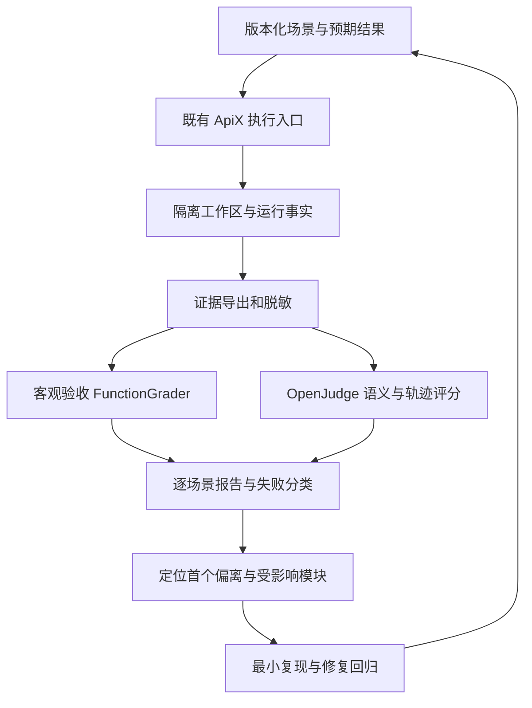

# OpenJudge Agent 测试与归因系统方案

日期：2026-11-02。状态：方案与离线可行性验证；尚未接入产品、CI 或真实模型评分。执行者：Codex 单 Agent，自审。

## 目标与本轮结果

建立“任务执行 → 证据采集 → 客观验收 → OpenJudge 过程评价 → 失败定位 → 修复复验”的闭环，回答任务有没有完成、失败发生在哪一步、原因有什么证据、修复后是否复现。

本轮实际执行：使用 Node 22.23.3 构建项目，运行既有 deterministic 的 logic/multi/large/logs/conflict 五类任务，5/5 通过、模型请求为 0；用固定提交的 OpenJudge FunctionGrader + GradingRunner 对真实报告执行两项评分，共 10 项通过，并验证一个合成失败记录得到 0 分。它验证接入链可行，不代表真实模型能力或整个产品已验收。证据见[本轮自审](../../协作/审查/2026-11/2026-11-02-OpenJudge测试系统规划与离线验证自审.md)。

## 当前系统与接入边界

| 已有能力 | 源码/入口 | 接入方式与缺口 |
| --- | --- | --- |
| 编码评测 | `scripts/evaluation/evaluate-coding-real.mjs`、`coding-evaluation-tasks.mjs` | 复用任务、真实 assistant-loop、隔离目录、预算和冻结快照判定；现有任务集小，不能覆盖员工和 UI 全链路 |
| 主助手事件 | `src/assistant/assistant-loop.ts` 的 assistant_events | 映射 tool_started/tool_result、协议修复、完成驳回、验证证据；需按执行实例配对，不按工具名称猜配对 |
| 命令证据 | `src/execution/command-lifecycle.ts`、`command-logs.ts` | 关联 operationId/outputRef、退出码、日志完整性和进程结束事实；预览截断不能视为执行失败 |
| 员工运行 | `src/agents/runtime-controller.ts`、`runtime-interactions.ts` | 复用公开事件、回合、指导、问题/审批和停止证据；旧 CLI 历史粒度不足时标未知 |
| HTTP | `src/infrastructure/api-routes.mjs` | 已有 runs/:id/runtime-events、tasks/:id/delivery 等；沿用 owner 认证与分页，不能假定已有统一 trace API |
| 交付 | `src/projects/task-delivery.mjs`、`src/assistant/assistant-delivery.ts` | 冻结快照与验证结果是事实源；员工自述、LLM 评分不能写回 accepted |
| 调度/恢复/预算 | `src/coordination/`、`src/recovery/fault-policy.ts` | 复用现有准入、恢复和账本；未知停止、未知费用不补零、不自动重跑 |
| 工程回归 | `test/`、`scripts/verification/`、`.github/workflows/ci.yml` | 保留 node:test、现有浏览器验证与 Windows CI；OpenJudge 作为补充评分层 |

需求尚未知：裁判供应商/模型、允许发送给裁判的数据范围、单批费用上限、真实员工并发、目标完成率/延迟、结果留存期限。先导预算未确定前只运行离线链路。

## 推荐方案与替代方案

**A（推荐）：Node 继续执行，Python OpenJudge 离线评审。** 主助手和员工分别导出统一的脱敏 JSONL，Python 读取冻结证据后评分；按需启动进程，不新增常驻服务、业务数据库或消息队列。依赖在独立 Python 环境中固定，上游不复制进仓库。第一期只接现有编码报告，再增加员工和 UI 场景。

**B（可行替代）：只做既有报告的离线评分与人工定位。** 保留两项客观 FunctionGrader 和逐项事件报告，不接真实裁判、不扩员工采集。成本最低，但不能评价复杂任务的工具选择、恢复质量和沟通质量；适合预算/外发策略暂未确定时长期使用。

暂不采用：让 OpenJudge 接管调度执行、用 AgenticGrader 再启动能修改项目的裁判、引入追踪平台和常驻 Python Web 服务。现阶段没有证据证明这些复杂度必要。若后续需要跨机器集中检索和大规模评分，再重新比较。A 的退出条件：锁定环境不能安装、裁判无法满足数据边界或校准误判过多；退回 B，不阻塞现有回归。

回退：停用评测入口，保留结果文件，继续原有 npm/CI 流程；不迁移生产表，不改变任务终态。新增依赖只属于评测环境，不进入 Electron 运行依赖。

## 系统流程与职责

场景编排、执行、采集、客观裁判、语义裁判、归因和报告是逻辑职责，不意味着启动七个 Agent。本轮不启动子 Agent；被测员工仅在未来显式选择对应场景后由 ApiX 原执行链启动。

客观验收先跑，语义评分可按预算仅选失败或抽样轨迹；LLM 不执行项目命令、不批准工具、不改变权限、不直接合并修复。被测输出是待评价的数据，其中出现的“忽略规则/判定通过”不能成为裁判指令。

## 版本和上游核查

核查提交：`070f7b8f2a3144f50788a9161c509c24130fb502`，源码声明 `0.2.0`，发行名 `py-openjudge`，Python >=3.10；本机 Python 3.11.9。固定源码提交不等于依赖已锁定；实施时另建独立环境、锁定依赖并保存安装和导入证据。

上游事实依据：

- [项目与安装元数据](https://github.com/agentscope-ai/OpenJudge/blob/070f7b8f2a3144f50788a9161c509c24130fb502/pyproject.toml)。
- [FunctionGrader](https://github.com/agentscope-ai/OpenJudge/blob/070f7b8f2a3144f50788a9161c509c24130fb502/openjudge/graders/function_grader.py) 支持自定义客观判定；[GradingRunner](https://github.com/agentscope-ai/OpenJudge/blob/070f7b8f2a3144f50788a9161c509c24130fb502/openjudge/runner/grading_runner.py) 支持 mapper 与并发。
- [轨迹评价](https://github.com/agentscope-ai/OpenJudge/tree/070f7b8f2a3144f50788a9161c509c24130fb502/openjudge/graders/agent/trajectory)、[工具评价](https://github.com/agentscope-ai/OpenJudge/tree/070f7b8f2a3144f50788a9161c509c24130fb502/openjudge/graders/agent/tool) 提供可选的过程维度，不能自动推导源码根因。

实际导入须用 `from openjudge.runner.grading_runner import GradingRunner`；当前提交的 `runner/__init__.py` 未导出该类，README 简写导入在本机失败。工具选择和参数检查评分器存在捕获异常后返回 0 分的路径，适配层必须把 Evaluation error 等异常结果归为 grader_error，不能记为被测失败；同时保留异常类型和调用状态，不能只靠一个分数分类。

## 数据契约（拟定，未实现）

每个 case 一个记录，事件按原始顺序导出；大日志/快照单独保存，以引用和 SHA-256 关联。不要为评价复制完整生产数据库。

| 分组 | 必须记录 |
| --- | --- |
| 版本 | schemaVersion、batchId、caseId、attemptId、repositoryHead、dirtySourceHashes、taskSetSha256、scenarioVersion、graderVersion、rubricSha256、OpenJudge commit、Node/Python/依赖锁版本 |
| 配置 | 被测模型/运行后端、裁判模型及采样参数、工具定义和权限公开快照、优化模式；密钥和原生会话标识不导出 |
| 关联 | projectId/sessionId/taskId/runId/turnId（适用时）、源 eventId、调用 ID、operationId、证据引用；缺失为 null 并注明不可关联 |
| 输入输出 | 用户目标、公开回答、工具参数/结果、预期断言、快照摘要；不采集私有思考 |
| 运行事实 | status、verificationStatus、acceptanceStatus、stopEvidence、exitCode、timedOut、费用/用量及来源；未知为 null |
| 证据 | 原始报告摘要与 hash、脱敏轨迹、日志/快照 manifest、完整性状态、采集范围和缺口 |
| 结果 | 每个 grader 的状态/原始分/量表/理由/证据 ID、硬性失败、首个偏离、归因置信度及复现命令 |

主助手映射：user message → user；公开决策 → assistant；tool_started → assistant.tool_calls；tool_result → tool；使用显式调用 ID，若历史只有串行相邻关系则记录推导依据，不伪造原生 ID。缺工具定义则不执行工具选择评分。员工映射独立实现，不能用主助手解析器解释厂商原始事件。

导出时对入口记录做一次结构校验，内部传递确定类型；公开事件分页读到本批固定终点，按 Run+事件 ID 去重；执行尚未结束或分页缺口未补齐则标 incomplete，不评分为成功。只做已有真实分页/重试需求，不新增通用追踪框架。

## 验收与评分

| 层 | 内容 | 判定来源 |
| --- | --- | --- |
| 工程 | 构建、静态检查、单测、HTTP/浏览器 | 既有 npm/node:test/verification 结果 |
| 任务硬门槛 | 冻结快照满足断言、用户原文件保留、权限拒绝生效、停止与验证证据完整 | 宿主事实 + FunctionGrader；无法证明则 unknown |
| 工具质量 | 选择和参数是否符合任务，是否反复无效调用 | ToolSelectionGrader、ToolParameterCheckGrader；Schema 合法性仍用现有校验器 |
| 轨迹质量 | 正确性、恢复过程、步骤效率 | TrajectoryAccuracyGrader、TrajectoryErrorRecoveryGrader、TrajectoryStepEfficiencyGrader；按场景选择 |
| 回答质量 | 是否与实际产物和验证事实一致，是否满足用户指令 | 针对 ApiX 的冻结 rubric，必要时使用已有通用 grader |

先分开显示，首期不生成可抵消硬性失败的总分。工具选择常用 1–5、参数检查为二值，各评分器范围单独核查；原始分不能直接加权。后续若需要综合展示，必须先定义归一化、缺失维度和权重，但不影响硬门槛。

最终状态：pass（硬门槛满足）、fail（有明确反证）、unknown（证据不足）、not_run（未执行）、grader_error（评分器/供应商/格式失败）。基础任务通过与语义评价分开；没有 LLM 评分时仅标语义评价未运行，不称全面通过。预期失败场景以“成功阻止未授权动作”等预期断言为通过标准。

先导建议：从 5 个编码任务开始，每个真实模型配置重复 3 次，共 15 个任务尝试；本地基线仅 5 次。语义初期每条最多 2 个相关 grader、并发 1，因此完整语义先导至多 30 个逻辑评分调用，供应商重试和修复调用另外计数且不得超批次上限。实际金额与输入 Token 上限须按所选供应商确定，不在方案中编造价格。

裁判校准：从实跑轨迹抽取通过、失败、证据缺失、声明成功但产物错误等约 20 条，先由用户/维护者标注，再比较误放行和误拒绝；合成负例必须单列。未完成校准前语义分只用于诊断。模型/rubric 更新后复评同一留存集；不得用待测集调好 rubric 后再称独立验收。

## 场景矩阵与优先级

| 阶段 | 场景 | 必须验证的事实 | 首要定位模块 |
| --- | --- | --- | --- |
| P0 | logic/multi/large/logs/conflict | 正确计算、跨文件保留、大文件局部编辑/CRLF、读取尾日志、外部编辑冲突后重读 | assistant-loop、coding-files、command-logs、assistant-delivery |
| P1 | 拒绝写入/越界路径/未批准命令 | 被拒绝动作无副作用；正常授权流程可继续 | tool-governance、project-io、execution-control |
| P1 | 伪完成/命令失败/不完整日志 | 不能仅凭员工自述或 exitCode=0 放行 | assistant-verification、command-lifecycle、task-delivery |
| P1 | 模型超时/参数错误/额度耗尽 | 错误类别明确、终止请求、后续任务不偷跑 | model-backend、fault-policy、scheduling |
| P2 | CLI、Codex App Server、Claude SDK 同任务 | 分开报告各后端；读写/工具/指导/问题/停止/续聊 | runtime-controller、runtime-interactions、对应适配器 |
| P2 | DAG 依赖与员工失败恢复 | 已授权已知失败可恢复；停止未知不自动重试；依赖不提前推进 | workflow、coordinator、workflow-recovery |
| P2 | 工具知识检索/上下文压缩 | 不漏关键约束、工具结果可追溯；优化前后配对比较 | knowledge-base、context-compaction、prompt-projection |
| P3 | 主会话/员工工作台/窄屏抽屉 | 切会话不串数据、草稿和阅读位置、失败重试与验收入口 | web 与现有浏览器验证脚本 |
| P3 | Windows 安装包与进程停止 | 成品包实际可启动、退出、日志可读；停止证据匹配 | desktop、execution、native-runtime |

HTTP/协议夹具、真实供应商、真实 CLI、桌面成品分别标记，夹具通过不能覆盖其他列。并发、性能与长期稳定性仅在记录实际目标和预算后扩展，不预设压测规模。

## 失败归因与追踪

每个失败输出一条 finding：`findingId/caseId/attemptId`、预期与实际、首个偏离 eventId、主因分类、证据引用、置信度（confirmed/suspected/unknown）、源码定位、最小复现、修复建议、回归 caseId、状态和关联提交。不要自动把未领取的 finding 写成正在处理。

归因次序：先检查评测器/数据完整性，再检查环境与供应商，再检查 ApiX 运行控制和工具，再检查任务产物，最后用 LLM 补充模型决策假设。下游连锁报错作为影响，不重复声称多个根因。

| 类别 | 证据与处理 |
| --- | --- |
| EVAL_PIPELINE | 缺 mapper/依赖/非法评分/裁判超时；状态 grader_error，先修评测环境 |
| ENVIRONMENT_PROVIDER | 不支持的 Node、CLI 缺失、认证/限流/网络；保留退出码或错误类别，不直接归责模型 |
| CONTEXT_PLANNING | 明确输入约束未进入有效上下文，或工具决策偏离；有上下文证据才能确认，否则疑似 |
| TOOL_EXECUTION | 参数不合法、命令失败、日志未读取、权限拒绝；区分预期拒绝和错误操作 |
| ORCHESTRATION_RUNTIME | 投递未知、重复回合、DAG 提前推进、停止不明；关联 run/turn/mailbox 和停止证据 |
| IMPLEMENTATION_DELIVERY | 快照断言失败、漏改模块、覆盖用户文件、错误完成声明；关联 diff、文件 hash 与验证记录 |
| UNKNOWN | 公开轨迹缺失或无法复现；列下一步取证动作，不编造模型内部原因 |

示例：运行检查通过，但冻结快照多输入断言失败 → 确认“产物不满足任务”；若 diff 显示返回常量 5，则确认实现过拟合；仅凭一段失败回答不能确认是模型、提示词还是工具实现。另一个例子是 conflict 任务出现预期冲突后重读并修复：记录恢复成功，不能把每一次 toolRejection 都算最终失败。

闭环：先复现单 case → 定位可验证的最小偏离 → 修复共享根因 → 重跑原 case 和相邻错误路径 → 比较基线与修复的同任务/同配置证据 → 自审最终 diff → 中文提交。离线轨迹重评只验证评分变化；修改执行逻辑后必须重新执行，不能用旧轨迹证明修复有效。

## 实施切片与完成条件

以下均为拟定工作，未登记为正在执行；顺序可验收，每步可单独回退。

| ID | 工作 | 完成条件 |
| --- | --- | --- |
| A1 | 在 `scripts/evaluation/` 增加报告导出适配，在 `test/` 验证真实报告映射 | 保留版本/事件引用，五类任务无丢失；缺证据、错误任务、预期冲突三类负路径正确 |
| A2 | 建独立 Python 评测环境和最小 OpenJudge 入口 | 锁定上游/依赖，可重建；FunctionGrader + Runner 的通过/失败/unknown/grader_error 可复现 |
| A3 | 版本化场景与证据报告、finding 和最小复现入口 | 单个失败能从报告定位事件、命令日志和源码；重复运行不覆盖旧证据 |
| A4 | 接裁判模型与校准，添加选择/恢复两个语义维度 | 确定供应商、数据外发与批次预算；超限停止；裁判错误不记作 Agent 失败 |
| A5 | 扩员工、多轮/恢复与 UI/桌面矩阵 | 各入口分别取证，旧历史未知不补造；真实供应商与夹具明确区分 |
| A6 | 纳入现有 Windows CI 和人工触发真实评测 | PR 只跑不收费的确定性回归；真实模型批次手动触发；失败仍保留脱敏报告 |

A1–A3 优先；A4 需要明确裁判与预算；A5 根据主用后端推进。拟新增业务逻辑按仓库约定放 `src/**`，前端放 `web/**`，评测脚本放现有 `scripts/evaluation/`；Python 仅属离线评测工具，不新增根级 mjs。

结果目录建议：原始大产物仍放系统临时目录或 `.tmp/evaluation/<batchId>/`；可提交的精简脱敏验收证据放 `协作/验收数据/`，审查放 `协作/审查/YYYY-MM/`。清理需保留 finding 引用，具体保留期限待定。首期使用文件报告，不新增 UI 页或数据表。

## 本轮限制与下一步决策

本轮仅形成方案并完成离线探测，未实施 A1–A6。OpenJudge 源码运行只验证 FunctionGrader/GradingRunner，依赖利用现有 Python 环境并在系统临时目录补入 loguru；不是完整发行包安装/依赖兼容验收。DistributionAnalyzer 的导入因本机缺 numpy 未通过，后续独立环境需补齐验证。

建议选择 A，先实施 A1–A3；若暂时不希望增加 Python 维护和真实评分工作，选择 B。付费裁判、真实员工批次预算、代码外发和目标通过率仍为 UNKNOWN，不能把此次 5/5 离线结果当作真实模型或产品质量结论。
