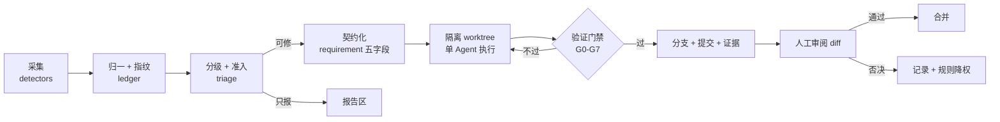
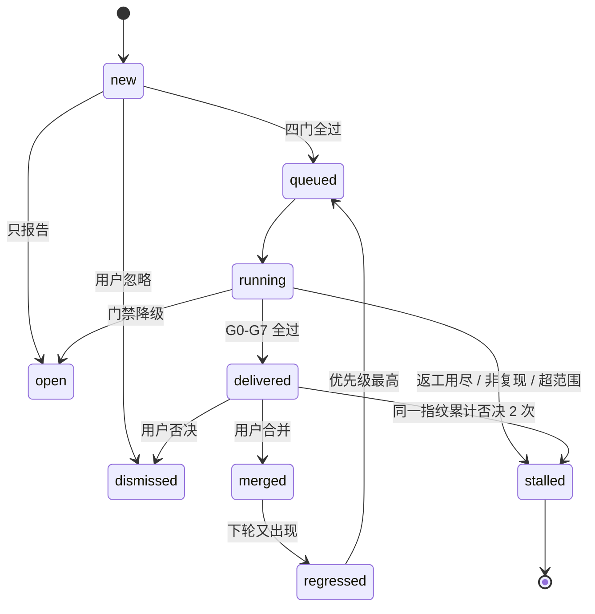

# 自动巡检与修复工作流方案（Sweep）

2026-11-24。状态：设计基线，未实施。范围：ApiX 自身（`E:\Projects\wyy\ApiX-Control-Center`）作为第一个试验田。

## 1. 一句话结论

在现有「需求 → 派工 → 验证 → 冻结交付」的协作骨架前面，补一个**采集层**：用仓库自己已有的客观信号（tsc / eslint / test / 文档链接 / 未登记测试）产出**带指纹的问题清单**，只把「有复现命令」的问题变成任务，修完只落**分支 + 提交 + 证据**，合并永远人工。

不新建一套 Agent 管线，只给现有管线供料。这样做的直接好处：预算、权限、worktree、验收、冻结交接全部复用，不用重写一遍安全边界。

## 2. 非目标（先说清楚不做什么）

- 不做「没有复现命令」的自动修改。模型觉得某处该改，不是证据。
- 不做架构级重构、大版本依赖升级、CI/发布配置变更。
- 不自动合并、不自动打 tag、不自动推送。
- 不允许巡检修改巡检自身（`src/sweep/**` 列为禁止路径，防止自我进化失控）。
- 不引入仓库没在用的工具链（不新增 vitest / jest / codeql / 各种 linter）。所有检测器只能跑本仓库已有的命令 + Node 内置模块。

## 3. 现状基线

已有的、直接复用的：

| 能力 | 位置 | 复用方式 |
| --- | --- | --- |
| 项目级自动协作开关 | `src/coordination/workflow.ts`（`apix_workflows`） | 巡检沿用同一授权与版本号 |
| 需求五字段契约 | `src/coordination/requirement-engine.ts` | 每条 finding 自动填成五字段 |
| DAG 调度 | `src/coordination/task-scheduler.mjs` | 一条 finding 一个 task，串行 |
| 验收与自动返工 | `src/coordination/autonomy.ts` | 借用「次数/时间/费用」边界与 repair 次数 |
| worktree 与交付冻结 | `src/projects/code-handoffs.mjs` | 分支、commit、`refs/apix/deliveries/`、diff 指纹 |
| 质量检查 | `src/projects/delivery-inspection.mjs` | 交付前 diff 审查 |
| 仓库门禁 | `npm run check`、`npm test`、`npm run test:ui:*` | 验证门禁的现成弹药 |

缺的部分只有三样：**怎么发现问题**、**怎么去重和分级**、**怎么保证修的是真问题**。本方案只补这三样。

## 4. 总体架构



一条竖线贯穿：**任何一步失败都不往下一阶段走，留在原地并记录原因**。不做「大概差不多就交付」。

## 5. 阶段一：采集（detectors）

检测器是声明式的最小单元，接口固定：

```ts
interface Detector {
  id: string;                                  // 规则 ID，也是忽略规则的粒度
  lane: 'static' | 'structural' | 'doc' | 'dynamic';
  cost: 'low' | 'medium' | 'high';             // 决定跑不跑、跑几次
  run(ctx: SweepContext): Promise<RawFinding[]>;
  reproduce?(f: Finding): string;              // 能给出复现命令的才有资格自动修
}
```

`SweepContext` 只有只读能力：仓库路径、基线 commit、允许执行的命令白名单、超时。检测器**没有写权限**，物理上就不可能改代码。

首批 11 条规则（全部基于仓库已有命令，零新依赖）：

| 规则 ID | 车道 | 数据源 | 成本 | 复现命令 | 默认可修 |
| --- | --- | --- | --- | --- | --- |
| `tsc.error` | static | `npx tsc --noEmit` 诊断码 + 文件:行 | 低 | 同命令 | 是 |
| `lint.error` | static | `npx eslint . --quiet -f json` | 低 | 同命令 | 是 |
| `dist.stale` | static | `node scripts/check-stale-dist.mjs` | 低 | 同命令 | 否（删 dist 重 build） |
| `test.failing` | dynamic | `npm test` TAP 解析，与基线比对 | 高 | `node --test <file>` | 是 |
| `test.unregistered` | structural | `test/*.test.mjs` 减去 `package.json` 的 `scripts.test` 清单 | 极低 | `node --test <file>` | 是 |
| `test.flaky` | dynamic | 同一用例重跑 2 次结果不一致 | 高 | `node --test <file>` | 否 |
| `doc.brokenlink` | doc | `docs/**/*.md` 相对链接存在性 | 低 | 无 | 否 |
| `doc.command-drift` | doc | 文档中 `npm run x` 不在 `package.json` | 低 | 无 | 否 |
| `todo.stale` | static | TODO/FIXME/HACK + `git blame` 年龄 > 90 天 | 低 | 无 | 否 |
| `dep.outdated` | structural | `npm outdated --json`（只报 patch/minor） | 中 | 无 | 否 |
| `code.dead-export` | structural | TS 导出零引用（粗启发） | 中 | `npm run build` | 否 |

`test.unregistered` 值得单列：本仓库的 `scripts.test` 是**显式文件清单**，新增测试忘了登记就永远不跑。这是真实存在过的坑，也是巡检最容易拿到「人工复审必过」的一条。

规则本身要能开箱关：忽略规则按 `(project_id, rule_id, fingerprint|path)` 三种粒度，写进 ledger，不写死在代码里。

## 6. 阶段二：归一、指纹与基线

原始输出五花八门（TAP、eslint JSON、tsc 文本），统一成一条 `Finding`：

```ts
interface Finding {
  fingerprint: string;   // sha256(rule_id | normalized_path | symbol_key)
  rule_id: string;
  file: string;          // 仓库相对路径
  line: number | null;
  title: string;         // 一行，进列表用
  detail: string;        // 原始证据片段，截断 4KB
  severity: 1 | 2 | 3;
  confidence: number;    // 0-1，来自规则基线 × 证据完整度
  reproduce: string | null;
}
```

**指纹是按「问题」算，不是按「行号」算。** 行号一改就变指纹的规则，等于没有去重。所以 `symbol_key` 取语义锚点：tsc 取 `文件 + 诊断码`、eslint 取 `文件 + ruleId`、test 取 `测试文件 + 用例名`、todo 取 `文件 + 去空白的注释正文哈希`、文档取 `文件 + 锚点`。行号只用于展示和定位。

**基线（baseline）**是第二道噪音闸门。每轮开始先在 main HEAD 上跑一遍「成本低 + 确定性」的检测器，把当前就存在的失败集记成基线。只有**相对基线新增**的条目才算新发现——否则第一次巡检会把仓库积累的所有历史欠账一次性糊到脸上，直接劝退。基线随每轮更新，可手动重置。

去重与状态在同一个 ledger 里解决：

- 同指纹已存在且状态为 `open/delivered/stalled` → 本轮只更新 `last_seen`、`occurrences+1`，不重复出任务。
- 同指纹状态为 `fixed` 但本轮又出现 → 标记 `regressed`，优先级直接拉到最高（回归比新问题严重）。
- 看到用户手动忽略过的指纹 → 静默跳过，不再打扰。

## 7. 阶段三：分级与准入

打分不是目的，**准入门禁**才是。四个门，必须全过才允许自动修：

| 门 | 条件 | 不过时 |
| --- | --- | --- |
| G-Repro | `reproduce` 非空，且在基线 commit 上实跑**确实失败** | 降级为「只报告」 |
| G-Det | 问题可被确定性判定（tsc / lint / test / 结构检查），不是模型判断 | 降级为「只报告」 |
| G-Scope | 预计改动 ≤ 3 文件、≤ 120 行，且不含禁止路径 | 降级为「待确认」，人工决定 |
| G-Budget | 本轮剩余预算 ≥ 单条预估成本 × 2 | 排队到下一轮 |

禁止路径（硬编码，改动需走人工）：`.github/**`、`desktop/**`、`scripts/verification/**`、`src/sweep/**`、`package.json` 的 `scripts` 段、任何 `*.db` / SQLite schema 迁移。

分级只是为了排序和展示：

```
priority = severity(1-3) × confidence / max(cost, 1)
```

- `priority ≥ 2.0` 且四门全过 → 本轮候选执行队列（默认最多 3 条）
- `1.0 ≤ priority < 2.0` → 「待确认」，等用户点一下
- `< 1.0` → 只进报告，折叠区

置信度初值由规则给定（tsc/lint/未登记测试 0.9+，结构类 0.5-0.7），之后按**采纳率**自动校准：某规则连续 10 次交付被人工否决 ≥ 7 次，置信度降到 0.2 并标记「仅报告」。

## 8. 阶段四：契约化与执行

一条 finding 不是一句「去修一下」，而是自动生成完整五字段契约，走现有任务管线：

```ts
// 由 finding 生成，不经过模型自由发挥
{
  goal: `修掉 ${rule_id} 报告的 ${file}:${line}：${title}`,
  scope: `仅限 ${file} 及其直接引用的测试文件；不改变对外接口签名`,
  constraints: '不新增依赖；不改 schema；不改 CI；改动 ≤3 文件 / ≤120 行',
  deliverable: `分支 sweep/${date}-${slug}，单个中文提交，含验证证据`,
  acceptance: `① ${reproduce} 在基线失败、修复后通过；② npm run build 通过；③ 受影响测试通过`
}
```

执行侧完全复用现有机制：从最新 `main` 派生隔离 worktree，派一个员工，**并发 1**。串行不是保守，是必要的——git 队列、worktree 基线、合并顺序三者都会在并发下互相咬。

执行期间只允许员工做三件事：读文件、改契约范围内的文件、跑白名单命令。想扩大范围 → 直接把任务标 `needs_human`，不返工。

## 9. 阶段五：验证门禁

按成本从低到高，先跑便宜的，失败立刻停：

| 门 | 检查 | 失败处理 |
| --- | --- | --- |
| G0 | worktree 从基线 commit 派生，起始 `git status` 干净 | 直接终止本轮 |
| G1 | 复现命令在**未改动**状态下确实失败（输出存证） | 标 `not_reproducible`，本轮不再碰这条 |
| G2 | 修复后同一命令通过 | 返工（≤2 次） |
| G3 | `npm run build` 通过 | 返工（≤2 次） |
| G4 | 受影响测试 + 固定核心集（`tool-dispatch`、`schema-consistency`、`assistant-loop`） | 返工（≤2 次） |
| G5 | diff 门禁：文件数 / 行数 / 禁止路径 / 新增依赖 / 未跟踪文件 | 不返工，标 `needs_human` |
| G6 | 若改了对外行为，`docs/INDEX.md` 有对应更新 | 不返工，标 `needs_human` |
| G7 | 证据齐备：G1 失败输出 + G2 通过输出 + G3/G4 结果 + diff 统计 | 不齐不算完成 |

G2 是关键设计。**它同时否掉了两类误报**：本来就没坏（G1 不失败）、改了也没用（G2 不转绿）。没有这道门，「优化」就会退化成无休止的润色。

## 10. 阶段六：交付

门禁全过后产出一条交付单元：

- 分支：`sweep/<YYYYMMDD>-<rule>-<slug>`
- 提交：一条，中文，写清**改了什么、为什么、验证了什么**
- 证据：`.apix/sweeps/<runId>/<fingerprint>.json`（不提交，跟着 run 目录走）
- 冻结：复用 `code-handoffs.freeze`，写 `refs/apix/deliveries/`
- ledger 状态：`delivered`

到此为止。**不合并、不推送、不打 tag。** 用户在项目页逐条看 diff，点「合并」才进入现有交付审阅与集成路径——合并实现不新增，直接调既有能力。

## 11. 数据模型

两张新表，挂在现有 SQLite 上，通过 `ensureModuleSchema(db, 'sweep')` 注册（遵守 schema 单一真源约定）。

```sql
CREATE TABLE apix_sweeps (
  id TEXT PRIMARY KEY,
  project_id TEXT NOT NULL,
  baseline_commit TEXT NOT NULL,      -- 本轮从哪个 commit 派生
  trigger TEXT NOT NULL,              -- manual | schedule | hook
  status TEXT NOT NULL,               -- collecting|triaging|executing|verifying|done|aborted
  stats TEXT NOT NULL,                -- JSON：各检测器条数/耗时/失败
  budget_used TEXT,                   -- JSON：tokens/cost/wallclock
  started_at TEXT NOT NULL,
  finished_at TEXT,
  abort_reason TEXT
);

CREATE TABLE apix_sweep_findings (
  id TEXT PRIMARY KEY,
  project_id TEXT NOT NULL,
  fingerprint TEXT NOT NULL,
  rule_id TEXT NOT NULL,
  file TEXT NOT NULL,
  line INTEGER,
  title TEXT NOT NULL,
  detail TEXT NOT NULL,
  severity INTEGER NOT NULL,
  confidence REAL NOT NULL,
  reproduce TEXT,
  status TEXT NOT NULL,               -- new|open|queued|running|delivered|merged|dismissed|stalled|regressed|not_reproducible
  occurrences INTEGER NOT NULL DEFAULT 1,
  first_seen TEXT NOT NULL,
  last_seen TEXT NOT NULL,
  sweep_id TEXT,
  task_id TEXT,
  branch TEXT,
  commit_sha TEXT,
  evidence_path TEXT,
  reason TEXT,                        -- 关闭/停滞原因
  UNIQUE(project_id, fingerprint)
);

CREATE TABLE apix_sweep_mutes (       -- 忽略规则，三级粒度
  project_id TEXT NOT NULL,
  rule_id TEXT NOT NULL,
  scope TEXT NOT NULL,                -- 'rule' | 'path' | 'fingerprint'
  target TEXT NOT NULL,
  created_at TEXT NOT NULL,
  PRIMARY KEY(project_id, rule_id, scope, target)
);
```

`UNIQUE(project_id, fingerprint)` 是整套去重的物理保证——不是靠代码里记得查一下。

### 单条 finding 的状态机



`merged → regressed` 这条边是整个工作流的自检回路：如果修好的问题又回来了，说明修复是错的或测试不够，下一轮必须优先处理。

## 12. 接口与界面

HTTP（挂在现有 API 路由，走同一 owner 门禁）：

| 方法 | 路径 | 作用 |
| --- | --- | --- |
| POST | `/api/projects/:id/sweeps` | 启动一轮，返回 runId |
| GET | `/api/projects/:id/sweeps` | 历史 run 列表 |
| GET | `/api/sweeps/:runId` | 本轮详情：阶段、统计、findings 分组 |
| POST | `/api/sweeps/:runId/findings/:fid/execute` | 手动放行一条候选 |
| POST | `/api/sweeps/:runId/findings/:fid/dismiss` | 忽略（可附加 mute 规则） |
| POST | `/api/sweeps/:runId/findings/:fid/merge` | 走现有交付审阅 + 集成 |
| POST | `/api/sweeps/:runId/abort` | 中止 |

界面：项目页新增「巡检」分区，四个分组列表（已交付 / 待确认 / 仅报告 / 已忽略），每条显示 `规则 · 文件:行 · 一句话 · 严重度 · diff 统计 · 验证证据`。点开看 diff 和 G1–G7 逐门结果。运行时顶部一条细进度条显示「采集 4/11 · 分级 12 条 · 执行第 2 条」。不新开页面，不新做导航层。

## 13. 预算、熔断与自适应

单轮默认上限（可在项目设置里改）：

| 项 | 默认 | 超限行为 |
| --- | --- | --- |
| 自动执行条目 | 3 | 其余转「待确认」 |
| 本轮墙钟 | 60 分钟 | 中止，已交付的保留 |
| 单条返工次数 | 2 | 转 `stalled` |
| 同指纹累计失败 | 2 次 | 永久降为「仅报告」 |
| 单条 token/费用 | 项目预算的 5% | 中止该条 |

三层熔断：

1. **规则级**：某规则连续 10 轮交付采纳率 < 30% → 该规则降为「仅报告」。
2. **轮次级**：单轮 3 条全被否决 → 下一轮自动执行数降为 0，只出报告，等人工重新放行。
3. **项目级**：连续 3 轮零采纳 → 暂停巡检，把原因写进项目页（避免每天烧钱产出没人看的东西）。

这三层不写进数据库开关，直接由 ledger 统计推出来——少一个可以忘同步的状态。

## 14. 这套东西自己的 KPI

工作流本身必须可度量，否则它就是个噪音制造机。每条 run 结束写入：

| 指标 | 定义 | 及格线 |
| --- | --- | --- |
| 交付采纳率 | `merged / delivered` | ≥ 50% |
| 误报率 | `(dismissed + not_reproducible) / 总 finding` | ≤ 40% |
| 回归引入率 | `merged 后被回滚或被 regressed 命中 / merged` | ≤ 10% |
| 单条有效修复成本 | 总费用 / merged 条数 | 有趋势即可，不设死线 |
| 去重有效率 | 重复轮次的新增条数 / 首轮条数 | ≤ 30% |

低于及格线不是「优化一下」，而是**先停**——按项目级熔断处理。

## 15. 风险与对策

| 风险 | 具体表现 | 对策 |
| --- | --- | --- |
| 模型「为了有事做」制造改动 | 改注释格式、重排 import、抽无意义函数 | G1/G2 复现门禁 + diff 门禁 + 采纳率熔断 |
| 误报淹没界面 | 首轮 200 条 TODO，用户直接不看了 | 基线 + 指纹去重 + 默认只展示 priority ≥ 1.0 |
| 修好 A 弄坏 B | 测试覆盖不到的地方被改 | 固定核心测试集 + diff 面积上限 + 触及公共接口即转人工 |
| worktree / 分支互相打架 | 并发从同一基线派生，合并时冲突 | 并发固定 1，串行派生与合并 |
| 成本失控 | 高成本检测器（全量 test）每轮都跑 | 按 lane 分频：static 每轮跑，dynamic 每 24h 或 hooks 触发 |
| 「优化」变成风格争论 | 改命名、改注释、换写法 | 自动修只受理可判定问题；风格类一律「仅报告」 |
| 巡检自己改了巡检 | 自我进化失控 | `src/sweep/**` 列入禁止路径，改动必须人工 |
| 文档漂移越修越乱 | 文档检测器误判 | 文档车道默认只报告，不自动改 |

## 16. 分期实施

### P0 — 只读巡检（无执行）

范围：11 个检测器 + ledger + 指纹去重 + 报告列表与 API。没有 worktree、没有员工、没有提交。

可判伪的验收：

1. 在 ApiX 自身跑一轮，能跑出至少 1 条真实问题（用例：人为去掉 `package.json` 里一个测试文件登记，`test.unregistered` 必须命中）。
2. 同一 commit 连跑两轮，第二轮新增条数为 0（指纹去重生效）。
3. 人为删掉一个 docs 链接，`doc.brokenlink` 命中且给出准确文件。
4. 单轮只读巡检墙钟 ≤ 5 分钟（不含全量 test），不产生任何 git 写入（`git status` 干净）。

P0 做完就可以天天用，价值已经成立。

### P1 — 单条执行闭环

范围：triage 四门 + 契约生成 + 单条 worktree 执行 + G0–G7 + 分支提交。只允许手动放行，不做批处理。

验收：

1. 挑 3 条真实 finding（1 条 tsc、1 条未登记测试、1 条 eslint），全部走通 G0–G7 并落分支+提交。
2. 人为构造一条假 finding（复现命令永不失败），必须被判 `not_reproducible` 而不是硬改。
3. 人为构造一条需要改 5 个文件的 finding，必须被 G-Scope 拦下转「待确认」。
4. 三条交付的 diff 全部 ≤ 3 文件，且无禁止路径改动。

### P2 — 批处理与自适应

范围：单轮 3 条串行 + 预算/墙钟 + 三层熔断 + 采纳率回写 + 「合并」按钮接现有交付路径。

验收：

1. 单轮 3 条全跑通，且被否决的条目正确回写 ledger、影响下一轮置信度。
2. 预算耗尽时能中止且已交付条目不受影响。
3. 连续两轮零采纳后，第三轮自动执行数降为 0。

### P3 — 触发扩展与通用化

范围：定时巡检、提交后钩子、任意已托管项目接入（检测器按项目类型装配）。

## 17. 代码落位

新增一个可整体删除的领域目录，不散进现有模块：

```
src/sweep/
├── detectors/
│   ├── types.ts          # Detector / RawFinding / SweepContext
│   ├── tsc.ts            # 解析 tsc --noEmit 输出
│   ├── eslint.ts         # 解析 eslint -f json
│   ├── test.ts           # 解析 TAP + 基线比对 + flaky 重跑
│   ├── structure.ts      # 未登记测试、stale-dist、dead-export
│   ├── docs.ts           # 链接与命令漂移
│   └── index.ts          # 装配顺序（按 cost 升序）
├── fingerprint.ts        # 语义锚点 → sha256
├── ledger.ts             # 三张表读写 + 状态机迁移
├── triage.ts             # 打分 + 四门判定
├── contract.ts           # finding → 需求五字段
├── runner.ts             # 阶段推进、预算、熔断
├── executor.ts           # worktree + 任务派发（调 coordinator）
├── verify.ts             # G0–G7
└── deliver.ts            # 分支/提交/证据/freeze
```

装配在 `control-plane.mjs`，路由挂 `src/infrastructure/api-routes.mjs`，与其它领域一致。不新增根目录 `.mjs`。

## 18. 未决事项

1. **首轮基线怎么处理历史欠账**：是把既存失败全部记入基线静默，还是单列「存量」分组让人一次性过一遍？倾向前者，但需要一次人工盘点。
2. **`test.failing` 的全量跑**：`npm test` 72 文件 654 项，完整耗时未测。若 > 10 分钟，dynamic 车道只能按文件级定向复现，不能每轮全量。
3. **合并由谁执行**：复用现有交付审阅的集成入口，还是巡检面板单独一条快路径？倾向复用，避免两套合并实现。
4. **是否允许巡检改文档**：目前 doc 车道只读。若 P2 采纳率良好，可放开「链接修复」这一类极小改动。
5. **跨项目通用化时机**：ApiX 自身跑满 2 周、采纳率 ≥ 50% 之后再谈，否则会把 ApiX 特有的检测器错当通用能力。

---

设计不作为当前功能承诺。实施前先跑 P0，用真实数据决定后面还做不做。
