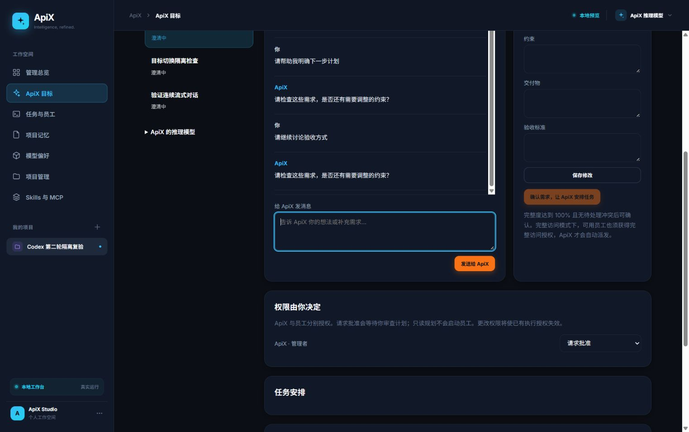
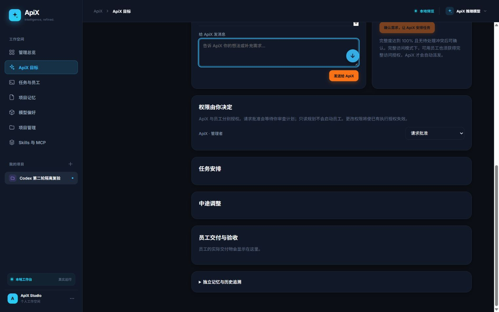

# Codex 单 Agent 修复与验收结果

日期：2026-10-11。执行者：Codex。用户已要求单独开发，直到明确恢复双 Agent 协作。

## 修改与结果

Codex 接手前端及测试，完成第二轮六项审查问题。后端接口与审批门槛保持原有约定，未添加依赖，未提交或推送。

| 问题 | 修复 | 证据 |
| --- | --- | --- |
| F2-01 编译及错误恢复 | 页面使用共享 readConversation，错误不再访问作用域外变量；错误后读取正式会话，同步失败时禁止发送 | 构建/check 通过；实际 error/EOF 页面恢复，不出现二次错误 |
| F2-02 测试复制实现 | 新增 web/conversation-stream.ts、web/model-settings.ts；页面和测试导入相同模块，测试目录来自后端 BUILTIN_PROVIDERS | 14 项真实模块回归通过；原模拟测试已替换 |
| F2-03 加载失败覆盖设置 | 目录及设置都加载成功前禁用整个配置表单；payload 函数拒绝未就绪及未知平台；无 URL 仅允许已有旧 Pi 配置 | 实际设置 503 时按钮/平台禁用；旧 Pi 往返及未知配置回归通过 |
| F2-04 目标与预览隔离 | 统一 selectSession，独立保存目标草稿；清理旧预览；流回调和成功清空输入绑定项目/目标；错误预览仅属于对应目标；正式消息由 complete 替换 | 实际生成期间切换目标，临时节点为 0；旧请求完成后新目标、草稿不变；错误后切换无残留 |
| F2-05 目录选项 | 页面只从 API 生成并转义平台/模型选项，本地 Key 显示使用 requiresApiKey | 实际选项与目录一致；本地字段隐藏；DeepSeek 自定义名切到百炼保存 qwen-max |
| F2-06 解析与终态 | 增量 UTF-8 解码，帧缓存保留分片，支持 LF/CRLF、多行 data 换行拼接；complete 后返回并释放 reader | 逐字节中文/emoji、CRLF、多行 JSON、终态后非法帧、HTTP 错误和 EOF 回归通过 |

另修复生成结束后跨目标残留的“正在处理”提示；允许生成期间点击目标列表，同时保持重复发送禁用。修正 CHANGELOG 行尾空白。

## 实际验证记录

- 运行时：bundled Node v24.19.0，未变更全局 Node。
- `npm run check`、`npm run build` 通过。
- 完整 `npm test`：40 tests / 40 pass / 0 fail，耗时约 380 秒。数量变化来自移除 18 项复制实现测试，替换为 14 项实际模块测试；后端、消息、审批、隔离、重启及工作流回归保持覆盖。
- 完整回归后只调整跨目标结束提示，随后重新构建和实际页面复验；最后进行 check、局部模块测试和 diff 检查。
- 隔离主服务：127.0.0.1:9190，数据目录 `.tmp-codex-round2-M0I0Oy`，假 Pi 分片间隔 650ms，未使用用户真实模型设置或数据库。
- 实际页面先观察发送后两个临时节点及控件禁用；长回复完成后 0 临时节点、4 正式历史节点；第二轮结束后 0 临时节点、6 正式节点。刷新与切换保留正式历史。
- 在一轮短回复中等待实际增量文本出现时，页面仍有 2 个临时节点、发送按钮禁用，证明文本在 complete 前可见。
- Enter 发送及 Shift+Enter 换行通过。中文/emoji 按字节分片由实际模块测试验证；未使用真实中文输入法进行人工组合输入测试。
- 旧 Pi 设置通过后端种子 → 页面回填 → 页面保存 → GET 核对，provider/model/Key 变量名不变。OpenAI Responses、自定义模型和 Key 名称以同样路径往返不变。
- 本地 Key 隐藏、DeepSeek 自定义模型切百炼后清除旧名，实际保存 qwen-max 与 DASHSCOPE_API_KEY。
- 使用本次临时 HTTP 代理注入 error、EOF 和设置 GET 503；其余流量转发到隔离主服务。它只用于故障验证，不修改产品服务器的 Host/Origin 校验。error/EOF 时片段和草稿保留、临时节点清零、控件恢复；错误目标切换无残留。503 时禁止保存，后端原设置未被清空。
- 最终生成中的真实延迟流切换目标时新目标无预览，发送保持禁用；原流结束后新目标仍不变、发送恢复、处理提示清除。

## 状态和边界

C1/C2/C3/C5 保持完成；本轮 F2-01–06 修复完成，V2/C4 在隔离假 Pi 范围内通过。当前转为 Codex 单独开发，不再等待 Claude 返修，也不启动其他 Agent。

真实远程/本地模型尚未联调；上述结果证明实际页面、协议和隔离 fixture 的完整路径，不代替真实平台可用性验证。客户端断开仍不代表取消后端；不自动重发，先同步正式目标状态。

隔离服务及临时代理完成后停止；保留被 Git 忽略的环境、协议样本和临时故障脚本作为调试资料。截图保存在协作目录：

