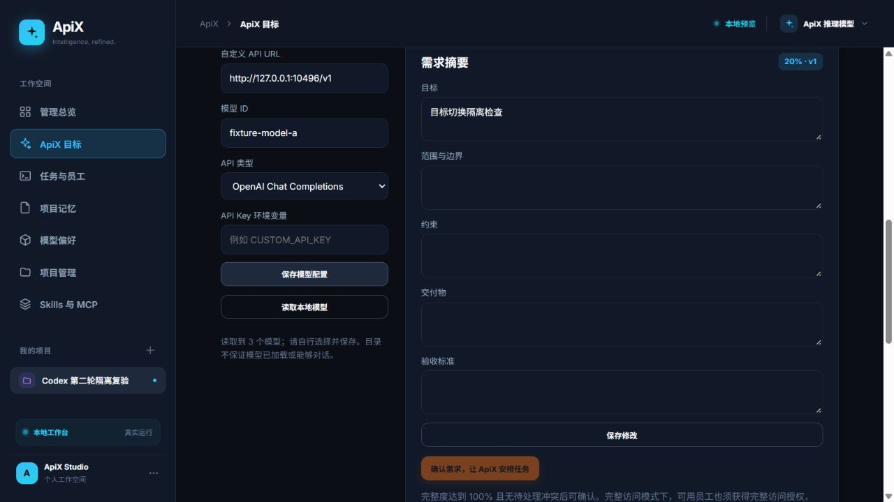

# 本地模型目录开发与审查

日期：2026-10-11。执行/审查：Codex 单 Agent 自审。基线：52ffcaa。

## 本轮交付

沿用后续计划，优先完成本地模型目录读取，而不在缺少服务/认证的环境声称真实模型已接通。

- 新增 POST `/api/manager/models`，输入 `{baseUrl, apiKeyEnv?}`，返回 `{models:[{id,name}]}`。只向已校验的回环 HTTP/HTTPS 地址发送 GET，追加 `/models`；不更改任何设置。
- 支持从环境变量取本地服务的 Bearer Key；不在浏览器输入或返回密钥，不展示上游错误正文，不跟随重定向；5 秒覆盖连接和正文，响应最大 1MB/1000 项。
- 提供“读取本地模型”按钮。预设本地平台更新模型选项，自定义 URL 提供输入建议；手动值始终保留，不自动选定新模型或保存。失败、空列表及读取期间切换配置均有明确行为。
- 保持既有 Host/Origin 和静态文件边界，无新增依赖。

接口依据：[Ollama OpenAI 兼容文档](https://docs.ollama.com/api/openai-compatibility)、[LM Studio 模型目录文档](https://lmstudio.ai/docs/developer/openai-compat/models)。模型列表不代表已加载、支持聊天或推理成功。

## 实际验证

- 本机默认端口 11434、1234 的 `/v1/models` 探测均未响应；未安装服务、下载模型或执行真实推理。
- check/build 通过，定向后端目录及前端实际模块测试 14/14 通过；完整 npm test 50/50 通过、0 失败，耗时约 375 秒，运行时 bundled Node v24.19.0。
- 实际浏览器使用隔离 ApiX 服务 10410 和本地 HTTP fixture 10496：成功返回 3 项目录，保留 manual-original；特殊 HTML 模型 ID 没有变成 DOM 图片。
- 读取后 GET 正式设置仍为默认，证明读取没有自动保存；用户明确填写 fixture-model-a 并点击保存后，正式设置才发生变化。
- fixture 的 401 响应正文包含测试敏感文字，页面只显示 HTTP 401 提示；输入保持。空目录保留输入；延迟读取时切换 DeepSeek，旧结果没有回填其选项/状态，按钮正确隐藏。
- 自动化覆盖逐项校验、去重、非法 ID、空目录、错误格式、超大响应/过多项目、错误正文处理、重定向、慢正文超时；HTTP 集成验证环境变量认证、Origin 拒绝以及正式设置不被覆盖。

## 自审与边界

- 检查后端读取路径、认证、资源释放和错误处理，前端绑定的实际函数、旧输入保留和异步归属，以及 API 调用方、测试入口与文档。
- 审查中将模型 ID 统一 trim 后校验，拒绝命令前缀、控制字符与过长 ID，使目录值与保存校验一致。
- 密钥只在后端进入请求头；错误正文不解析或回传。目录响应只返回 ID/name，不转发服务的其他元数据；页面选项全部经过 HTML 转义。
- 接口不调用模型推理或模型加载端点。当前只是手动目录读取，不替代完整连接测试；真实 Ollama/LM Studio、IPv6 服务及认证服务未现场联调（认证行为由隔离 HTTP 回归验证）。

自审结论：通过，无已确认的本轮阻塞问题。完整回归和实际页面验证通过，8 个代码/测试/脚本指纹随提交前清单核对。本轮 16 个明确文件可本地提交，不包含其他既有改动，不推送；实际提交号以 Git 历史为准。

## 审查代码指纹

提交前核对以下暂存代码与工作区一致；若改变则重新审查。

| 路径 | Git blob |
| --- | --- |
| `src/local-models.ts` | `c24bf9bb77cdb39cfb27956c27a8d5d70a92359c` |
| `server.mjs` | `98dd50a24875256a77962676b66bc3f4c6a66927` |
| `web/coordinator.ts` | `33dcb70fecf31bc6d20abf6a7a9594edfaa1ca76` |
| `web/model-settings.ts` | `287bd4922e82fa3a7a4729779fec9875139901bc` |
| `test/local-models.test.mjs` | `6d28c963bb973e5b0b649dcf5213a4f53fd115f1` |
| `test/coordinator.test.mjs` | `60f842c62421e6744b349be9d6c8987c7f7df664` |
| `test/model-settings-ui.test.mjs` | `b8b08b4333ec28b024a416f20a96812bfb7397b2` |
| `package.json` | `4a904e6e8032214d2d45a3866d7b81368f0f321a` |
