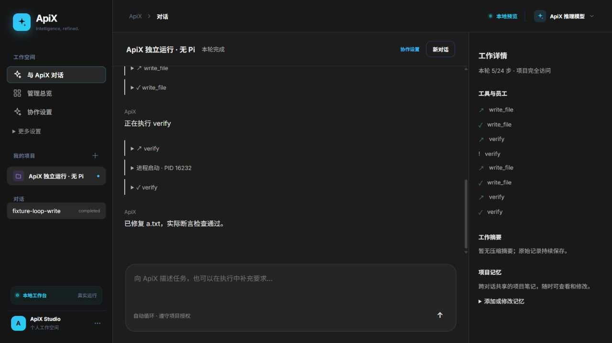
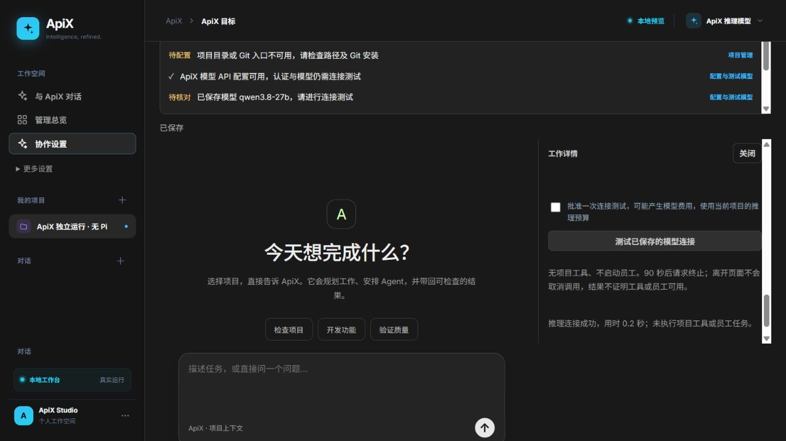

# 独立 ApiX 开发与自审

日期：2026-10-16；分支 `codex/readiness-p0-p2`，开发基线 `2035de1`。本轮由 Codex 实现并自审，不启动子 Agent；这是自审，不是独立审查或人工批准。

## 结果与范围

用户明确要求 ApiX 独立，Pi 与 Codex、Claude 同为执行 Agent。已先确定[模块边界与验收契约](./独立ApiX推理后端架构与验收.md)，再实现：

- 新增 `src/model-backend.ts`：直接通过 HTTP 调用已配置的 Chat Completions、Responses 或 Anthropic Messages；统一处理 SSE、公开答复、完整结束标记、错误、超时、取消、大小限制和认证。
- `control-plane.mjs` 的对话、架构、规划、监督、质量审查及摘要统一调用独立 API 后端。管理者不再启动 Pi，不写 `manager-pi/models.json`，不使用 `APIX_MANAGER_PI_ENTRY`，也不读取 Pi 登录信息。Pi RPC 只保留在显式员工咨询与执行路径。
- 默认 `assistant-loop` 的上下文、记忆、Skill、工具、选择、授权与验收仍由 ApiX 管理；停止现在会传递到实际 HTTP 请求。旧需求工作台负责结构化对话/计划，工具工作使用默认主循环，不再借 Pi 隐式运行本机工具。
- `src/apix-agent.ts`、contracts/coordinator 的新模型决策标记为 `mode=api`，主体 `foundation=ApiX`；历史 `pi` 标记与事件保留，界面明确显示旧记录。
- 就绪检查依赖模型 API 配置与密钥，不依赖 Pi 入口；员工仍需各自安装、认证与授权。模型配置字段和预算准入继续沿用已有契约。
- 更新界面、README、环境示例与 Wiki 入口说明。浏览器发现并修复顶部模型设置入口未展开工作详情的问题；无协作任务也能配置模型。真实验收脚本的报告名称改为独立 ApiX 管理者，没有执行收费验收。

## 最终差异自审

已检查新增文件、全部调用方、状态与错误路径、数据一致性及访问边界。结论：本轮独立后端范围自审通过，最终代码适合本地提交；没有声称已完成所有真实模型联调。

1. 模型后端只返回文本；工具和 CLI 派发仍由宿主白名单、批准、权限、项目指纹和计划契约处理。没有把供应商原生 tool call 自动执行为本机操作。
2. 管理者网络路径不再调用 CLI。缺少 API 地址、模型或必要密钥时明确阻塞，不选择收费默认模型、不回退 Pi。已有可识别 provider 可映射已有平台地址；旧 Pi 私有 provider 无法推断 URL 时要求用户补齐，保留其原配置，不擅自复制凭据。
3. 管理者/员工凭据隔离仍生效；密钥只放 HTTP 认证头，未写入新文件或返回界面。远端必须配置 Key 环境变量；本机可无 Key。重定向拒绝，供应商原始错误正文不透传。额度代码只通过固定白名单映射，未知费用继续保留预留，不记成零。
4. 三种协议有明确成功结束条件；截断、未完成、工具输出、失败事件、无文本不能成为成功。忽略 reasoning/thinking 字段。UTF-8、CRLF、分块与多行 SSE 按流解析；普通 JSON 响应仍可兼容。
5. 底层统一请求流式输出，避免部分 Qwen 思考模型拒绝非流式调用。保留用户指定的 `qwen3.8-27b` 名称；没有更换模型或自行改变模型采样/推理参数。
6. 90 秒时限覆盖响应正文；主循环停止、项目权限撤销会取消 HTTP。连接测试的批准、并发防重、保存配置检查、预算预留和额度暂停仍被验证。底层不自动重试；既有计划格式纠正仍经过单独预算准入。
7. 既有数据结构和配置保留，没有破坏性迁移。新旧 mode 明确区分；历史会话不被伪装为新 API 证据。旧协调工作台失去 Pi 原生工具阶段是有意边界变化，默认 ApiX 工具循环继续实际执行与验证。
8. Pi 员工保留专用 RPC、模型选择、独立环境与无工具会议咨询；本轮简化的咨询读取使用流式 UTF-8 解码，保留超时和额度错误分类。Codex、Claude 与其他员工适配器继续使用既有任务工作区、消息与权限路径。
9. `test/fake-model-http.mjs` 仅被测试导入，使用回环 HTTP，复用旧 fake-pi 文件生成确定性答案；这不是生产 ApiX 的 Pi 依赖。另有纯 HTTP 服务测试，不需要该文件或任何 CLI。
10. 没有新增依赖、读取或修改用户的生产数据库，没有安装/卸载 Pi，没有重启用户当前服务，没有推送、合并或切分支。用户 `.gitignore` 修改、未跟踪 Skills 和其他文件保留。

## 验证证据

- 最终 `npm run check`、TypeScript 构建、修改过的真实验收脚本与 HTTP 夹具语法检查通过。
- 最终单元回归 45/45 通过：HTTP 三协议、认证与路径、SSE、结束/截断/超时、额度脱敏、主循环、批准与记忆、模型设置与就绪边界。
- 最终 HTTP 专项 9/9 通过：停止取消真实 HTTP、无 Pi 主循环完成真实文件失败修复、连接测试批准/预算/防重、额度与失败恢复、权限撤销、自有 API 密钥、Pi/Claude 员工咨询、流式对话与配置跨重启保留。
- `npm test` 全量运行完成：215 项中 214 通过、1 失败，约 1008 秒。全量进程已加载的旧 HTTP 测试夹具未给 SSE 额度错误附上错误码，导致一项额度用例失败；新夹具保留固定额度代码后，同名测试单独 1/1 通过，最终 HTTP 专项 9/9 中再次通过（含账户暂停和重复测试拦截），没有放宽产品额度校验。最终代码另有上述 45+9 项通过，包含全量启动后新增的 HTTP 停止用例；没有冒称全量整套在修正后重新跑过。
- 浏览器：隔离端口 4477，独立数据目录，PATH 为空，Pi/Codex/Claude 入口均不可用；通过 ApiX 对话完成写入 bad → 实际断言失败 → 写入 good → 实际断言通过。快照确认 `PiAvailable=false`、员工数 0、员工运行数 0。再验证首次打开模型配置、保存现有本机模型与明确批准的连接测试成功；无控制台 error。模型为本机 HTTP 夹具，不是实际 qwen3.8-27b。

测试浏览器与隔离进程已关闭，没有操作用户的 4173 服务。除夹具模型返回外，HTTP、Node 断言、SQLite、Git、消息与员工子进程均实际执行。

## 迁移与尚未验证项

- 完整 API 配置可继续使用；仅依赖 Pi 默认配置/登录的旧安装需在“ApiX 推理模型”补 API URL、模型 ID、协议和 Key 环境变量。`APIX_MANAGER_PI_ENTRY` 已停用；`APIX_PI_ENTRY` 只配置 Pi 员工。新代码需构建并重启服务才生效，本轮未重启正在运行的实例。
- 没有调用真实 qwen3.8-27b、OpenAI、Anthropic 或付费 CLI；未验证各供应商真实账户、网关兼容性及复杂项目成功率。真实验收脚本仍需用户已配置的模型和所选员工凭据。
- 有请求、响应、输出与活动轮次上限；MCP 执行仍未接入，本机命令不提供 OS 沙箱。独立后端不等于所有任务都能自动完成。
- 旧设计、简历材料与既往验收记录中的 Pi 底座叙述属于历史版本；README 与 Wiki 顶部已指向当前契约，不重写历史测试证据。

提交前核对明确暂存清单、Git blob 与已审查工作区一致，并检查最终 diff。代码自审后如继续修改，需再次审查并验证；本记录如实区分运行中全量与最终定向结果。
