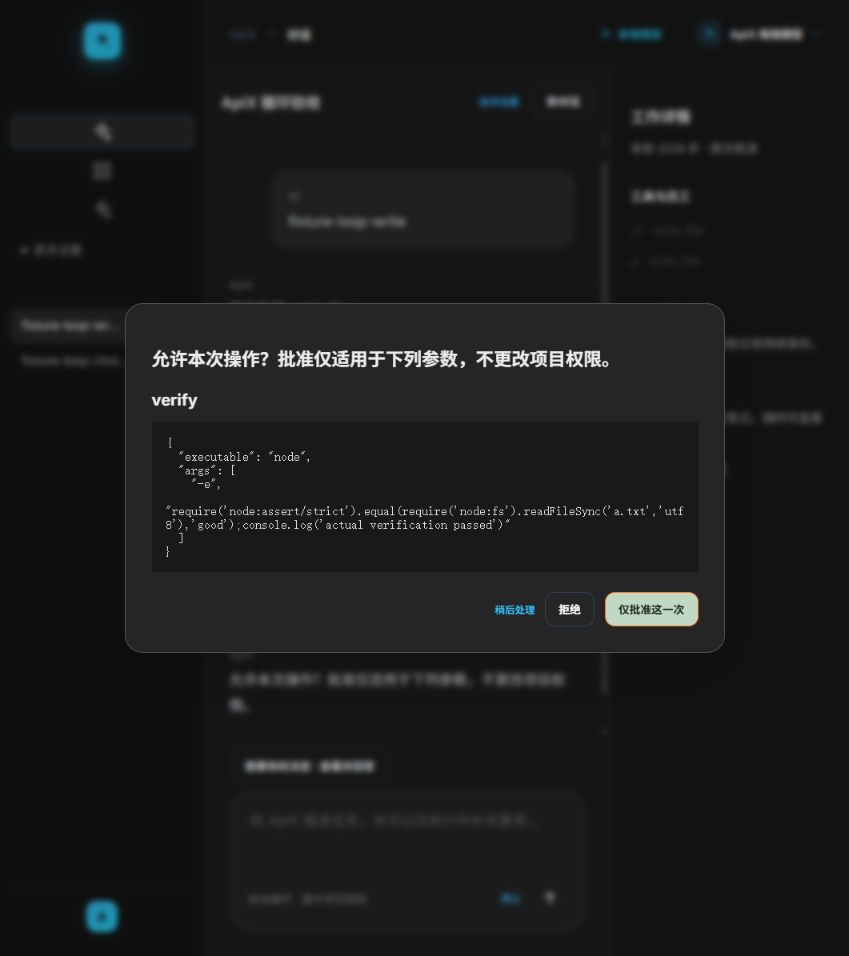
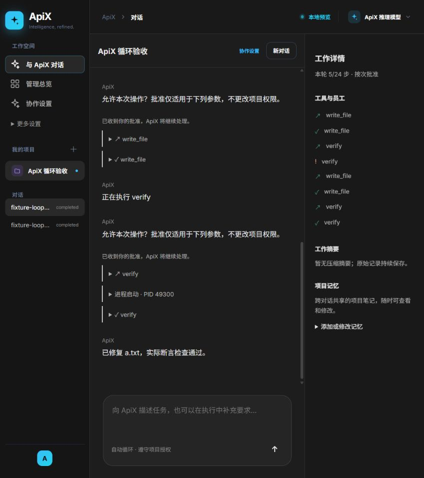

# 统一 Agent 循环开发与自审

日期：2026-10-16。分支：`codex/readiness-p0-p2`；开发基线：`3394775`。
本轮由 Codex 完成前后端与自审，没有额外启动 Agent；以下是自审，不是独立审查或人工批准。

## 需求与完成范围

用户要求默认采用持续观察、工具执行、检查与修复的循环，ApiX 作为通用 Agent，并把其他本机 Agent 作为循环能力调用；支持多轮上下文、项目记忆、批准/选择，以及参考 Codex 桌面版的工作区布局。

先编写了[架构、接口与验收标准](./统一Agent循环架构与验收.md)，再实现以下模块：

- `src/assistant-loop.ts`：SQLite 会话与事件、模型决策循环、版本化请求、上下文整理、项目笔记、委派等待与回收、停止、重启恢复、同项目主会话写入互斥。
- `src/assistant-tools.ts`：受项目路径限制的文件能力、真实命令与验证、输出截断标记、凭据过滤、规则与文件系统 Skill 加载。没有新增运行时依赖。
- `control-plane.mjs`、`server.mjs`、`src/contracts.ts`、`src/coordinator.ts`：复用现有模型/费用/权限/员工/架构契约/质量闭环；增加 assistant API，停止期间的架构与计划推理不得迟到派发员工。
- `web/assistant.ts`、`web/assistant-view.ts`、`assistant.css`、`index.html`、`agent-os.js`：默认对话、左项目/会话、中间对话与输入、右侧证据/摘要/笔记；批准、单/多选、补充输入、分页历史；旧协作与设置页面仍可访问。
- `test/assistant-loop.test.mjs`、`test/assistant-tools.test.mjs`、`test/coordinator.test.mjs`、`test/fake-pi.mjs`、`package.json`：状态机、隔离、真实命令、HTTP 与委派返工回归。

## 最终差异自审

审查范围包括上述新增文件、全部调用方、API 路由与访问边界、停止/错误/恢复路径、数据库一致性，以及界面渲染。结论：本轮范围内自审通过，具备本地提交条件。

- API 使用现有 Host/Origin 防护；assistant 路由与员工 Bearer 邮箱分开。界面文本、工具参数与结果均转义，不将模型文本作为 HTML 或执行命令。
- 普通问答无需员工或 Git；未选项目时自动建立通用工作区。不能将包含 ApiX 内部状态目录的项目交给助手读取。
- 单次批准绑定 session/version/requestId、参数、权限版本与当前项目指纹；不会变更全局权限。持续协作设置即使已有完全访问也再次明确批准；真实验收脚本必须存在。配置通过 SAVEPOINT 一起提交，失败回滚员工注册、权限、配置与能力声明。
- 所选员工能力仅为用户批准的声明；不按模型品牌推定性能，不伪造费用。继续使用已有账户预算和额度策略；额度错误归属请求发出时的原账户，未知金额不记为零。
- 最终访问边界审查另发现项目配置可能改写复用员工的全局能力档案；已改为只初始化新员工，已有声明不一致时拒绝并回滚，防止本项目批准影响其他项目的模型、能力与费用配置。调用方与错误路径重新自审，并补充真实 HTTP 隔离回归。
- 先记录工具调用与进程 PID，再收集结果。可能写入的操作在执行前使验证失效；成功 exitCode 仍需无超时/取消/截断/未知状态，并绑定当前指纹。验证命令若改写项目不能作为有效交付证据。
- 发现并修复：子流程自动返工准备期间的暂态 needs_revision 曾让父循环过早停止；现在以 autonomy 的真实运行状态为准，完成后继续主循环。停止期间迟到的架构/计划不能启动员工；对应真实 HTTP/进程测试已通过。
- 发现并修复：返回非零退出码的验证曾在界面显示成功；现根据实际结果标记失败。修正初始页面继承网格导致的空白列、窄桌面侧栏标签不可见、深色工具证据对比度。
- 读取凭据和越界链接被拒绝；文件、规则和 Skill 的大小检查针对链接的真实目标。命令输出在合并分块后脱敏，覆盖跨块凭据及 UTF-8 边界。
- 原文保留并分页，摘要不替代审计记录；初始目标与最新用户输入固定注入。笔记有项目边界和版本，规则/Skill/笔记不改变授权。模型输出只驱动明确工具目录。
- 重启不会自动重放未知工具；新的普通消息与新的写入会话也不能绕过未确认进程。只读对话可继续。多个主会话不同时写同一项目；员工模块并行继续使用既有工作区机制。
- 界面轮询不替换输入框；选择对话正文不触发会话重载；异步请求有代次/会话检查，避免旧响应覆盖新项目。请求错误在批准弹窗内可见。
- 既有数据只新增表，没有破坏性迁移；没有改动原用户模型配置、现有数据库或运行服务，没有新增 Git/GitHub 推送或合并。

## 实际验证

使用 Node 24.19.0（系统另一 Node 缺少本仓库所需 FTS 支持）。模型推理使用本仓库 fake-pi 夹具，但文件操作、Node 断言、HTTP、SQLite、Git 交付和员工子进程实际执行。

| 验证 | 结果与范围 |
| --- | --- |
| `npm test` | 全量 196/196 通过，约 988 秒；包括旧架构/契约、成本路由、权限、代码交付、冲突、重启恢复等回归，以及本轮新增的主循环/HTTP/委派用例。该次运行开始后补充的用例另见下两行，未将其冒充同一次全量结果。 |
| 最终循环与工具回归 | `node --test test/assistant-loop.test.mjs test/assistant-tools.test.mjs`：21/21 通过。包括默认循环、真实验证失败/修复、一次批准、只读拒绝、多选、迟到决策、上下文摘要、持久记忆、项目互斥与未知进程恢复。最后一次链接大小修正后再次通过。 |
| 最后补充的 HTTP 用例 | `node --test --test-name-pattern='Assistant can start\|Assistant refuses' test/coordinator.test.mjs`：2/2 通过；无项目直接对话、内部状态目录防护。 |
| 最后一次权限修正后回归 | `node --test --test-name-pattern='Assistant project setup\|Assistant loop approves setup\|stopping Assistant' test/coordinator.test.mjs`：3/3 通过，约 78 秒；真实委派失败返工后完成、已有全局能力档案不被覆盖、规划期间停止后零派发。随后静态检查结果保持通过，最终变动仅本报告。 |
| 委派闭环 HTTP | 首次批准员工与实际验收脚本 → 冻结契约 → 员工失败 → 生成修复 → 通过测试与集成验收 → 主 Agent 再回复；单独运行与上述全量均通过。另有架构推理期间停止后零员工启动的用例。 |
| 静态与构建 | 最终 `npm run check`、TypeScript 构建通过；覆盖 TS、server/control-plane 与旧入口语法。 |
| 浏览器 | 独立端口 4476、独立项目与数据库；多选后端/文档并补充约束、刷新恢复；点击正文后未发送草稿保持；逐次批准写入、实际失败检查、修复与成功检查；批准等待时刷新不重复写入；无浏览器控制台 error。 |

浏览器截图是隔离夹具证据，不代表真实模型能力：

测试页和本轮隔离测试服务已关闭；未操作用户正在使用的 4173 服务。

## 未验证项与使用边界

- 本轮没有调用真实 qwen3.8-27b 或付费 Codex/Claude 模型，没有验证真实模型长期遵循 JSON 工具协议的成功率、CLI 登录/套餐状态、复杂真实项目交付质量，也没有声称“相当完美”或生产级高度可用。用户现有测试模型配置保留。
- 首次持续协作仍需用户明确批准员工、验收脚本与能力声明；费用和未知进程需要有证据地处理。循环上限、文件/项目指纹上限、命令最长时间与大型项目限制见架构文档。
- MCP 仍未接入执行；Skill 为文件系统发现与加载。最终回答尚无 token 流式显示。命令在本机以当前用户运行，不提供 OS 沙箱或完整进程树终止保证。
- 是否满足某个真实系统的交付要求，仍须有匹配的验收脚本和真实模型/CLI 联调。通过这些回归证明实现路径与恢复边界有效，不能证明所有任务必然完成。
- 同项目互斥针对新主循环会话；不把现有第三方工具进程变为可接管进程。使用期间仍需避免绕过 ApiX 手动运行另一个项目写入器。

## Git 管理

只纳入本轮明确文件清单。保留用户已有 `.gitignore` 修改和 `.claude/skills/`、`API_VALIDATION_FIX.md`、`test-error-messages.html`、`test/MCP_test.py`、自定义模型说明、项目 wiki/简历等未跟踪内容；不暂存这些文件。不切换分支，不推送、不合并。

提交前核对最终暂存清单、逐文件 Git blob 与已审查工作区内容、差异空白检查；代码自审后仅整理本报告与证据。若代码继续变化，需重新自审与相应验证。
